# App Flow — Homi

| | |
|---|---|
| Product | Homi — hotel management system (the rebuild of HotelV2) |
| Owner / developer | Gab |
| Version | 1.1 |
| Date | 11 November 2026 |
| Status | Approved with mockup v3 (dashboards, Z-report, day close and shift safeguards added the same day) |
| Wins on conflict | Navigation, flow order, allowed state transitions (§5) and edge-case behaviour (§6). Table and column names: [DATABASE_SCHEMA](DATABASE_SCHEMA.md). Formulas, permissions and error names: [TRD](TRD.md). |
| Related | [Mockup](mockup/hotel-mockup.html) · [PRD](PRD.md) · [TRD](TRD.md) · [DATABASE_SCHEMA](DATABASE_SCHEMA.md) · [SYSTEM_DESIGN](SYSTEM_DESIGN.md) · [DESIGN_SYSTEM](DESIGN_SYSTEM.md) · [ROADMAP](ROADMAP.md) |

Screen numbers are the mockup numbers: 1–63 plus 2b, 4b, 4c, 31b, 37b, 37c and 38b (70 frames in total). Screen 37c is the room chart that was numbered 37b before mockup v3; 37b is now the sales-and-cash paper. Terms used throughout:

| Term | Meaning |
|---|---|
| Open shift | The one `shift_sessions` row of the branch with status `open` or `closing`, found only through `CurrentShift`. |
| Member | A user with a `shift_members` row on the open shift. |
| Sheet | A side panel or dialog that opens on top of a page without changing the route. |
| Approver | A `supervisor` or `admin` of the branch, or an `owner`, who types their own PIN on screen 14 and is not the requester. |
| Ledger rows | Rows in `folio_lines`, `payments`, `payment_allocations`, `stock_movements`. They are only ever inserted. |
| Role home | The page a role lands on after sign-in (§1.1). |
| This computer | A browser identified by the long-lived `device_key` cookie. PIN tries and PIN locks are kept per computer. |
| Summary tables | `summary_days`, `daily_summaries`, `hourly_sales_summaries`, `daily_payment_summaries`, `daily_report_lines`. Rebuilt from the ledgers every minute; read only by the dashboards (60, 61) and Stats (63). |
| Live state | What is true right now and read directly: the open shift and its members, rooms by status, in-house stays, kiosk holds. |
| Preview | The Z-report page of a shift that is still open: no Z number, marked "Preview. Do not sign.", not exportable. |

## 1. Navigation map

### 1.1 Sign-in and role homes

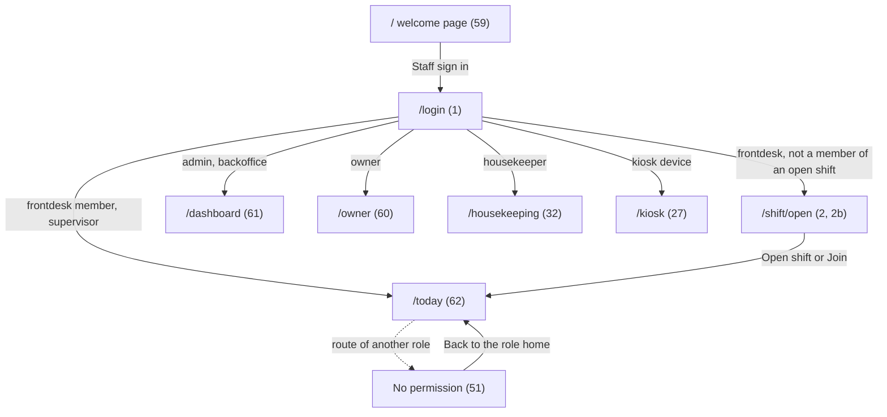

| Role | Home after sign-in | Screen |
|---|---|---|
| `frontdesk`, member of the open shift | `/today` | 62 |
| `frontdesk`, not a member | `/shift/open` — Open shift when the branch has no open shift, Join when it has one | 2, 2b |
| `supervisor` | `/today` | 62 |
| `admin`, `backoffice` | `/dashboard` | 61 |
| `owner` | `/owner` | 60 |
| `housekeeper` | `/housekeeping` | 32 |
| `kiosk` | `/kiosk` | 27 |

A signed-in user who opens `/` sees "Dashboard" instead of "Staff sign in"; it leads to the role home above.

### 1.2 Front desk (`frontdesk` members and `supervisor`)

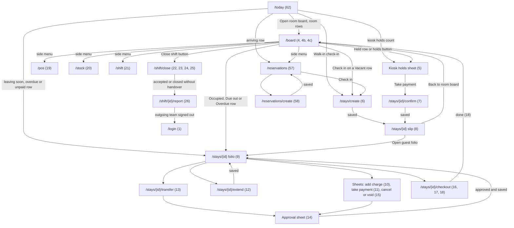

### 1.3 Kiosk and housekeeping

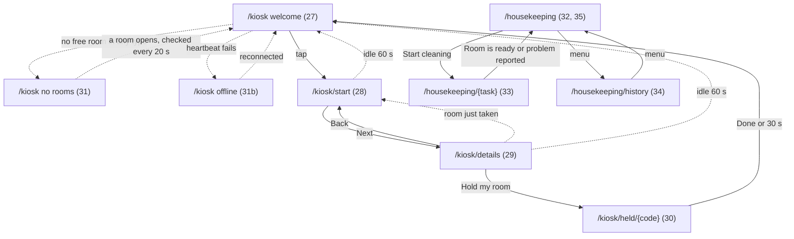

### 1.4 Reports, admin and owner

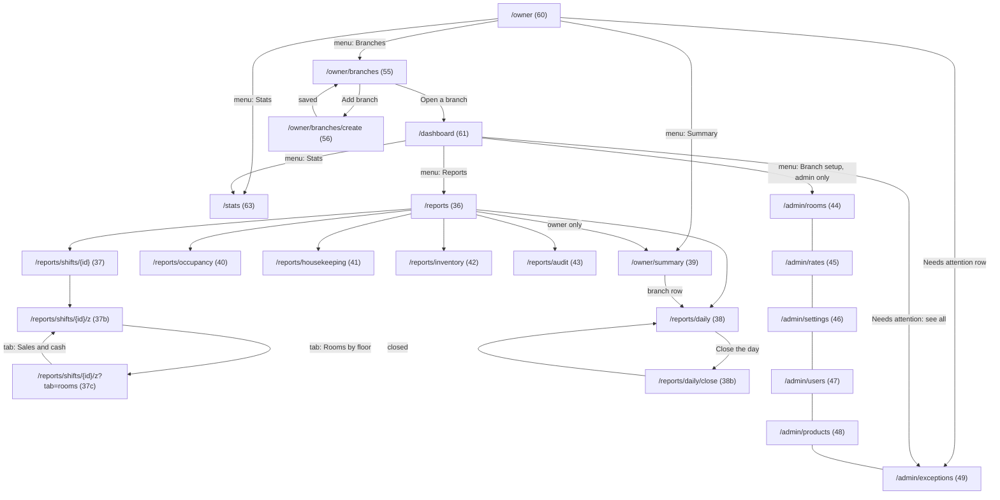

A row of "Needs attention" on a dashboard opens the screen that fixes that row; the diagram shows only the link to the full list (49). `/dashboard` and `/stats` are also open to a `supervisor` from the side menu, although the supervisor's home is `/today`.

The admin screens 44–49 are one menu; any of them can be reached from any other. The lines between them only show that they are siblings.

## 2. Routes

Page routes are exactly those in the mockup routes table. A form on a page posts back to the same controller; the write method is named in the "Writes handled by" column. After every successful write the server redirects (Inertia), so the browser's Back button never re-submits a form. Final method signatures and the HTTP verbs of write routes are in [SYSTEM_DESIGN](SYSTEM_DESIGN.md).

| Route | Screens | Controller@method (page) | Writes handled by | Arguments | Who can open it | Browser Back |
|---|---|---|---|---|---|---|
| `/` | 59 | `WelcomeController@index` | — | `branch` (shown only with more than one active branch) | Everyone, signed in or not | Normal. |
| `/login` | 1 | `AuthController@create` | `AuthController@store` (sign in), `@destroy` (sign out), `@switch` (PIN switch, sheet 3) | — | Anyone not signed in | A signed-in user who goes back to `/login` is redirected to their role home. |
| `/today` | 62 | `TodayController@index` | — | — | `supervisor`; `frontdesk` members | Normal. The page reloads its live state by polling; Back never re-submits anything. |
| `/dashboard` | 61 | `DashboardController@index` | — | `period` (today, yesterday, week, month) | `admin`, `backoffice`, `supervisor` of the branch; `owner` who opened it | The period is in the query string, so Back steps through it. |
| `/owner` | 60 | `Owner\DashboardController@index` | — | `period` (today, yesterday, week, month, year), `branch` (all or one) | `owner` | The period and branch are in the query string. |
| `/stats` | 63 | `StatsController@index` | — | `from`, `to`; `branch` (owner only) | `admin`, `backoffice`, `supervisor` (own branch); `owner` (any branch) | The date range is in the query string. |
| `/shift/open` | 2, 2b | `ShiftController@create` | `ShiftController@store` (open), `@join` | — | `frontdesk`, `supervisor`, when not yet a member of an open shift. Shows 2 when no shift is open, 2b when one is. | After opening or joining, Back from Today returns to Today (the route redirects members away). |
| `/board` | 4, 4b, 4c · sheets 3, 5 | `BoardController@index` | `StayController@release` (release a hold from sheet 5) | `q` (search), `floor` (filter) | `supervisor`; `frontdesk` members | Search and floor filter are in the query string, so Back steps through them. Sheets close on Back. |
| `/stays/create` | 6, 52, 53 | `StayController@create` | `StayController@store` | `room` (room id, required), `reservation` (stay id, when checking in from 57) | `supervisor`; `frontdesk` members | Back returns to the board; nothing is saved until Save. |
| `/stays/{id}/confirm` | 7 | `StayController@confirm` | `StayController@confirmStore` | `id` of a `held` stay | `supervisor`; `frontdesk` members | Back returns to the board; the hold keeps counting down. |
| `/stays/{id}` | 8, 9 · sheets 10, 11, 14, 15 | `StayController@show` | `StayController@charge` (10), `@pay` (11), `@void` and `@cancel` (15) | `id`; the slip view (8) is shown once, right after check-in | `supervisor`; `frontdesk` members | Back from the slip goes to the board, never to the check-in form. Open sheets close on Back. |
| `/stays/{id}/extend` | 12 | `StayController@extend` | `StayController@extendStore` | `id` of a `checked_in` stay | `supervisor`; `frontdesk` members | Back returns to the folio. |
| `/stays/{id}/transfer` | 13 · sheet 14 | `StayController@transfer` | `StayController@transferStore` | `id` of a `checked_in` stay | `supervisor`; `frontdesk` members | Back returns to the folio; an open approval sheet closes first. |
| `/stays/{id}/checkout` | 16, 17, 18 | `StayController@checkout` | `StayController@checkoutStore` | `id` of a `checked_in` stay | `supervisor`; `frontdesk` members | Steps 1 and 2 are page state, not history entries: Back leaves the guide for the folio and nothing is saved. After step 3, Back shows the done view again (the stay is already `checked_out`). |
| `/pos` | 19 · sheet 14 | `PosController@index` | `PosController@store` (sale), `@void` | — | `supervisor`; `frontdesk` members; branch with `pos_enabled` | Back returns to the previous page; the cart is page state and is lost. |
| `/stock` | 20 | `StockController@index` | `StockController@store` (receive, wastage) | — | `supervisor`; `frontdesk` members; branch with `pos_enabled` | Normal. |
| `/shift` | 21 · sheet 14 | `ShiftController@show` | `ShiftController@movement` (record, with an `idempotency_key`), `@voidMovement` | — | `supervisor`; `frontdesk` members | Normal. A repeated submit of the same entry returns the first one. |
| `/shift/close` | 22, 23, 24, 25 · sheet 14 | `ShiftController@close` | `ShiftController@closeStore` (one method, one step at a time; it also saves the count draft of step 2) | — | `supervisor`; `frontdesk` members | The step shown comes from the server (shift status, whether a `cash_counts` row exists), so Back and reload always land on the current step, and a reload on step 2 restores the pieces from `cash_count_drafts`. A confirmed count cannot be gone back on. |
| `/shift/{id}/report` | 26 | `ShiftController@report` | — | `id` of a closed shift | `supervisor`; `frontdesk` who were members of that shift | Back cannot reopen the close guide; the shift is `closed`. |
| `/kiosk` | 27, 31, 31b | `KioskController@index` | — | — | `kiosk` | The kiosk browser has no Back button (kiosk mode); only on-screen Back buttons exist. |
| `/kiosk/start` | 28 | `KioskController@start` | — | — | `kiosk` | On-screen Back returns to 27. |
| `/kiosk/details` | 29 | `KioskController@details` | `KioskController@hold` | `room_type` id, `hours`, both validated on the server | `kiosk` | On-screen Back returns to 28 with the choice kept. |
| `/kiosk/held/{code}` | 30 | `KioskController@held` | — | `code` of the `held` stay | `kiosk` | None; Done or 30 seconds returns to 27. |
| `/housekeeping` | 32, 35 | `HousekeepingController@index` | `HousekeepingController@start` | — | `housekeeper`; branch with `housekeeping_enabled` | Normal. |
| `/housekeeping/{task}` | 33 | `HousekeepingController@show` | `HousekeepingController@finish` | `task` id, in progress by this user | `housekeeper` | Back returns to the queue; the task stays in progress and the queue shows it as the only startable item. |
| `/housekeeping/history` | 34 | `HousekeepingController@history` | — | — | `housekeeper` | Normal. |
| `/reports` | 36 | `ReportController@index` | — | `branch` (owner only) | `backoffice`, `supervisor`, `admin` (own branch); `owner` (any branch) | Normal. |
| `/reports/shifts/{id}` | 37 | `ReportController@shift` | — | `id` of a shift of the branch | Same as `/reports` | Normal. |
| `/reports/shifts/{id}/z` | 37b, 37c | `ReportController@zReport` | — (print and export are logged in `print_logs`; export through `ZReportExport`) | `id`; `tab`: none = sales and cash (37b), `rooms` = rooms by floor (37c), then `cleaning`, `housekeeping`, `stocks`, `expenses` | Same as `/reports` | Tabs are in the query string; Back steps through them. |
| `/reports/daily` | 38 | `ReportController@daily` | — | `date`, `range` (day, week, month) | Same as `/reports` | Normal. |
| `/reports/daily/close` | 38b | `ReportController@closeDay` | `ReportController@closeDayStore` (action `CloseDay`) | `date` (the business date) | `backoffice`, `admin` of the branch; `owner` | After the day is closed, Back shows the closed day paper; the Close button is gone. |
| `/reports/occupancy` | 40 | `ReportController@occupancy` | — | `date` | Same as `/reports` | Normal. |
| `/reports/housekeeping` | 41 | `ReportController@housekeeping` | — | `date` or `shift` | Same as `/reports` | Normal. |
| `/reports/inventory` | 42 | `ReportController@inventory` | — | `date` | Same as `/reports` | Normal. |
| `/reports/audit` | 43 | `ReportController@audit` | — | `date`, `type`, `user` | Same as `/reports` | Filters are in the query string. |
| `/reservations` | 57 | `ReservationController@index` | `ReservationController@cancel`, `@refund` (both through sheet 14) | `tab` (today, upcoming, past), `date` | `supervisor`; `frontdesk` members; branch with `reservations_enabled` | Normal. |
| `/reservations/create` | 58 | `ReservationController@create` | `ReservationController@store` | — | Same as `/reservations` | Back returns to the list; nothing is saved until Save. |
| `/admin/rooms` | 44 | `Admin\RoomController@index` | `@store`, `@update` (rooms, floors, room types, status Available ↔ Maintenance) | `tab` | `admin` of the branch; `owner` who opened it | Normal. |
| `/admin/rates` | 45 | `Admin\RateController@index` | `@update` (rates, extension rates, discounts) | — | Same as `/admin/rooms` | Normal. |
| `/admin/settings` | 46 | `Admin\SettingController@index` | `@update` | — | Same as `/admin/rooms` | Normal. |
| `/admin/users` | 47 | `Admin\UserController@index` | `@store`, `@update` (role, floors, deactivate, reset password, reset PIN) | — | Same as `/admin/rooms` | Normal. |
| `/admin/products` | 48 | `Admin\ProductController@index` | `@store`, `@update` | `kind` tab | Same as `/admin/rooms` | Normal. |
| `/admin/exceptions` | 49 · sheet 14 | `Admin\ExceptionController@index` | `@forceClose`, `@resetTask` | — | `admin`, `supervisor` of the branch; `owner` who opened it | Normal. |
| `/owner/branches` | 55 | `Owner\BranchController@index` | `@open` (enter a branch), `@update` (deactivate) | — | `owner` | Normal. After "Open" the owner lands on that branch's dashboard (61); Back returns here; the opened branch stays selected until another is opened. |
| `/owner/branches/create` | 56 | `Owner\BranchController@create` | `Owner\BranchController@store` | — | `owner` | Back returns to the list; nothing is saved until Create. |
| `/owner/summary` | 39 | `Owner\SummaryController@index` | — | `range` (week, month), `branch` (all or one) | `owner` | Normal. |
| any | 50, 51, 54 | — (layout components and the 403 page) | — | — | 50: every signed-in screen. 51: any role on a route it may not open. 54: all front desk routes. | 51 offers "Back to" the role's home instead of relying on Back. |

Rules that apply to every route:

1. A route of a module that is switched off for the branch is hidden from the menus and refused with screen 51.
2. Every query is scoped to the current branch: the user's `branch_id`, or the branch an `owner` opened, kept in the server-side session.
3. A front desk route opened while the branch has no open shift redirects to `/shift/open`. `/today` is a front desk route.
4. The navigation menu of every layout is built on the server from the role, the branch's module flags and, for an owner, the opened branch. A page never decides by itself which links to show.
5. No page sent to a `frontdesk` user carries `expected_cash` or collected amounts of an open shift. The server omits them from the props ([TRD](TRD.md) §4.11).
6. A print or an export of a slip or report writes one `print_logs` row. Exports need the reports permission.

## 3. Sheets, dialogs and bars

| Screen | What it is | Component | Opened by | Closes when |
|---|---|---|---|---|
| 3 | Switch user PIN pad | `PinSwitch` | Tapping the user name in the top bar on any front desk route | Correct PIN (the session becomes that member), Cancel, or 3 wrong PINs (goes to 1). When PIN entry is locked on this computer the pad is replaced by the locked message until a supervisor or admin unlocks it. |
| 5 | Kiosk holds panel | `Board/KioskHolds` | The kiosk-hold counter or a Held row on the board | Take payment (goes to 7), Release room (after the confirm dialog), or close |
| — | "Release Room 210?" confirm | `ConfirmDialog` | "Release room" on sheet 5 | Keep hold, or Release room |
| 10 | Add charge panel | `Stays/AddCharge` | "Add charge" on the folio (9); "Add damage charge" on check-out step 1 (16) | Add to folio, Add and take payment now (opens 11), or close |
| 11 | Take payment panel | `Stays/TakePayment` | "Take payment" on the folio (9); continued from 10; embedded in check-out step 2 (17) | Save payment, or Cancel |
| 14 | Supervisor approval PIN pad | `ApprovalPin` | Saving a transfer (13); void a line or cancel a stay (15); void a cash movement (21); void a POS sale (19); force close (49); close without handover (25); approving a variance when a supervisor, not the receiver, signs it off (24, 25); changing the proposed shift period (2); cancel a reservation or refund a no-show (57); any entry whose reason has `needs_manager` | Approve (the underlying action is saved), or Cancel (nothing is saved). Refused while PIN entry is locked on this computer. |
| 15 | Cancel stay / void line dialog | `ConfirmDialog` with a required reason | "Cancel stay" on the folio; "Void this line" on a folio line | Keep stay, or confirm (then opens 14) |
| 50 | Connection lost bar | `ConnectionBar` | A failed heartbeat request, on every signed-in screen | The heartbeat succeeds again (retried every 5 s) |
| 52 | Missing rate alert | `AppAlert` inside 6, 12 or 13 | An option with no rate, or `RateNotFound` from the server | The user picks an option that has a rate |
| 53 | Room just taken dialog | `ConflictDialog` | `RoomTaken` on Save in 6 or 7, or on "Hold my room" at the kiosk (29) | Back to board, or Pick another room of the same type |
| 54 | Shift running late bar | `OverdueBar` | The open shift is `shift_overdue_warn_minutes` (default 30) past its end time, on all front desk routes. From `shift_stale_block_minutes` (default 240) the bar says that payments are stopped until the shift is closed. | The shift is closed; its "Close shift" button opens 22 |
| — | "… is closing the shift" notice | `AppAlert` | The other member of the shift, on any front desk route, once a member has pressed "Next: count cash" (22) | The shift is closed, or the closer pressed "Not yet" |
| — | Export menu | `UDropdownMenu` | "Export" on 37b, 37c, 38b and 63 | A format is chosen (PDF or CSV), or it is dismissed. Disabled on a preview. |

Forms that open inside a page and have no mockup number of their own — the three "+ Expense / + Remittance / + Shortage payment" forms on 21, "Receive stock" on 20, and the add/edit forms on 44–48 — use the shared form components and `ConfirmDialog`.

## 4. Flows

Every write flow is one Action class running one database transaction with locks in the order shift → rooms by id → stay → products by id → branch (for a counter, taken last and held briefly) ([DATABASE_SCHEMA](DATABASE_SCHEMA.md) §8). "Open shift" below always means the row returned by `CurrentShift` and locked inside that transaction.

Every row a flow writes to `folio_lines`, `payments`, `cash_movements`, `pos_orders` or `stock_movements` carries the open shift and `created_by` = the person signed on at that computer at that moment (after a PIN switch, that person). Every such write is refused with `ShiftClosing` once another member has started the close, and payments and charges are refused on a shift that is `shift_stale_block_minutes` past its defined end ([TRD](TRD.md) §4.12). These three rules are not repeated in each flow.

Action classes named in the mockup folder tree are written plainly. Names marked with an asterisk (\*) are not in that tree; they follow the verb-first convention of [TRD](TRD.md) §12 and their final names are fixed in [SYSTEM_DESIGN](SYSTEM_DESIGN.md).

### 4.1 Sign in

Screen 1 · `AuthController@create`, `AuthController@store`

1. `/login` renders the split sign-in: photograph and greeting on the left, sign-in panel on the right. The server sends the part of the day (morning, afternoon, evening) from `Clock` in Asia/Manila; the page picks the matching photograph and greeting.
2. On a computer that has signed in before, the server also sends four facts about the remembered branch, read live: rooms `available`, stays `checked_in`, guests due out (by `expected_checkout_at`), reservations arriving today (by `arrival_at`), and the open `shift_sessions` row (period name and `opened_at`), if any. They are counts only: no money and no guest names. On a new computer only the greeting is shown.
3. The user types username and password.
4. Reads `users` by `username`. Refuses when the user does not exist, `is_active = 0`, or `locked_until` is in the future.
5. Wrong password: writes `users.failed_logins + 1`; at 5 it writes `locked_until` = now + 15 minutes. The screen says the account is locked for 15 minutes.
6. Correct password: writes `failed_logins = 0`, starts a 12-hour session, and remembers the user's branch on this computer for step 2.
7. A `frontdesk`, `supervisor` or `admin` user whose `pin_hash` is empty sets a 4-digit PIN before continuing (writes `users.pin_hash`).
8. Redirects by `users.role` to the role home (§1.1): `frontdesk` → `/today` when a member of the open shift, otherwise `/shift/open`; `supervisor` → `/today`; `admin` and `backoffice` → `/dashboard`; `owner` → `/owner`; `housekeeper` → `/housekeeping`; `kiosk` → `/kiosk`.

### 4.2 Open a shift

Screen 2 · Action `OpenShift`

1. Reads the last closed `shift_sessions` row of the branch, its `shift_handovers` row, and the branch's active `shift_definitions`.
2. The screen proposes the period that follows the last closed shift and its business date ([TRD](TRD.md) §4.6), and shows the cash the previous shift counted.
3. The user types the drawer count. If it differs from the counted amount a note is required.
4. On Save: writes `shift_sessions` (`branch_id`, `shift_definition_id`, `period_name`, `business_date`, `status = open`, `opened_at`, `opened_by`, `opening_cash`, `opening_note`) and `shift_members` for the opener.
5. If the previous shift was closed without handover, writes the open `shift_handovers` row: `to_shift_id`, `received_by`, `received_cash`, `difference_amount`, `note`.
6. A second open shift for the branch hits `shift_sessions_one_open` → `ShiftAlreadyOpen`; the user is shown Join (2b) instead.
7. Changing the proposed period is allowed only when no shift has ever been closed, or through the approval sheet (14) with `approvals.action = change_shift_period`.
8. Redirects to `/today`.

### 4.3 Join a shift

Screen 2b · Action `JoinShift`

1. Reads the open shift, its `shift_members`, and `branches.max_frontdesks_per_shift`.
2. On "Join as second front desk": locks the open shift, counts members.
3. If the limit is reached, refuses with "This shift already has two front desks" (the number follows the setting). Nothing is written.
4. Otherwise writes `shift_members` (`shift_session_id`, `user_id`, `joined_at`). No cash is entered; there is one drawer.
5. Redirects to `/today`.

### 4.4 Switch user

Sheet 3 · `AuthController@switch` · [TRD](TRD.md) §4.12

1. Reads `shift_members` of the open shift with their `users` rows; lists the other members. If this computer has an open `pin_locks` row, the pad is not shown (see "PIN entry locked" below).
2. The user taps a name and types that member's PIN, checked against `users.pin_hash`.
3. Every try, right or wrong, writes one `pin_attempts` row (`device_key`, `user_id` = the account tried, `context = switch_user`, `succeeded`).
4. Correct: the session's user becomes that member. Nothing else changes: the shift, the drawer and the page stay as they were. Rows written from now on carry this person as `created_by`.
5. Wrong: the sheet shows the tries left. After 3 wrong PINs the session ends and the browser goes to `/login`. The shift stays open.

**PIN entry locked.** The same `pin_attempts` log is written by the approval sheet (14, `context = approval`) and by the handover (25, `context = handover`). Ten wrong tries in a row on one computer, across all three, write a `pin_locks` row for its `device_key`. While that row has no `unlocked_at`, every PIN pad on that computer is refused: switch user, approvals and the handover. A supervisor or admin unlocks it by typing their own username and password; this writes `pin_locks.unlocked_at` and `unlocked_by` and an `audit_logs` row; no `approvals` row is written (TRD §4.12). Signing in with a password is never blocked by a PIN lock.

### 4.5 Walk-in check-in

Screens 4 → 6 → 8 · Action `CheckInGuest` · [DATABASE_SCHEMA](DATABASE_SCHEMA.md) §8.1

1. The user clicks "Check in" on a Vacant row. The form opens with a new `idempotency_key`.
2. Reads `rates` for the room's type, the branch's stay options, deposit settings, `payment_methods` and active `discounts`. Options without a rate are greyed out (52).
3. The user picks the stay option, types the guest's name (and optional mobile and plate number), picks a discount if any, picks the payment method and types the cash received or the reference number.
4. On "Check in and print slip": locks the open shift (`NoOpenShift` if none), locks the `rooms` row (must be `available`).
5. `PricingService::quoteStay` returns room amount, discount amount and expected check-out (`RateNotFound` if the rate is missing).
6. Locks `branches`, takes and increments `next_stay_number`, builds the stay code.
7. Writes `stays` (`state = checked_in`, `source = walk_in`, `checked_in_at`, `expected_checkout_at`, `checkin_shift_id`, `checked_in_by`, `cycle_hours_used`). A duplicate on `stays_one_active_per_room` → `RoomTaken` (53). A duplicate `idempotency_key` → the first stay is returned.
8. Writes `stay_rooms`; `folio_lines` (one `room` line, one `discount` line if any); `payments` (`payment` with `tendered_amount` and `change_amount`) and its `payment_allocations`; `payments` `deposit_in` with `deposit_type = key` when `deposit_enabled`; `payments` `deposit_in` with `deposit_type = guest` when the guest keeps the change as deposit.
9. `RoomStatusService` moves the room `available → occupied` and writes `room_status_logs`.
10. Redirects to the slip (8), which shows the change to give and opens the print dialog.

### 4.6 Kiosk hold, then confirm at the front desk

Screens 30 → 5 → 7 → 8 · Actions `HoldRoom`, `ConfirmKioskHold` · [DATABASE_SCHEMA](DATABASE_SCHEMA.md) §8.2

1. The kiosk creates the hold (flow 4.18): a `stays` row with `state = held`, `source = kiosk`, `hold_expires_at`, `quoted_amount`.
2. The board's holds sheet (5) reads `StayQuery::kioskHolds` every 5 seconds and shows the guest, room, stay, time left and amount to collect.
3. The front desk presses "Take payment", or scans the guest's QR code; screen 7 opens with room, hours and discount fixed.
4. The front desk types the cash received (or picks another accepted method).
5. On Save: locks the open shift, the room and the stay. Refuses with `HoldExpired` ("This hold has expired") unless `state = held` and `hold_expires_at` is in the future.
6. Writes `stays.state = checked_in`, `checked_in_at` = now, `expected_checkout_at` recomputed from now, `checkin_shift_id`, `checked_in_by`, `cycle_hours_used`.
7. Writes `stay_rooms`, `folio_lines` (`room`, and `discount` if the guest had one), `payments` and `payment_allocations`, and the key `deposit_in`, exactly as in flow 4.5 step 8.
8. Room `available → occupied`. Redirects to the slip (8).

**Release a hold** (sheet 5, action `ReleaseKioskHold`\*): after the confirm dialog, writes `stays.state = cancelled` with `closed_reason`. The room was never moved from `available`, so it is back on sale at once.

### 4.7 Add a charge

Sheet 10 on screen 9 · Action `AddCharges` · [DATABASE_SCHEMA](DATABASE_SCHEMA.md) §8.3

1. Reads active `products` by tab (food and drinks, amenities, damages) with `stock_on_hand`. Out-of-stock items cannot be added.
2. The user sets quantities and presses "Add to folio" or "Add and take payment now".
3. Locks the open shift, the stay (`checked_in`) and each product by id.
4. Refuses with `InsufficientStock` if a stock-tracked product has less than the quantity.
5. Writes `pos_orders` (`mode = room_charge`, `stay_id`), one `folio_lines` row per item (`kind` from the product, `unit_amount` = current price, `room_id` = current room), `stock_movements` (`kind = sale`, negative quantity, `balance_after`), and `products.stock_on_hand`.
6. "Add to folio": the lines stay unpaid. "Add and take payment now": continues into flow 4.8 in the same transaction.

### 4.8 Take a payment

Sheet 11 on screen 9 · Action `TakePayment` · [DATABASE_SCHEMA](DATABASE_SCHEMA.md) §8.4

1. Reads the stay's unpaid lines, the balance due, and the guest deposit held.
2. The user picks a method the branch accepts — cash, GCash or card with a reference number, or guest deposit — and types the amount.
3. Locks the open shift and the stay. Refused with `ShiftClosing` while the shift is `closing`, and refused on a shift that is `shift_stale_block_minutes` past its defined end. The form carries an `idempotency_key`; a repeated key returns the first payment.
4. Amount applied = the smaller of the amount given and the balance due.
5. Writes one `payments` row: `kind = payment`, or `kind = deposit_applied`, `method = deposit`, `deposit_type = guest` when paying from the guest deposit (refused if it exceeds the guest deposit held).
6. Writes `payment_allocations`, oldest unpaid line first, until the amount is used up. A smaller payment leaves the newest lines unpaid.
7. Cash above the balance: records `change_amount`, or writes a `deposit_in` (`guest`) for the excess when the guest asks to keep it.
8. The folio reloads with the new balance.

### 4.9 Extend a stay

Screen 12 · Action `ExtendStay` · [DATABASE_SCHEMA](DATABASE_SCHEMA.md) §8.5 · [TRD](TRD.md) §4.3

1. Reads `extension_rates`, `rates`, `branches.extension_rule`, `extension_cycle_hours` and `stays.cycle_hours_used`. Only hour options whose every needed rate exists are offered; with none, the screen shows the missing-rate alert (52).
2. The user picks the hours. The screen shows the price, how it was worked out, and the new expected check-out.
3. The user presses "Extend and take payment" or "Extend, pay later".
4. Locks the open shift and the stay. `PricingService::quoteExtension` returns the amount and the new `cycle_hours_used`.
5. Writes one `folio_lines` row of kind `extension`; writes `stays.expected_checkout_at` (+ hours) and `stays.cycle_hours_used`.
6. With payment: continues into flow 4.8 in the same transaction.
7. Redirects to the folio.

### 4.10 Transfer with approval

Screens 13 → 14 · Action `TransferRoom` · [DATABASE_SCHEMA](DATABASE_SCHEMA.md) §8.6 · [TRD](TRD.md) §4.4

1. Reads `RoomQuery::freeForType` (rooms `available`, no active stay, no overlapping reserved stay), `transfer_reasons`, and the price difference from `PricingService::quoteTransfer`.
2. The user picks the new room, a reason, and what the old room becomes (Uncleaned or Maintenance). The screen shows the amount to collect, or the credit.
3. "Transfer — needs approval" opens sheet 14. The approver is chosen and types their PIN.
4. Verifies the PIN (`PinInvalid` → "PIN not recognised", nothing saved); writes `approvals` (`action = transfer`, `requested_by`, `approved_by`, `reason`, `summary`).
5. Locks the open shift, both rooms in id order, and the stay.
6. Closes the current `stay_rooms` row (`to_at`, `transfer_reason_id`); writes a new `stay_rooms` row; writes `stays.room_id` and `room_type_id`.
7. Upgrade (difference above ₱0.00): writes a positive `transfer_difference` line, then takes payment (flow 4.8).
8. Downgrade (credit of D): writes a `transfer_difference` line of −D; a `refund` payment of −D allocated to that line; a `deposit_in` (`guest`) of +D with the note "transfer credit". The drawer is unchanged and the guest deposit rises by D.
9. Same price: no line.
10. Old room `occupied → uncleaned` with a new `cleaning_tasks` row (`trigger_kind = transfer_out`), or `occupied → maintenance`. New room `available → occupied`.
11. The original `room` line and the expected check-out are untouched. Redirects to the folio.

### 4.11 Void a line, cancel a stay

Dialog 15 → sheet 14 · Actions `VoidLine`, `CancelStay` · [DATABASE_SCHEMA](DATABASE_SCHEMA.md) §8.9

1. The user clicks a line and "Void this line", or presses "Cancel stay". The dialog says what will be reversed and how much cash must be returned. A reason is picked from the branch's list (`reasons`, kind `void_line` or `cancel_stay`); a reason with `needs_note` also requires a typed note.
2. Sheet 14: verifies the approver's PIN; writes `approvals` (`action = void_line` or `cancel_stay`).
3. Locks the open shift, the room (cancel only), the stay and the products.
4. For each line being voided: writes the reversing `folio_lines` row (`reversal_of_id`, `reversal_reason`, quantity negated, stamped with the open shift); writes a `refund` payment with negative `payment_allocations` for what had been paid on it; writes `stock_movements` (`sale_reversal`) and restores `products.stock_on_hand`.
5. Cancel only: writes a `deposit_refund` for every deposit held; writes `stays.state = cancelled` and `closed_reason`; closes the `stay_rooms` row; room `occupied → available` with no cleaning task.
6. The folio reloads. Reversed lines stay visible with their reversals.

### 4.12 Check out (3 steps)

Screens 16 → 17 → 18 · Action `CheckOutGuest` · [DATABASE_SCHEMA](DATABASE_SCHEMA.md) §8.8

1. **Step 1 (16).** Reads `branches.lost_key_amount` and `lost_remote_amount`. The user answers Yes or No for the room key and the TV remote, and may add other damages from the product list. Nothing is written yet. Next is enabled when both are answered.
2. **Step 2 (17).** Reads the balance due including the pending damage charges, and the deposits held per type. If there is a balance, the payment panel (11) collects it. The user then answers the deposit box: "I handed ₱… to the guest" or "Guest did not claim".
3. "Check out guest" is enabled when the balance to collect is ₱0.00 and the deposit box is answered.
4. On Save: locks the open shift, the room and the stay. If the stay is no longer `checked_in`, the existing result is returned and nothing is written.
5. Writes `damage` lines for each item not returned and each added damage.
6. Collects any balance (flow 4.8). Refuses with `BalanceNotZero` if a balance remains after damages are covered by the key deposit.
7. Settles each deposit type: writes `deposit_applied` against the damage lines; then a `deposit_refund` for the rest, or — when not claimed — a `forfeited_deposit` folio line with a `deposit_applied` that pays it. Deposit held is now ₱0.00.
8. Writes `stays.state = checked_out`, `checked_out_at`, `checkout_shift_id`, `checked_out_by`; closes the `stay_rooms` row; writes `rooms.last_checkout_at`.
9. Room `occupied → uncleaned`; writes `cleaning_tasks` (`trigger_kind = check_out`, `queued_at` = now, `due_at` = now + `cleaning_deadline_minutes`).
10. **Step 3 (18).** Shows how long the guest stayed, the deposit returned, and the clean-by time. "Print receipt" prints the receipt; "Back to room board" returns to 4.

### 4.13 POS: walk-in sale and room charge

Screen 19 · Action `CompleteSale`

**Walk-in · cash**

1. Reads active `products` with stock. The form opens with a new `idempotency_key`.
2. The user adds items, types the cash received, and presses "Complete sale". The sale must be paid in full.
3. Locks the open shift and each product by id; `InsufficientStock` if any item is short.
4. Writes `pos_orders` (`mode = walk_in`, `total_amount`, `idempotency_key`); `folio_lines` with `pos_order_id` set and `stay_id` empty; `stock_movements` (`sale`) and `products.stock_on_hand`; one `payments` row (`kind = payment`, `method = cash`, `pos_order_id`, `tendered_amount`, `change_amount`) and its `payment_allocations`.
5. A repeated `idempotency_key` returns the first order. The screen shows the change and clears the cart.

**Charge to room**

1. The user switches to "Charge to room" and picks an occupied room (a `checked_in` stay).
2. The rest is flow 4.7: `pos_orders` (`mode = room_charge`, `stay_id`), unpaid `folio_lines` on the stay, `stock_movements`. No payment is written.

**Void a sale** (action `VoidSale`\*, sheet 14): allowed only while the sale's shift is the open shift. Writes `approvals` (`action = void_sale`), reversing `folio_lines`, a `refund` payment with negative allocations for a paid sale, and `stock_movements` (`sale_reversal`).

### 4.14 Receive stock and record wastage

Screen 20 · Action `ReceiveStock`

1. Reads `ReportQuery::stock` for the open shift: opening, in, sold, wastage, on hand per product.
2. "Receive stock": the user picks a product and types the pieces received.
3. Locks the open shift and the product. Writes `stock_movements` (`kind = receive`, positive quantity, `balance_after`, `shift_session_id`) and `products.stock_on_hand` in the same transaction.
4. Wastage (action `RecordWastage`\*): the same with `kind = wastage`, a negative quantity, a reason from the list (`reasons`, kind `wastage`) and a required note. Refused if it would take the balance below zero.

### 4.15 Record an expense, remittance or shortage payment; void one

Screen 21 · Action `RecordCashMovement` · [DATABASE_SCHEMA](DATABASE_SCHEMA.md) §4.9 · [TRD](TRD.md) §4.12

1. Reads the open shift's `cash_movements` (voided rows included), active `expense_categories` with their `needs_note` and `needs_manager` flags, and — for a shortage payment — earlier closed shifts with a negative `variance_amount`.
2. The user presses "+ Expense", "+ Remittance" or "+ Shortage payment". The dialog opens with a new `idempotency_key`. The user types an amount above ₱0.00 and a note. An expense needs a category; a shortage payment names the short shift.
3. A category with `needs_manager` opens the approval sheet (14) before saving; one with `needs_note` keeps Save disabled until the note is typed.
4. Locks the open shift. For an expense or a remittance the server works out the cash expected in the drawer at that moment with `CashMath`; an amount above it is refused with `NotEnoughCash`. The refusal does not state the expected amount.
5. Writes `cash_movements` (`kind`, `expense_category_id` or `for_shift_id`, `amount`, `note`, `created_by`, `occurred_at`, `shift_session_id`, `idempotency_key`). A repeated `idempotency_key` returns the first row and writes nothing.
6. The list reloads. The expected drawer total is not shown and is not in the page's props.

**Void** (action `VoidCashMovement`\*, sheet 14)

1. The user picks an entry and a reason from the list (`reasons`, kind `void_cash_movement`), with a note when the reason has `needs_note`. Allowed only while the entry's shift is `open`.
2. Sheet 14: verifies the PIN; writes `approvals` (`action = void_cash_movement`).
3. Writes `cash_movements.voided_at`, `voided_by`, `void_reason`, `reason_id`, `approval_id` — the only update allowed on this table.
4. The entry stays in the list, struck through, and counts as ₱0.00. The correct entry is typed again as a new row. The void is counted under "Voided cash entries" on the Z-report (37b).

### 4.16 Close the shift and hand over (4 steps)

Screens 22 → 23 → 24 → 25 → 26 · Actions `CloseShift`, `HandOverShift` · [DATABASE_SCHEMA](DATABASE_SCHEMA.md) §8.10 · [TRD](TRD.md) §4.5, §4.10, §4.12

1. **Step 1 — check (22).** Opened by the "Close shift" button. Reads `StayQuery::kioskHolds`, `StayQuery::inHouse` (occupied rooms, overdue guests, unpaid lines) and open `cleaning_tasks`. Amber items do not block.
2. The same page shows the papers check list, "Have these with you before you count", as counts only: expense receipts, remittance slips, GCash and card slips, cancelled stays and voids, key deposits taken and returned. No peso amount is sent to this page.
3. "Next: count cash" writes `shift_sessions.status = closing`. From now on payments, charges and cash movements by the outgoing team are refused with `ShiftClosing`. The other member sees "… is closing the shift"; their next save is refused and their unsaved form stays on screen. "Not yet" leaves the guide; if the status is already `closing` it is set back to `open`, which is possible only while no `cash_counts` row exists.
4. **Step 2 — blind count (23).** The user types the pieces of each bill and the coins total; the witness is recorded. After each change, debounced 1 second, the pieces are saved to `cash_count_drafts` (`denominations`, `updated_by`); a reload or a power cut restores them. Until the count is confirmed no response to the outgoing team contains `expected_cash` or a figure it can be derived from.
5. "Confirm count": the server adds up the pieces itself and ignores any total sent by the browser. Writes `cash_counts` (`denominations`, `total_cash`, `counted_by`, `witness_id`). There is one row per shift and it cannot be changed. The draft is no longer used; its row is deleted with the close in step 9 at the latest.
6. **Step 3 — result (24).** The server now computes `expected_cash` with `CashMath` and shows it line by line next to the count, with `variance = counted − expected`. A variance other than ₱0.00 requires an explanation: a reason from the list (`reasons`, kind `variance`) and the note it is saved with.
7. "Next: hand over" writes `shift_sessions.expected_cash`, `counted_cash`, `variance_amount` and `variance_note`. The shift is still `closing`; nothing is frozen until step 9 or step 11, so there is never a moment with no open shift.
8. **Step 4 — handover (25).** Reads the counted cash and `StayQuery::inHouse` (forwarded guests with unpaid balance and deposits). The outgoing front desk may type a handover note. The incoming front desk is picked by name — the person who counted (`cash_counts.counted_by`) cannot be picked — and types their own drawer count and their PIN (`pin_attempts`, `context = handover`).
9. "Accept and open … shift" (`CloseShift` + `HandOverShift`, one transaction): verifies the incoming user's PIN and that the receiver is not the counter; builds `totals` with `ReportService::computeShiftTotals`; writes one `shift_forwarded_stays` row per `checked_in` stay; locks the `branches` row, takes `next_z_number` and reads the previous closed shift's `grand_total_after`; writes on the closing shift `handover_note`, `totals`, `status = closed`, `closed_at`, `closed_by`, `z_no`, `grand_total_before`, `grand_total_after` (= before + the shift's net sales); deletes the `cash_count_drafts` row; writes the new `shift_sessions` row (`opening_cash = received_cash`, next period and business date), its `shift_members` row for the receiver, and `shift_handovers` (`from_shift_id`, `to_shift_id`, `received_by`, `received_cash`, `difference_amount = received_cash − counted_cash`, `note`). Writes `audit_logs` (`shift.closed`). By accepting with their PIN the receiver, who is not the counter, also accepts the variance.
10. "Amount is different — report it": the same as step 9 with a required note; the difference is kept on the handover for the supervisor.
11. **Close without handover.** When nobody is there to receive: sheet 14, `approvals` (`action = close_without_handover`). The approver cannot be the person who counted; when the variance is not ₱0.00 the supervisor's sign-off is also recorded as `approvals` (`action = approve_variance`). The close is written as in step 9, with its Z number and grand total, but without a new shift; `shift_handovers` is written with `to_shift_id` empty. The branch then has no open shift until the next person uses Open shift (flow 4.2), which links itself to this handover.
12. Redirects to the shift report slip (26), which reads the frozen `totals`, the Z number and the handover and can be printed. Each print writes `print_logs` (`document = shift_slip`, `format = print`); a second print is marked `is_reprint`. The outgoing team is then signed out. The incoming front desk signs in and lands on Today (62) as a member of the new shift.

What does not change: one shared drawer per shift, a count at every shift change, and the handover accepted by the incoming front desk's PIN.

**Force close** (screen 49, action `ForceCloseShift`\*, sheet 14): an admin or supervisor types a cash count and a PIN; writes `approvals` (`action = force_close_shift`), `cash_counts`, and the close as in step 9 — including `z_no` and the grand totals — with `is_force_closed = 1` and a `shift_handovers` row with `to_shift_id` empty. The Z-report of that shift prints "force closed" in its exceptions list.

### 4.17 Housekeeping: start, finish, report a problem

Screens 32 → 33 · Actions `StartCleaning`, `FinishCleaning` · [DATABASE_SCHEMA](DATABASE_SCHEMA.md) §8.11 · [TRD](TRD.md) §4.7

1. The queue (32) reads `CleaningQuery::queue`: `queued` tasks on the user's `floor_user` floors, ordered by `queued_at`, with the first N marked startable (N = housekeepers of those floors with `last_seen_at` in the last 2 minutes, at least 1). It reloads every 20 seconds and touches `users.last_seen_at` at most once a minute. With no tasks it shows the empty state (35).
2. **Start.** "Start cleaning" on a startable task: locks the room and the task. Refused if the task is not among the first N, or if the user already has a task in progress (`cleaning_tasks_one_per_cleaner`).
3. Writes `cleaning_tasks.status = in_progress`, `started_at`, `cleaned_by`. Room `uncleaned → cleaning`. Opens 33 with the timer against `cleaning_target_minutes`.
4. **Finish.** "Room is ready": locks the room and the task (`in_progress`, `cleaned_by` = this user). Refused if the room has an active stay.
5. Writes `cleaning_tasks.status = done`, `finished_at`, `is_late` (finished after `due_at`), `result = ready`. Room `cleaning → available`. Returns to the queue.
6. **Report a problem.** "Report a problem in this room": the user types a note. Writes `status = done`, `finished_at`, `is_late`, `result = problem`, `problem_note`. Room `cleaning → maintenance`. An admin returns it to Available on screen 44 when it is fixed.
7. "My cleans" (34) reads `cleaning_tasks` where `cleaned_by` = this user for the day.

**Reset a stuck cleaning** (screen 49, action `ResetCleaning`\*): writes `cleaning_tasks.status = reset` on the stuck task and a new `queued` task for the same room and stay with the same `queued_at` and `due_at`; room `cleaning → uncleaned`. The actor is recorded in `audit_logs`.

### 4.18 Kiosk: the full guest flow

Screens 27 → 28 → 29 → 30 · Action `HoldRoom` · Service `RoomRotation` · [TRD](TRD.md) §4.8

1. **Welcome (27).** Reads `branches.house_rules` and the count of rooms the kiosk may offer. Reloads every 20 seconds. With no room free in any type it shows "All rooms are taken" (31); when the heartbeat fails it shows "The kiosk is offline" (31b) and takes no input.
2. The guest taps the screen.
3. **Room and hours (28).** For each active room type, `RoomRotation` picks one room: `available`, `is_kiosk_enabled`, no active stay, no reservation arriving in the period; never-used rooms first, then the oldest `last_checkout_at`, then room number. A type with no room shows "Full". Reads `rates` for the hour options. The guest picks a type and the hours and presses Next.
4. **Your name (29).** The guest types a name (at least 3 letters) and optionally a mobile number (all 11 digits or blank). A discount with `kiosk_enabled` that is allowed on the chosen rate is shown as applied. The summary shows room, discount, deposit and the total to pay at the front desk, all computed by the server. The form carries a new `idempotency_key`.
5. "Hold my room": the kiosk sends the room type, hours, name, mobile and key — never a price or a room price.
6. `HoldRoom` locks the room, calls `PricingService::quoteStay`, locks `branches` for `next_stay_number`, and writes `stays` (`state = held`, `source = kiosk`, `room_id`, `code`, `stay_kind`, `hours`, `discount_id`, `quoted_amount`, `hold_expires_at` = now + `kiosk_hold_minutes`, `idempotency_key`). No ledger row is written and no shift is needed.
7. A duplicate on `stays_one_active_per_room` → `RoomTaken`: the kiosk says the room was just taken and returns to 28, where rotation offers the next room.
8. **Room held (30).** Shows the code, its QR, the amount, and a countdown to `hold_expires_at`. Returns to 27 on Done or after 30 seconds.
9. The guest walks to the front desk; the flow continues at 4.6 step 2.
10. If the guest does not pay in time, `ExpireKioskHolds` (every minute) writes `stays.state = expired`. The room is on sale again.

### 4.19 Reservations: make one, check in from it, no-show

Screens 57, 58, 6 · Action `ReserveRoom` · [DATABASE_SCHEMA](DATABASE_SCHEMA.md) §8.7

**Make a reservation (58)**

1. The user types the guest's name and mobile, the arrival date and time, the stay option, the room type and optionally a specific room.
2. Reads `RoomQuery::freeForType` for the period and `rates`; shows whether a room is free for the whole period, the check-out time, the price, the deposit and the total at check-in.
3. Optionally the user records money paid ahead: method, amount and, for GCash or card, the reference number.
4. On "Save reservation": locks the room (or, for "any room", counts free rooms of the type for every night). Refuses with `NotAvailable` if a `checked_in`, `held` or `reserved` stay overlaps the period.
5. Writes `stays` (`state = reserved`, `source = reservation`, `room_id` or empty for "any", `room_type_id`, `arrival_at`, `expected_checkout_at`, `stay_kind` with `hours` or `nights`, `quoted_amount`).
6. With money paid ahead: locks the open shift and writes `payments` (`kind = deposit_in`, `deposit_type = guest`, `method`, `reference_no`). It appears on that shift's report.
7. Returns to the list (57). On the arrival day a specific room shows "Reserved · 2:00 PM" in the guest column of its row on the board and is kept off the kiosk.

**Check in from a reservation (57 → 6 → 8)**

1. "Check in" on the list opens `/stays/create` with the reserved stay; guest, stay option and room are filled in. For an "any room" reservation the user picks a free room of the type.
2. The total shows the room amount plus the deposit, less the money paid ahead.
3. Save runs `CheckInGuest` (flow 4.5) on the existing stay: `state reserved → checked_in`, `checked_in_at`, `checkin_shift_id`; the `room` line is written; the guest deposit is applied to it with a `deposit_applied` payment and its allocation; the rest is collected as a normal `payment`; the key `deposit_in` is taken.

**No-show**

1. `ReleaseNoShows` runs every 5 minutes. For each `reserved` stay past `arrival_at` + `reservation_release_minutes` (default 120) it writes `stays.state = no_show`. The room is released for sale.
2. Money paid ahead stays as guest deposit on the stay.
3. A supervisor may refund it (action `RefundNoShow`\*, sheet 14): writes `approvals` (`action = refund_no_show`) and a `deposit_refund` payment on the open shift.

**Cancel a reservation** (action `CancelReservation`\*, sheet 14): a reason from the list (`reasons`, kind `cancel_reservation`) and a PIN; writes `approvals` (`action = cancel_reservation`), `stays.state = cancelled`, `closed_reason`, and settles any money paid ahead: handed back as a `deposit_refund`, or kept as a `forfeited_deposit` line paid by a `deposit_applied` (the desk chooses; the no-show settlement offers the same choice and uses the same reason list). The check-in from a reservation is priced at today's rates; the booked price is shown for reference (Gab, 12 Nov; TRD §4.9).

### 4.20 Owner creates a branch and opens it

Screens 55 → 56 → 55 → 61 → 44 · Action `CreateBranch`

1. The owner presses "Add branch" and types the name, the address, the three-character stay-code prefix, and the first admin's full name and username.
2. The owner picks an existing branch to copy from, or none.
3. The form is validated on the server: name unique, prefix unique ("DGS is already used by …"), username unique. It does not save while a field is wrong.
4. On "Create branch", in one transaction: writes `branches` (`status = setting_up`; settings copied from the source branch, otherwise the column defaults) and `users` (`role = admin`, `branch_id` = the new branch).
5. When copying: writes `shift_definitions`, `room_types`, `rates`, `extension_rates`, `products` (with `stock_on_hand = 0`), `transfer_reasons` and `expense_categories` from the source. Rooms, floors, users, stays and money rows are never copied.
6. Writes `audit_logs` (`branch.created`). Returns to the list (55), where the branch shows as "Setting up".
7. **Open.** The owner presses "Open" on the row. The server stores that branch as the current branch in the session; the top-bar chip shows it; the owner lands on `/dashboard` (61) with admin rights for that branch. A branch that is still "Setting up" shows empty cards there, and the menu leads to rooms (44).
8. The owner or the new admin adds floors and rooms (44). When the first room is saved, `branches.status` becomes `active`.

### 4.21 Nightly reconcile and invariant check

Jobs `ReconcileBusinessDay` (09:00 Asia/Manila) and `CheckInvariants` (09:05) · [TRD](TRD.md) §6, §8

1. For each branch, `ReconcileBusinessDay` reads the closed `shift_sessions` of the previous business date and their frozen `totals`.
2. It recomputes each shift and the whole day from `folio_lines`, `payments`, `payment_allocations` and `cash_movements` through `ReportService`.
3. Equal: nothing is written; the report hub (36) and daily sales (38) show the green line "Last night's check passed".
4. Different: writes `audit_logs` (`action = reconcile.mismatch`, with the stored and recomputed figures). Screens 36 and 38 show a red line and list the rows that differ. Nothing is corrected.
5. `CheckInvariants` evaluates invariants 1–8. Each failure writes `audit_logs` (`action = invariant.failed`) and appears on the attention list (49). Nothing is corrected.

### 4.22 View the Z-report, preview it, export it

Screens 37b, 37c · `ReportController@zReport` · `ReportService::zReport()` · `ZReportExport` · [TRD](TRD.md) §4.10, §6

1. Opened from the shift report (37), the shifts list or the report hub (36).
2. **Closed shift.** Reads `shift_sessions` (`z_no`, `totals`, `grand_total_before`, `grand_total_after`), `shift_forwarded_stays`, `cash_counts` and `shift_handovers`. Nothing is recalculated. `ReportService::zReport()` returns one array of sections and lines.
3. **Sales and cash (37b, the default tab).** The page draws that array: the header with the Z number (`Z-0629`), the "Sales and cash" column from gross sales to short or over, "By front desk", the fixed exceptions list (every row printed, even at zero), "Documents" (first and last stay code and POS order number), "Running grand total", and the signature block with the names of who closed and who received pre-printed. When `branches.vat_enabled`, the VAT block (VATable sales, VAT, VAT-exempt) and the branch's `tin` and `registered_name` are added from `totals.vat`; otherwise no VAT line exists.
4. **Rooms by floor (37c, `?tab=rooms`).** Sales by floor and category with the "No room" column, "Deposits held at close", then one row per stay per room, FWD rows in red and EXT marks. Reads `totals`, `shift_forwarded_stays`, `stays`, `stay_rooms`, `folio_lines` and `payments` of that shift. Its total equals net sales on 37b. The remaining tabs (cleaning chart, housekeeping log, stocks, expenses) read `cleaning_tasks`, `stock_movements` and `cash_movements` of the shift.
5. **Open shift: preview.** The same page is built live from the ledger by the same method. It carries the watermark "Preview. Do not sign.", has no Z number, and its Export menu is disabled; an export request for it is refused by the server. It is reachable only with the reports permission, so not by a `frontdesk` user.
6. **Print.** Browser print with the A4 report stylesheet, or the 80 mm slip. Writes `print_logs` (`document = z_report`, `subject_id` = the shift, `format = print`, `user_id`, `shift_session_id` = the shift open at that moment, `is_reprint` = 1 from the second print on).
7. **Export.** PDF: dompdf, A4, from a Blade view that renders the same array. CSV: streamed, UTF-8 with BOM, columns Section, Line, Count, Amount. Each export writes `print_logs` with `format = pdf` or `csv`. The screen, the slip, the PDF and the CSV therefore carry the same figures.
8. A void made after the close never changes this paper. It appears on the paper, and lowers the grand total, of the shift in which it was made.

### 4.23 Close the day

Screen 38b · `ReportController@closeDay` · Action `CloseDay` · [DATABASE_SCHEMA](DATABASE_SCHEMA.md) §8.10b

1. Opened from daily sales (38) for one business date. Reads the `shift_sessions` of that date (period, members, `z_no`, net sales from `totals`, `variance_amount`, status), the last `day_closings` row, and the result of `ReconcileBusinessDay` for the date.
2. The page lists the shifts with their Z numbers, net sales and short or over, the day total, the day Z number it will get, and the grand total before and after. A line states whether the day can be closed, or why not.
3. "Close the day" is enabled only when every shift of the date is `closed`, the previous business date that has shifts is already in `day_closings`, and the nightly check found no mismatch for the date. The server checks the same three conditions again and refuses the save if one fails; nothing is written.
4. On save: locks the `branches` row and takes `next_day_z_number`. `grand_total_before` = the day's first shift's `grand_total_before`; `grand_total_after` = its last shift's `grand_total_after`; `net_sales_amount` = their difference.
5. Writes `day_closings` (`branch_id`, `business_date`, `day_z_no`, `net_sales_amount`, `short_amount`, `over_amount`, `grand_total_before`, `grand_total_after`, `shift_z_from`, `shift_z_to`, `closed_by`). Short and over are summed separately and never netted.
6. The day paper is the sum of its shift papers and is drawn in the layout of 37b with the day number (`D-0314`). It prints and exports as in flow 4.22 steps 6 and 7, with `print_logs.document = day_z`.
7. A day is closed once: a second attempt hits `day_closings_date_unique` and shows the closed paper.

### 4.24 Dashboard load and refresh

Screens 60, 61, 63 (and 62 for live state) · `DashboardService::owner()`, `DashboardService::branch()`, `StatsService` · [TRD](TRD.md) §4.11

1. The first response returns the page shell, the period and the live state at once: the open shift and its members, rooms by status, in-house stays, kiosk holds. It runs no sum over `folio_lines` or `payments`.
2. Every figure card and chart is an Inertia deferred prop. The page shows a skeleton in each card's place and fills the cards as they arrive. Each card reads only the summary tables (`daily_summaries`, `hourly_sales_summaries`, `daily_payment_summaries`, `daily_report_lines`).
3. Each card states its period. The change figure compares with the same-length period just before; for "today", with yesterday up to the same time of day (from `hourly_sales_summaries`). With no earlier data the card shows no change figure. Short and over are shown as two sums.
4. "Needs attention" comes from `AttentionList`: each row has a severity, one sentence and a route. The dashboards show the top rows; screen 49 shows all. With no rows: "All good."
5. Every 30 seconds the page reloads its figures with a partial reload. The reload is skipped while the tab is hidden or a request is still in flight. A failed reload leaves the last figures on screen with "Could not refresh. Retry". A poll does not count as activity for the 12-hour session.
6. Changing the period or, for an owner, the branch reloads the cards for that choice. On Stats (63) the grain follows the range: up to 2 days by hour, up to 62 days by day, longer by month.
7. On the branch dashboard (61) the open-shift block (each front desk's check-ins and collections so far) is sent only to `admin`, `backoffice`, `supervisor` and `owner`.
8. Today (62) is all live state and carries no money: counts and names of who is arriving, due out, overdue, unpaid and held, and rooms by status. It polls like the dashboards.

### 4.25 Summaries rebuild and check

Jobs `RebuildSummaries` (every minute) and `CheckSummaries` (every 10 minutes) · [DATABASE_SCHEMA](DATABASE_SCHEMA.md) §4.16 · [TRD](TRD.md) §4.11

1. When a ledger row is created, its model marks `summary_days.dirty_at` for the row's branch and business date. Today is always treated as dirty.
2. `RebuildSummaries` notes its start time, then takes every branch-day with `dirty_at >= rebuilt_at`.
3. For each one, in one transaction: recomputes the day from the ledgers, deletes that day's rows in `daily_summaries`, `hourly_sales_summaries`, `daily_payment_summaries` and `daily_report_lines`, inserts the new ones, and writes `summary_days.rebuilt_at` = the start time of the run. A row written while the rebuild was running keeps the day dirty, so the next run picks it up.
4. Hours are bucketed in PHP in the branch's local time.
5. `CheckSummaries` runs for today and yesterday. It logs an error when the sum of `payments` differs from the sum of `daily_payment_summaries`, when the sum of `folio_lines` differs from `daily_summaries.net_sales_amount`, or when a summary is more than 10 minutes older than the newest ledger row. Nothing is corrected by the check; the next rebuild replaces the day.
6. The summary tables are never read by the shift report, the Z-report, daily sales or the day close (37, 37b, 37c, 38, 38b).

## 5. State machines

### 5.1 `stays.state`

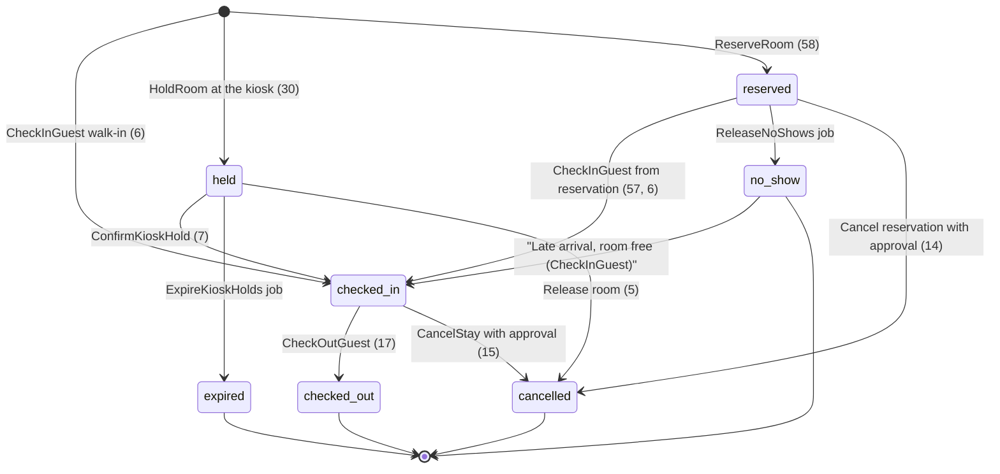

`checked_out`, `cancelled`, `expired` and `no_show` are final. Only `held` and `checked_in` occupy `active_room_id`, which is what makes a second open stay in the same room impossible.

### 5.2 `rooms.status`

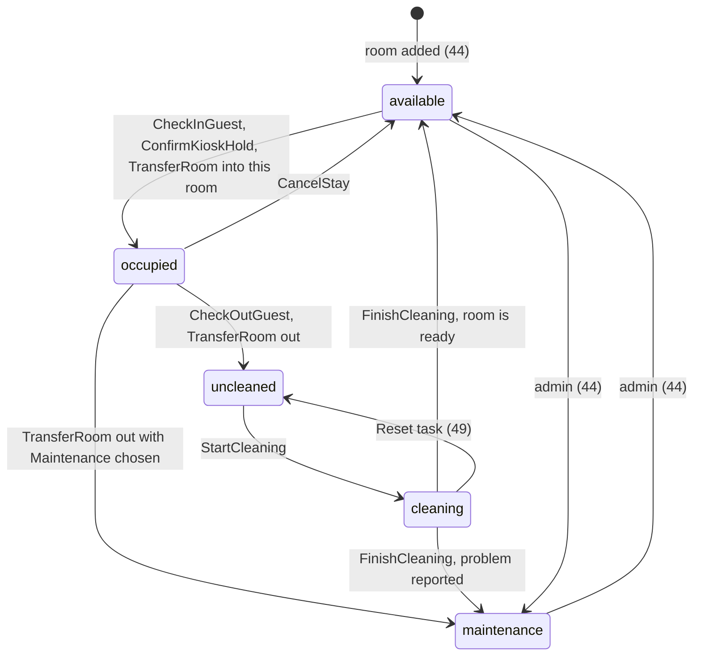

| From → to | Caused by | `room_status_logs.reason` |
|---|---|---|
| `available → occupied` | `CheckInGuest` (6), `ConfirmKioskHold` (7) | `check_in` |
| `available → occupied` | `TransferRoom`, the new room (13) | `check_in` |
| `occupied → uncleaned` | `CheckOutGuest` (17) | `check_out` |
| `occupied → uncleaned` | `TransferRoom`, the old room (13) | `transfer_out` |
| `occupied → maintenance` | `TransferRoom`, the old room with Maintenance chosen (13) | `transfer_out` |
| `occupied → available` | `CancelStay` (15) | `cancel` |
| `uncleaned → cleaning` | `StartCleaning` (32) | `clean_start` |
| `cleaning → available` | `FinishCleaning`, result `ready` (33) | `clean_finish` |
| `cleaning → maintenance` | `FinishCleaning`, result `problem` (33) | `clean_finish` |
| `cleaning → uncleaned` | Reset task (49) | `admin` |
| `available → maintenance` | Admin on screen 44 | `admin` |
| `maintenance → available` | Admin on screen 44 | `admin` |

Every other move is refused by `RoomStatusService::transition()`. In particular: nothing but a check-in, a hold confirmation or a transfer makes a room `occupied`; an admin cannot change an `occupied`, `uncleaned` or `cleaning` room; `uncleaned` never goes straight to `available`. A kiosk hold or a reservation does not change the room status — the board reads "held" and "reserved" from the stay.

### 5.3 `shift_sessions.status`

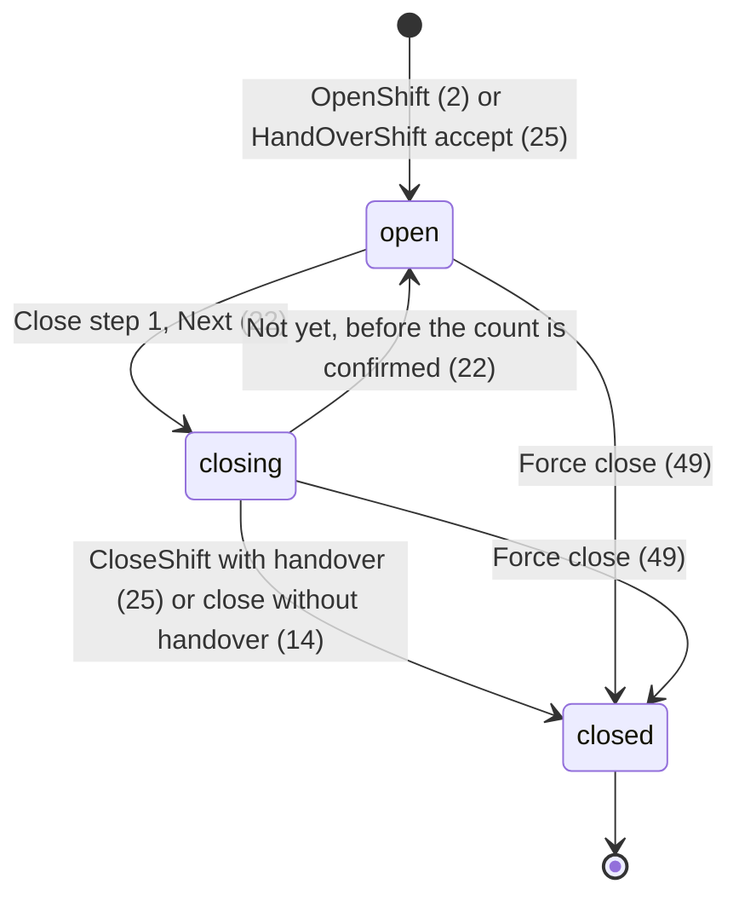

The states are unchanged in version 1.1. `open` and `closing` both count as the branch's one open shift. While `closing`, payments, charges and cash movements by the outgoing team are refused (`ShiftClosing`). `closed` is final: `totals`, `z_no`, the grand totals and `shift_forwarded_stays` are frozen. A shift that is `shift_stale_block_minutes` past its defined end stays `open` but refuses new payments and charges; that is a rule on the open state, not a state of its own.

### 5.4 `cleaning_tasks.status`

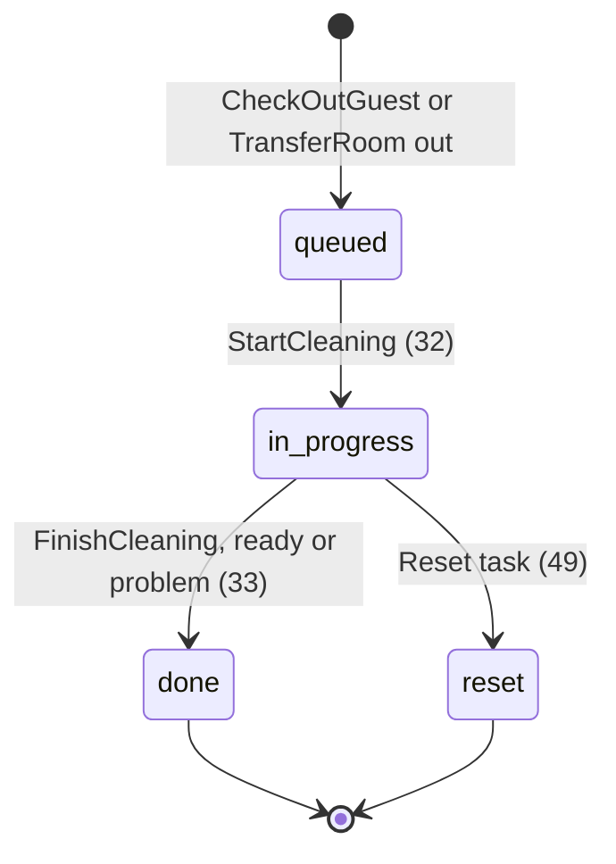

A room has at most one `queued` or `in_progress` task; a housekeeper has at most one `in_progress` task. A reset task is replaced by a new `queued` task for the same room and stay.

### 5.5 Folio line status (derived, never stored)

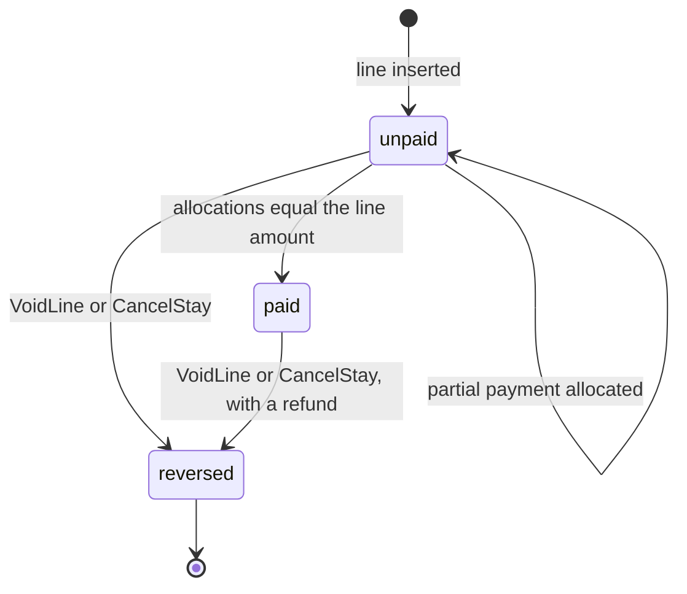

| Status | Rule ([DATABASE_SCHEMA](DATABASE_SCHEMA.md) §4.12) |
|---|---|
| `unpaid` | The line's `payment_allocations` sum to less than its `amount`. |
| `paid` | The allocations sum to its `amount`. |
| `reversed` | Another line has `reversal_of_id` pointing at it. A line can be reversed once. |

The "Held" chip on the folio (9) is not a line status: it marks a deposit, which is a `payments` row (`deposit_in`) and stays held until check-out or until it is applied.

### 5.6 `branches.status`

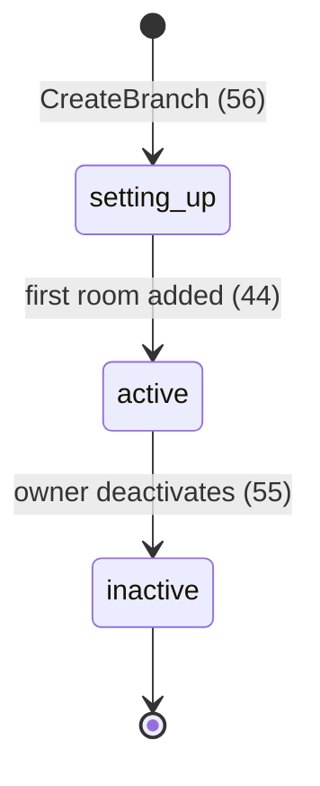

A branch is never deleted. An inactive branch's history stays readable by the owner. The owner can set an inactive branch back to `active` ([TRD](TRD.md) §4.9).

### 5.7 Business day closing

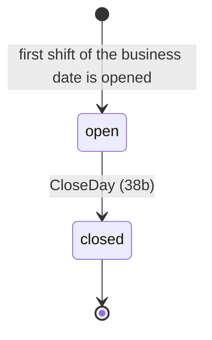

`open` is not stored: a business date is open while it has no `day_closings` row. `closed` is the `day_closings` row, written once. `CloseDay` is refused while a shift of the date is `open` or `closing`, while an earlier date with shifts is not closed, or after a reconcile mismatch for the date. Days are closed in date order and are never reopened.

### 5.8 PIN entry on one computer

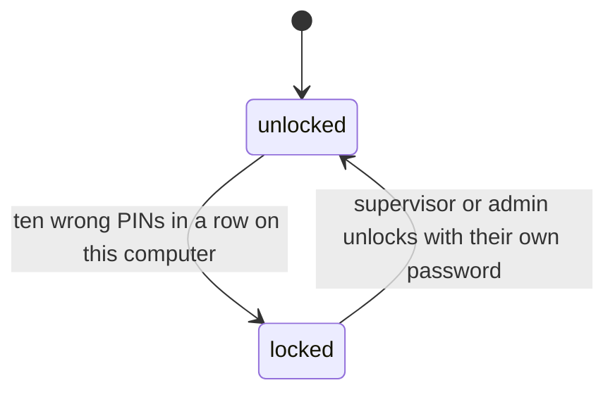

`locked` is a `pin_locks` row without `unlocked_at`; a computer has at most one. A correct PIN resets the run of wrong tries.

## 6. Edge cases

| # | Situation | What the user sees (screen) | What the system does |
|---|---|---|---|
| 1 | The server cannot be reached | Red bar "No connection to the server. Do not take payments until this bar disappears." on every screen; board dimmed; Save buttons disabled (50) | Retries the heartbeat every 5 s; removes the bar when it succeeds. Nothing is queued or saved offline. |
| 2 | A user opens a page their role cannot use | "You do not have access to this page", naming the account, with a button to the role's home (51) | Returns HTTP 403 from the policy; nothing is read. |
| 3 | A stay option has no rate | The option is greyed out with "no rate" and an explanation (52) in check-in (6), extend (12) and transfer (13) | `PricingService` throws `RateNotFound`; nothing is charged at ₱0.00; nothing is saved. |
| 4 | Two users save a check-in to the same room at the same moment | The second sees "Room 205 was just taken", with who took it; "Pick another" keeps the guest's details (53) | The second insert fails on `stays_one_active_per_room` → `RoomTaken`; the whole transaction rolls back; no payment is recorded. |
| 5 | A kiosk guest and the front desk take the same room | The loser sees the room-taken message: dialog 53 at the front desk, or a message and a return to 28 at the kiosk | Same unique index; exactly one stay is created. |
| 6 | The shift is past its end time | Amber bar "The AM shift should have ended at 8:00 PM. You can keep working…" with a Close shift button (54) | Shown from `shift_overdue_warn_minutes` (30) after the end time. Every transaction still goes to this shift. After 2 hours the shift is also listed on 49. After 4 hours see case 59. The app never closes it. |
| 7 | A kiosk hold expires while screen 7 is open | Save is refused with "This hold has expired"; the room is back on sale (7) | `HoldExpired`; the stay is already, or is now set, `expired`; nothing else is written. The front desk can start a walk-in check-in (6) if the room is still free. |
| 8 | A kiosk hold expires unpaid | The hold shows as "Expired … released automatically" in the holds sheet (5); the kiosk guest can start again | `ExpireKioskHolds` sets `state = expired` within one minute. No guest record is left over. |
| 9 | Double click on "Check in", "Complete sale", "Save payment", "Hold my room" or Save on a cash movement | The first result, once | The repeated `idempotency_key` returns the existing stay, order, payment or cash movement. |
| 10 | Double click on "Check out guest" | The done screen (18), once | The stay is no longer `checked_in`; the action returns the existing result and writes nothing. |
| 11 | The session expires in the middle of a shift | The sign-in screen (1); after signing in, Today (62) | The shift stays open; nothing is closed or freed. An unsaved form is lost; nothing was half-saved. A count being typed at close is restored from its draft. |
| 12 | A user signs out or closes the browser during a shift | The sign-in screen (1) | The shift, the drawer and the members are unchanged. |
| 13 | The incoming front desk counts a different amount at handover | "Amount is different — report it" with a required note (25) | The new shift opens with `opening_cash = received_cash`; `shift_handovers.difference_amount` and `note` are saved for the supervisor. |
| 14 | The drawer count typed at Open shift differs from the last close | A note is required (2) | The difference and note are written to the handover and `opening_note`; the shift opens with the typed amount. |
| 15 | Nobody is present to receive the shift | "Close without handover" asks for a supervisor PIN (25, 14) | The shift closes; the handover has no receiving shift; the next user gets Open shift (2). |
| 16 | A third front desk tries to join | "This shift already has two front desks" (2b) | `JoinShift` refuses at `max_frontdesks_per_shift`; nothing is written. |
| 17 | A second user tries to open a shift when one is open | Join screen (2b) instead of Open | `shift_sessions_one_open` → `ShiftAlreadyOpen`. |
| 18 | A front desk user acts when no shift is open | Redirect to Open shift (2) | `NoOpenShift`; nothing is saved. |
| 19 | A payment, charge or cash movement is tried while the shift is closing | The save is refused with a message naming who is closing the shift; the form stays on screen with what was typed (11, 10, 21) | `ShiftClosing`; nothing is written. |
| 20 | The count does not match the expected cash | "Short by ₱50.00. This will be recorded against the AM shift." and a required explanation (24) | `variance_amount` and `variance_note` are frozen with the shift; a shortage can be repaid later as a shortage payment (21). |
| 21 | A mistake is found after the shift closed | The correction appears on the shift in which it is made; the closed shift's report is unchanged (37) | A void posts reversing rows to the open shift. `totals` of the closed shift are never touched. |
| 22 | A wrong expense was typed | The entry struck through with its reason, and the corrected entry below it (21) | Void with approval sets the void columns; the row counts as ₱0.00. |
| 23 | A cash movement of a closed shift needs voiding | The void is refused | Voids are allowed only while the row's shift is `open`. |
| 24 | The approver is the same person as the requester | The approval is refused; another approver must be chosen (14) | No `approvals` row; the action is not saved. |
| 25 | A wrong approval PIN | "PIN not recognised" (14) | `PinInvalid`; nothing is saved. After 5 wrong PINs that approver's approvals are locked for 15 minutes. |
| 26 | Three wrong PINs on switch user | The full sign-in screen (1) | The session ends; the shift stays open. Each try is in `pin_attempts`. |
| 27 | Five wrong passwords | A message that the account is locked for 15 minutes (1) | `users.locked_until` is set. |
| 28 | A deactivated user tries to sign in | Sign-in is refused (1) | `is_active = 0`; no session. |
| 29 | An item is out of stock | The item shows "Out of stock" / "Out" and cannot be added (10, 19) | Stock is checked again on Save. |
| 30 | Stock runs out between opening the panel and Save | An error naming the item; nothing was added (10, 19) | `InsufficientStock`; the whole sale rolls back. |
| 31 | A payment is smaller than the balance | The oldest lines turn Paid, the rest stay Unpaid (9, 11) | Allocations are written oldest line first. |
| 32 | Paying from guest deposit with more than is held | The option is disabled at ₱0.00 available, or the amount is refused (11) | `TakePayment` refuses above the guest deposit held. The key deposit is never offered. |
| 33 | Check-out with an unpaid balance | "Check out guest" stays disabled (17) | If forced, `BalanceNotZero`; nothing is saved. |
| 34 | The guest leaves without claiming the deposit | The front desk picks "Guest did not claim" (17) | A `forfeited_deposit` line and a `deposit_applied` payment make it income of that shift. |
| 35 | Key or remote not returned | A damage line per item at the branch's lost-item amount, taken out of the deposit (16, 17) | `damage` lines, settled by `deposit_applied` from the key deposit. |
| 36 | A guest is past the expected check-out | The row shows Overdue with the time in brick (4); a far-overdue stay is listed on 49 | Nothing is charged automatically. The front desk extends (12) or checks out (16). |
| 37 | No extension option has a rate | The missing-rate alert (52) on Extend (12) | Nothing is saved. |
| 38 | Transfer to a room that was taken a moment ago | The room-taken dialog (53) | `RoomTaken`; the approval and the transfer roll back together. |
| 39 | A housekeeper tries to start a room that is not next | The button is not offered; the row shows "Next in line" (32) | Only the first N tasks are startable. |
| 40 | A housekeeper tries to start a second room | The start is refused (32) | `cleaning_tasks_one_per_cleaner`. |
| 41 | "Room is ready" on a room that has an active stay | The finish is refused (33) | `FinishCleaning` fails; room and task are unchanged. |
| 42 | A cleaning never finishes | "Cleaning stuck" on the attention list with "Reset task" (49) | Reset sets the task to `reset`, queues a new one and returns the room to `uncleaned`. |
| 43 | A shift is left open for hours | "Shift open too long" with "Force close" (49) | Force close needs a count and a PIN and sets `is_force_closed = 1`. |
| 44 | The kiosk loses its connection | "The kiosk is offline. Please check in at the front desk." (31b) | No hold can be created; it reconnects by itself and returns to 27. |
| 45 | No room is free for the kiosk | "All rooms are taken right now" (31); a single full type shows "Full" (28) | Rechecks every 20 s. |
| 46 | The kiosk guest walks away mid-flow | The welcome screen (27) | Idle reset after 60 s; nothing was saved before "Hold my room". |
| 47 | The kiosk guest types an incomplete mobile number | "Enter all 11 digits, or leave it blank."; "Hold my room" stays grey (29) | Validation on the kiosk and again on the server. |
| 48 | A reservation overlaps another stay | The form says the room is not free for those dates (58) | `NotAvailable`; nothing is saved. |
| 49 | A reserved guest does not arrive | Status "No-show" on the list (57) | `ReleaseNoShows` sets `no_show` after the release time; money paid ahead stays as guest deposit until a supervisor refunds it. |
| 50 | An admin tries to set a room with a guest to Available | The change is not offered; the note on 44 explains why | `RoomStatusService` allows the admin only `available ↔ maintenance`. |
| 51 | A rate or product price changes while stays are open | Open folios keep their amounts (9) | Lines keep their `unit_amount`; the change applies to new check-ins and sales and is logged (43). |
| 52 | A duplicate stay-code prefix or branch name | "DGS is already used by Dalisay GenSan." under the field; the form does not save (56) | Validation; the unique keys on `branches` are the last guard. |
| 53 | The nightly reconcile finds a difference | A red line on the report hub and daily sales, listing the rows that differ (36, 38) | `audit_logs` `reconcile.mismatch`. Nothing is corrected. |
| 54 | A nightly invariant fails | A row on the attention list (49) | `audit_logs` `invariant.failed`. Nothing is corrected. |
| 55 | Any unexpected error | "Something went wrong. Nothing was saved." with a request id | The transaction is rolled back and the error is logged with user, branch, route and request id. |
| 56 | A validation error on any form | The message under the field | HTTP 422; nothing is saved. |
| 57 | A module is switched off for the branch | Its menu items are gone; its routes show 51 | Checked on every request from the `branches` flags. |
| 58 | The board finds no match for a search | "No room or guest matches …" with "Clear search" (4c) | The search covers room numbers and names of checked-in guests only. |
| 59 | A shift is 4 hours past its end time | The bar (54) says payments are stopped until the shift is closed; Save on a payment or charge is refused (10, 11, 19) | The shift is `shift_stale_block_minutes` (240) past its defined end. Payments and charges are refused; closing (22–25) and force close (49) still work. Nothing is moved to another shift. |
| 60 | Ten wrong PINs in a row on one computer | Every PIN pad on that computer (3, 14, 25) shows that PIN entry is locked and asks for a supervisor or admin | A `pin_locks` row for the `device_key`. A supervisor or admin unlocks it with their own password (`pin_locks.unlocked_by`, `audit_logs`). Password sign-in still works. |
| 61 | Someone tries to export a preview | Export is disabled on the page; a direct request is refused (37b) | The shift has no `z_no`; no file is produced and no `print_logs` row is written. |
| 62 | Close the day while a shift of that date is open | "Close the day" is disabled and the line says which shift is still open (38b) | `CloseDay` refuses; nothing is written. |
| 63 | Close the day while an earlier day is not closed | The line names the earlier day (38b) | `CloseDay` refuses; days close in date order. |
| 64 | Close the day after the nightly check found a mismatch | The red check line of 38 is repeated; "Close the day" is disabled (38b) | `CloseDay` refuses until the day reconciles. |
| 65 | A day is closed twice | The closed day paper (38b) | `day_closings_date_unique`; nothing is written the second time. |
| 66 | A summary is more than 10 minutes older than the newest ledger row | The dashboard keeps showing its last figures with their "Updated" time (60, 61) | `CheckSummaries` logs an error. The next `RebuildSummaries` run replaces the day. Signed papers are not affected: they never read the summaries. |
| 67 | A dashboard refresh fails | "Could not refresh. Retry" on the page; the last figures stay (60, 61) | The next poll, 30 seconds later, tries again. |
| 68 | A dashboard card has no earlier period to compare with | The figure without a change line (60, 61, 63) | No "+100%" is ever shown. |
| 69 | The other front desk saves while their partner is closing | "… is closing the shift"; the save is refused and the form is kept (22) | `ShiftClosing`. If the closer presses "Not yet" the shift is `open` again and the save can be repeated. |
| 70 | An expense or remittance is larger than the cash in the drawer | The entry is refused; the message does not state the expected amount (21) | `NotEnoughCash`; nothing is written. |
| 71 | The person who counted is chosen as receiver, or tries to approve their own variance | Their name is not offered as receiver; an approval by them is refused (24, 25, 14) | Checked again on the server against `cash_counts.counted_by`. |
| 72 | A reason that needs a note or a supervisor is picked | Save stays disabled until the note is typed; the approval sheet (14) opens when a supervisor is needed | `needs_note` and `needs_manager` on `reasons`, `transfer_reasons` and `expense_categories`, checked again on the server. |
| 73 | The browser sends a total with the count that does not match the pieces | The total the server worked out (23) | The server adds up the pieces and ignores any total sent. |
| 74 | The page reloads or the power fails during the count | The pieces typed so far are back (23) | Restored from `cash_count_drafts`. |
| 75 | A new computer opens the sign-in | The photo with the greeting only, no branch figures (1) | No branch is remembered on that computer yet. |
| 76 | A slip or report is printed a second time | The same figures | `print_logs.is_reprint = 1`; reprints are counted under "Slip reprints" on the Z-report (37b). |
| 77 | A `frontdesk` user opens a dashboard, Stats or a report | No permission (51) | HTTP 403. Their own pages never carry sales or drawer amounts. |

## 7. Screen inventory

All 70 mockup frames: 63 numbered screens and 7 variants (2b, 4b, 4c, 31b, 37b, 37c, 38b). Page components are under `resources/js/Pages`; shared components under `resources/js/Components`; charts under `resources/js/Components/Charts`.

| Screen | Name | Route or sheet | Component | Feature | Status |
|---|---|---|---|---|---|
| 1 | Sign in | `/login` | `Auth/Login.vue` | F1 | Planned |
| 2 | Open shift | `/shift/open` | `Shift/Open.vue` | F2 | Planned |
| 2b | Join an open shift | `/shift/open` | `Shift/Join.vue` | F2 | Planned |
| 3 | Switch user by PIN | Sheet on any front desk route | `Components/PinSwitch.vue` | F1 | Planned |
| 4 | Room board | `/board` | `Board/Index.vue`, `Components/RoomTable.vue` | F3 | Planned |
| 4b | Room board — loading | `/board` | `Board/Index.vue` with `Components/Skeleton.vue` | F3 | Planned |
| 4c | Room board — nothing found | `/board?q=` | `Board/Index.vue` with `Components/EmptyState.vue` | F3 | Planned |
| 5 | Kiosk holds | Sheet on `/board` | `Board/KioskHolds.vue` | F10 | Planned |
| 6 | Walk-in check-in | `/stays/create` | `Stays/Create.vue` | F4 | Planned |
| 7 | Confirm a kiosk hold | `/stays/{id}/confirm` | `Stays/ConfirmHold.vue` | F10 | Planned |
| 8 | Checked in — slip | `/stays/{id}` (after check-in) | `Stays/Slip.vue` | F4 | Planned |
| 9 | Guest folio | `/stays/{id}` | `Stays/Show.vue`, `Components/FolioTable.vue` | F5 | Planned |
| 10 | Add charge | Sheet on `/stays/{id}` | `Stays/AddCharge.vue` | F5 | Planned |
| 11 | Take payment | Sheet on `/stays/{id}` | `Stays/TakePayment.vue` | F5 | Planned |
| 12 | Extend stay | `/stays/{id}/extend` | `Stays/Extend.vue` | F6 | Planned |
| 13 | Transfer room | `/stays/{id}/transfer` | `Stays/Transfer.vue` | F6 | Planned |
| 14 | Supervisor approval | Sheet | `Components/ApprovalPin.vue` | F15 | Planned |
| 15 | Cancel stay / void a line | Dialog on `/stays/{id}` | `Stays/Show.vue` with `Components/ConfirmDialog.vue` | F5 | Planned |
| 16 | Check-out step 1 — items returned | `/stays/{id}/checkout` | `Stays/Checkout/Returns.vue` | F7 | Planned |
| 17 | Check-out step 2 — settle | `/stays/{id}/checkout` | `Stays/Checkout/Settle.vue` | F7 | Planned |
| 18 | Check-out step 3 — done | `/stays/{id}/checkout` | `Stays/Checkout/Done.vue` | F7 | Planned |
| 19 | Point of sale | `/pos` | `Pos/Index.vue` | F8 | Planned |
| 20 | Stock | `/stock` | `Stock/Index.vue` | F8 | Planned |
| 21 | Shift cash | `/shift` | `Shift/Cash.vue` | F2 | Planned |
| 22 | Close step 1 — check | `/shift/close` | `Shift/Close/Check.vue` | F2 | Planned |
| 23 | Close step 2 — blind count | `/shift/close` | `Shift/Close/Count.vue` | F2 | Planned |
| 24 | Close step 3 — result | `/shift/close` | `Shift/Close/Result.vue` | F2 | Planned |
| 25 | Close step 4 — handover | `/shift/close` | `Shift/Close/Handover.vue` | F2 | Planned |
| 26 | Shift report slip | `/shift/{id}/report` | `Shift/ReportSlip.vue` | F2 | Planned |
| 27 | Kiosk — welcome | `/kiosk` | `Kiosk/Welcome.vue` | F10 | Planned |
| 28 | Kiosk — room and hours | `/kiosk/start` | `Kiosk/PickRoom.vue` | F10 | Planned |
| 29 | Kiosk — your name | `/kiosk/details` | `Kiosk/Details.vue` | F10 | Planned |
| 30 | Kiosk — room held | `/kiosk/held/{code}` | `Kiosk/Held.vue` | F10 | Planned |
| 31 | Kiosk — no rooms | `/kiosk` | `Kiosk/NoRooms.vue` | F10 | Planned |
| 31b | Kiosk — offline | `/kiosk` | `Kiosk/Offline.vue` | F10 | Planned |
| 32 | Housekeeping — queue | `/housekeeping` | `Housekeeping/Queue.vue` | F9 | Planned |
| 33 | Housekeeping — cleaning | `/housekeeping/{task}` | `Housekeeping/Task.vue` | F9 | Planned |
| 34 | Housekeeping — my cleans | `/housekeeping/history` | `Housekeeping/History.vue` | F9 | Planned |
| 35 | Housekeeping — nothing to clean | `/housekeeping` | `Housekeeping/Queue.vue` with `Components/EmptyState.vue` | F9 | Planned |
| 36 | Report hub | `/reports` | `Reports/Hub.vue` | F12 | Planned |
| 37 | Shift report | `/reports/shifts/{id}` | `Reports/Shift.vue` | F12 | Planned |
| 37b | Z-report — sales and cash | `/reports/shifts/{id}/z` | `Reports/ZReport.vue` | F12 | Planned |
| 37c | Z-report — rooms by floor | `/reports/shifts/{id}/z?tab=rooms` | `Reports/ZReport.vue` | F12 | Planned |
| 38 | Daily sales | `/reports/daily` | `Reports/Daily.vue` | F12 | Planned |
| 38b | Close the day | `/reports/daily/close` | `Reports/CloseDay.vue` | F12 | Planned |
| 39 | Owner summary | `/owner/summary` | `Owner/Summary.vue` | F14 | Planned |
| 40 | Occupancy and guests | `/reports/occupancy` | `Reports/Occupancy.vue` | F12 | Planned |
| 41 | Housekeeping report | `/reports/housekeeping` | `Reports/Housekeeping.vue` | F12 | Planned |
| 42 | Inventory report | `/reports/inventory` | `Reports/Inventory.vue` | F12 | Planned |
| 43 | Audit trail | `/reports/audit` | `Reports/Audit.vue` | F15 | Planned |
| 44 | Admin — rooms | `/admin/rooms` | `Admin/Rooms.vue` | F13 | Planned |
| 45 | Admin — rates | `/admin/rates` | `Admin/Rates.vue` | F13 | Planned |
| 46 | Admin — branch settings | `/admin/settings` | `Admin/Settings.vue` | F13 | Planned |
| 47 | Admin — users | `/admin/users` | `Admin/Users.vue` | F13 | Planned |
| 48 | Admin — products | `/admin/products` | `Admin/Products.vue` | F13 | Planned |
| 49 | Admin — needs attention | `/admin/exceptions` | `Admin/Exceptions.vue` | F16 | Planned |
| 50 | Connection lost | Bar on all routes | `Components/ConnectionBar.vue` | F16 | Planned |
| 51 | No permission | Any route (HTTP 403) | `Errors/Forbidden.vue` | F16 | Planned |
| 52 | Missing rate | Alert in `/stays/create`, extend, transfer | `Components/AppAlert.vue` in `Stays/Create.vue` | F16 | Planned |
| 53 | Room just taken | Dialog on `/stays/create` | `Components/ConflictDialog.vue` | F16 | Planned |
| 54 | Shift running late | Bar on all front desk routes | `Components/OverdueBar.vue` | F16 | Planned |
| 55 | Owner — branches | `/owner/branches` | `Owner/Branches.vue` | F14 | Planned |
| 56 | Owner — add branch | `/owner/branches/create` | `Owner/BranchForm.vue` | F14 | Planned |
| 57 | Reservations | `/reservations` | `Reservations/Index.vue` | F11 | Planned |
| 58 | New reservation | `/reservations/create` | `Reservations/Create.vue` | F11 | Planned |
| 59 | Welcome page | `/` | `Welcome.vue` | F18 | Planned |
| 60 | Owner dashboard | `/owner` | `Dashboard/Owner.vue` | F17 | Planned |
| 61 | Branch dashboard | `/dashboard` | `Dashboard/Branch.vue` | F17 | Planned |
| 62 | Front desk — today | `/today` | `Dashboard/Today.vue` | F17 | Planned |
| 63 | Stats | `/stats` | `Stats/Index.vue`, `Components/Charts/*` | F17 | Planned |

## 8. Additions agreed in the cross-check

These fill gaps the mockup does not draw. The rules are in [TRD §4.9](TRD.md); this section gives their routes and where they appear. It was checked against mockup v3 and agrees with sections 1 to 7.

### 8.1 Extra routes

| Route | Controller@method | Who | Purpose |
|---|---|---|---|
| `/pin/setup` | `Auth\PinController@edit` / `update` | frontdesk, supervisor, admin at first sign-in | Set your 4-digit PIN (uses PinPad) |
| `/password/change` | `Auth\PasswordController@edit` / `update` | any user with a temporary password | Replace a temporary password |
| `/reports/shifts` | `ReportController@shifts` | backoffice, supervisor, admin, owner | List of shifts by business date with their Z numbers; each row opens 37, 37b or 37c. An open shift opens as a preview. |
| `POST /owner/branches/{branch}/open` | `Owner\BranchController@open` | owner | Stores the opened branch in the session and goes to that branch's dashboard (61) |
| `/owner/accounts` | `Owner\AccountController@index` / `store` / `update` | owner | Owner accounts list and form |
| `POST /stays/{stay}/release` | `StayController@release` | frontdesk, supervisor | `ReleaseKioskHold` (from 5 and 7) |
| `/reservations/{stay}` | `ReservationController@show` | frontdesk, supervisor | Reservation detail sheet: check in, cancel, settle no-show |
| `POST /shift/{shift}/force-close` | `ShiftController@forceClose` | supervisor, admin, owner | `ForceCloseShift` (from 49) |
| `POST /housekeeping/{task}/reset` | `HousekeepingController@reset` | supervisor, admin, owner | `ResetCleaning` (from 49) |
| `GET /heartbeat` | closure returning 204 | any signed-in user or kiosk | Connection check for the bar (50) and offline screen (31b), every 5 s |

### 8.2 Sheets and forms without their own mockup frame

Each is built only from shared components in [DESIGN_SYSTEM §5](DESIGN_SYSTEM.md) and follows the nearest mockup pattern named here.

| Sheet or form | Opened from | Pattern to follow | Action |
|---|---|---|---|
| Set your PIN | First sign-in, before the role home | PIN pad of screen 3, typed twice | `Auth/SetPin` |
| Change temporary password | First sign-in of a user created with a temporary password | Sign-in card of screen 1 | `Auth/ChangePassword` |
| Reset password / reset PIN | "Edit" on a user row (47) | ConfirmDialog; new temporary password shown once | writes `users`, `audit_logs` |
| Owner accounts | Owner menu | Table and form of screen 47 | writes `users` (role owner) |
| Receive stock | "Receive stock" on 20 | Side sheet of screen 10 with product, quantity, note | `Pos/ReceiveStock` |
| Record wastage | A product row on 20 | Same side sheet; note required | `Pos/RecordWastage` |
| Shifts list | "Shift reports" in the reports menu | Table of screen 43 | read only |
| Reservation detail | "Open" on 57 | Side sheet of screen 5 | `CancelReservation`, `RefundNoShow` with screen 14 |
| Force-close count | "Force close" on 49 | Count table of screen 23, then screen 14 | `ForceCloseShift` |
| Release hold | "Release room" on 5 and 7 | ConfirmDialog (Building blocks) | `ReleaseKioskHold` |
| PIN entry locked | Any PIN pad (3, 14, 25) on a locked computer | Sign-in card of screen 1, for the supervisor's or admin's own username and password | writes `pin_locks` (`unlocked_at`, `unlocked_by`), `audit_logs` |
| Reason lists | Branch settings (46) | Transfer reasons and expense categories on 46, with two switches per row: needs a note, needs a supervisor | writes `reasons`, `transfer_reasons`, `expense_categories`, `audit_logs` |
| VAT settings | Branch settings (46) | A settings group of 46: on or off, rate, TIN, registered name | writes `branches`, `audit_logs` |
| Day paper | After "Close the day" on 38b | Z-report paper of 37b with the day number | read only; print and export logged |

### 8.3 Action names confirmed

`ReleaseKioskHold`, `VoidSale`, `VoidCashMovement`, `RecordWastage`, `ForceCloseShift`, `ResetCleaning`, `RefundNoShow`, `CancelReservation`, `Auth/SetPin`, `Auth/ChangePassword`. The asterisks in section 4 can be read as confirmed.
