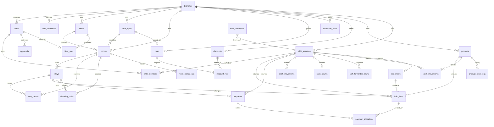

# Database Schema — Homi

| | |
|---|---|
| Engine | MySQL 8.0 (InnoDB, `utf8mb4_unicode_ci`) |
| Version | 1.1 · 11 November 2026 (Z numbers, day close, summaries, shift safeguards) |
| Status | Approved with mockup v2 |
| Wins on conflict | **Yes.** If another doc names a table or column differently, this file is right. |
| Related | [TRD](TRD.md) · [SYSTEM_DESIGN](SYSTEM_DESIGN.md) · [APP_FLOW](APP_FLOW.md) · [mockup](mockup/hotel-mockup.html) |

## 1. Conventions

| Topic | Rule |
|---|---|
| Primary keys | `id BIGINT UNSIGNED AUTO_INCREMENT` on every table |
| Foreign keys | Always declared, `ON DELETE RESTRICT` unless stated. No orphan rows are possible. |
| Money | `BIGINT` **centavos**, signed. ₱650.00 is stored as `65000`. Column names end in `_amount` or `_cash`. Never `FLOAT`, `DECIMAL` or strings. |
| Quantities | `INT` whole units. Stock is counted in pieces. |
| Timestamps | `TIMESTAMP` stored in **UTC**; shown in `Asia/Manila`. Every table has `created_at`, `updated_at` unless marked append-only (then `created_at` only). |
| Business time | Event time is a named column (`checked_in_at`, `occurred_at`), never `created_at`. Reports never filter on `created_at`. |
| Status values | MySQL `ENUM`, mirrored by a PHP backed enum in `app/Enums`. No free strings, no numeric type IDs. |
| Booleans | `TINYINT(1)`, names start with `is_` or end with `_enabled`. |
| Branch scope | Every operational table has `branch_id NOT NULL`. Models use the `BelongsToBranch` global scope. |
| Deletes | No soft deletes and no hard deletes on money, stays, shifts or stock. Config rows use `is_active`. |
| Append-only tables | `folio_lines`, `payments`, `payment_allocations`, `cash_counts`, `stock_movements`, `shift_forwarded_stays`, `room_status_logs`, `approvals`, `audit_logs`. No `UPDATE` except the void columns on `cash_movements`. Corrections are new rows. |
| "One at a time" rules | Enforced by a generated column with a `UNIQUE` index (MySQL has no partial indexes). See `stays.active_room_id` and `shift_sessions.open_branch_id`. |
| Schema versioning | Laravel migrations only. One migration per table, named in section 6. Never edit a migration that has run in production; add a new one. |

## 2. ER diagram



## 3. Table overview

| # | Table | Rows (one branch, one year) | Purpose |
|---|---|---|---|
| 1 | `branches` | 1–20 | A hotel branch and all its settings (screens 46, 55, 56) |
| 2 | `users` | ~15 per branch | Staff, owner accounts and kiosk devices (1, 3, 47) |
| 3 | `shift_definitions` | 2–3 per branch | Named shifts and their hours (46) |
| 4 | `floors` | 3–10 | Floors (44) |
| 5 | `room_types` | 3–8 | Standard, Deluxe, Suite… (44) |
| 6 | `rooms` | 20–300 | Rooms and their current status (4, 44) |
| 7 | `room_status_logs` | ~40,000 | Every status change, who and why |
| 8 | `rates` | ~15 | Price per room type and stay option (45) |
| 9 | `extension_rates` | ~4 | Price per extension block (45) |
| 10 | `discounts` | ~3 | Promo, senior, PWD (45) |
| 11 | `discount_rate` | ~6 | Which rates a discount may be used on |
| 12 | `transfer_reasons` | ~6 | List for screen 13 |
| 13 | `expense_categories` | ~8 | List for screen 21 |
| 14 | `floor_user` | ~6 | Housekeeper ↔ floor assignment (47) |
| 15 | `shift_sessions` | ~730 | One row per shift actually worked (2, 22–26, 37) |
| 16 | `shift_members` | ~1,400 | Who was on each shift (2b, 3) |
| 17 | `cash_counts` | ~730 | Blind count at close (23) |
| 18 | `shift_handovers` | ~730 | Outgoing → incoming acceptance (25) |
| 19 | `shift_forwarded_stays` | ~17,000 | In-house list saved at close (25, 37, 37c) |
| 20 | `cash_movements` | ~3,000 | Expenses, remittances, shortage payments (21) |
| 21 | `stays` | ~20,000 | One guest stay, from held/reserved to closed (5–18, 57, 58) |
| 22 | `stay_rooms` | ~20,500 | Which room a stay was in, and when (13) |
| 23 | `folio_lines` | ~60,000 | Every charge, discount and reversal — the sales ledger (9, 10) |
| 24 | `payments` | ~70,000 | Every money movement with a guest — the cash ledger (11, 17) |
| 25 | `payment_allocations` | ~65,000 | Which payment settled which line |
| 26 | `products` | ~25 | Food, drinks, amenities, damages (48) |
| 27 | `product_price_logs` | ~50 | Price change history |
| 28 | `stock_movements` | ~30,000 | Stock in, sold, wastage, reversal (20, 42) |
| 29 | `pos_orders` | ~10,000 | Header for a POS sale (19) |
| 30 | `cleaning_tasks` | ~20,500 | One clean per check-out or transfer-out (32–34, 41) |
| 31 | `approvals` | ~1,500 | Supervisor PIN approvals (14) |
| 32 | `audit_logs` | ~10,000 | Settings and admin changes (43) |
| 33 | `day_closings` | ~365 | Day-level Z (38b) |
| 34 | `cash_count_drafts` | 0–1 | Count being typed at close (23) |
| 35 | `reasons` | ~20 | Reason lists with note and manager flags |
| 36 | `pin_attempts`, `pin_locks` | ~5,000 | PIN tries and locks per computer (3, 14) |
| 37 | `print_logs` | ~25,000 | Every print and export (8, 26, 37b) |
| 38 | `summary_days`, `daily_summaries`, `hourly_sales_summaries`, `daily_payment_summaries`, `daily_report_lines` | ~60,000 | Rebuildable figures for dashboards and stats (60–63) |

Laravel's own `sessions`, `cache`, `jobs`, `failed_jobs` and `password_reset_tokens` tables are also present and are not described here.

## 4. Tables

All statements assume `ENGINE=InnoDB DEFAULT CHARSET=utf8mb4 COLLATE=utf8mb4_unicode_ci`.

### 4.1 branches

```sql
CREATE TABLE branches (
  id BIGINT UNSIGNED AUTO_INCREMENT PRIMARY KEY,
  name VARCHAR(80) NOT NULL,
  address VARCHAR(160) NOT NULL,
  slip_header VARCHAR(80) NOT NULL,
  code_prefix CHAR(3) NOT NULL,
  status ENUM('setting_up','active','inactive') NOT NULL DEFAULT 'setting_up',
  -- stays
  hourly_enabled TINYINT(1) NOT NULL DEFAULT 1,
  overnight_enabled TINYINT(1) NOT NULL DEFAULT 0,
  overnight_checkin_time TIME NOT NULL DEFAULT '14:00:00',
  overnight_checkout_time TIME NOT NULL DEFAULT '12:00:00',
  long_stay_enabled TINYINT(1) NOT NULL DEFAULT 1,
  long_stay_max_days TINYINT UNSIGNED NOT NULL DEFAULT 31,
  extension_rule ENUM('cycle','per_hour','block') NOT NULL DEFAULT 'cycle',
  extension_cycle_hours TINYINT UNSIGNED NOT NULL DEFAULT 24,
  extension_per_hour_amount BIGINT NOT NULL DEFAULT 0,
  due_soon_minutes SMALLINT UNSIGNED NOT NULL DEFAULT 30,
  -- money
  deposit_enabled TINYINT(1) NOT NULL DEFAULT 1,
  deposit_name VARCHAR(40) NOT NULL DEFAULT 'Key & remote',
  deposit_amount BIGINT NOT NULL DEFAULT 20000,
  lost_key_amount BIGINT NOT NULL DEFAULT 10000,
  lost_remote_amount BIGINT NOT NULL DEFAULT 10000,
  payment_methods JSON NOT NULL,              -- e.g. ["cash","gcash"]
  -- shifts
  max_frontdesks_per_shift TINYINT UNSIGNED NOT NULL DEFAULT 2,
  shift_overdue_warn_minutes SMALLINT UNSIGNED NOT NULL DEFAULT 30,
  -- modules
  kiosk_enabled TINYINT(1) NOT NULL DEFAULT 0,
  kiosk_hold_minutes TINYINT UNSIGNED NOT NULL DEFAULT 10,
  reservations_enabled TINYINT(1) NOT NULL DEFAULT 0,
  reservation_release_minutes SMALLINT UNSIGNED NOT NULL DEFAULT 120,
  pos_enabled TINYINT(1) NOT NULL DEFAULT 1,
  housekeeping_enabled TINYINT(1) NOT NULL DEFAULT 1,
  cleaning_deadline_minutes SMALLINT UNSIGNED NOT NULL DEFAULT 240,
  cleaning_target_minutes SMALLINT UNSIGNED NOT NULL DEFAULT 15,
  cleaning_urgent_minutes SMALLINT UNSIGNED NOT NULL DEFAULT 120,
  house_rules TEXT NULL,
  next_stay_number INT UNSIGNED NOT NULL DEFAULT 1,
  next_pos_number INT UNSIGNED NOT NULL DEFAULT 1,
  next_z_number INT UNSIGNED NOT NULL DEFAULT 1,
  next_day_z_number INT UNSIGNED NOT NULL DEFAULT 1,
  shift_stale_block_minutes SMALLINT UNSIGNED NOT NULL DEFAULT 240,
  -- tax (off unless the branch is VAT-registered)
  vat_enabled TINYINT(1) NOT NULL DEFAULT 0,
  vat_rate_percent TINYINT UNSIGNED NOT NULL DEFAULT 12,
  tin VARCHAR(20) NULL,
  registered_name VARCHAR(120) NULL,
  welcome_enabled TINYINT(1) NOT NULL DEFAULT 1,
  created_at TIMESTAMP NULL, updated_at TIMESTAMP NULL,
  UNIQUE KEY branches_name_unique (name),
  UNIQUE KEY branches_code_prefix_unique (code_prefix),
  CONSTRAINT branches_methods_chk CHECK (JSON_LENGTH(payment_methods) >= 1),
  CONSTRAINT branches_amounts_chk CHECK (deposit_amount >= 0 AND lost_key_amount >= 0 AND lost_remote_amount >= 0)
);
```

- `code_prefix` + two-digit year + `next_stay_number` padded to 6 gives the stay code, e.g. `DGS-26-004126`. `next_stay_number` is incremented with `SELECT … FOR UPDATE` inside the check-in transaction, so codes are unique and gap-tolerant.
- Every setting has a working default, so no front desk screen can be blocked by a missing value.
- `next_z_number` and `next_day_z_number` give the shift Z number (`Z-0629`) and the day Z number (`D-0314`); `next_pos_number` gives POS order numbers (`P-008821`). Each is taken with the branch row locked, inside the transaction that uses it, so numbers never repeat. A number is consumed only when its transaction commits.
- `vat_enabled` adds the VAT block to the Z-report (37b); prices are then treated as VAT-inclusive at `vat_rate_percent`. With it off, no VAT figure is computed or shown.
- `shift_stale_block_minutes`: a shift this long past its defined end refuses new payments and charges (`ShiftStale`) until it is closed (screen 54).
- `welcome_enabled`: the branch and its rates are listed on the public welcome page (59).
- `status = setting_up` until the branch has at least one room (screen 55).

### 4.2 users

```sql
CREATE TABLE users (
  id BIGINT UNSIGNED AUTO_INCREMENT PRIMARY KEY,
  branch_id BIGINT UNSIGNED NULL,             -- NULL only for role = owner
  name VARCHAR(80) NOT NULL,
  username VARCHAR(40) NOT NULL,
  password VARCHAR(255) NOT NULL,
  pin_hash VARCHAR(255) NULL,                 -- bcrypt of a 4-digit PIN
  role ENUM('owner','admin','supervisor','frontdesk','backoffice','housekeeper','kiosk') NOT NULL,
  is_active TINYINT(1) NOT NULL DEFAULT 1,
  failed_logins TINYINT UNSIGNED NOT NULL DEFAULT 0,
  locked_until TIMESTAMP NULL,
  last_seen_at TIMESTAMP NULL,
  remember_token VARCHAR(100) NULL,
  created_at TIMESTAMP NULL, updated_at TIMESTAMP NULL,
  UNIQUE KEY users_username_unique (username),
  KEY users_branch_role_idx (branch_id, role, is_active),
  CONSTRAINT users_branch_fk FOREIGN KEY (branch_id) REFERENCES branches(id),
  CONSTRAINT users_owner_branch_chk CHECK ((role = 'owner') = (branch_id IS NULL))
);
```

- A PIN is required for `supervisor`, `admin` and `frontdesk`; it is set by the user at first sign-in and can only be reset (set to `NULL`) by an admin.
- `last_seen_at` is touched at most once a minute and is used for "housekeepers online" (screen 32).
- No shift state is stored on users.

### 4.3 shift_definitions

```sql
CREATE TABLE shift_definitions (
  id BIGINT UNSIGNED AUTO_INCREMENT PRIMARY KEY,
  branch_id BIGINT UNSIGNED NOT NULL,
  name VARCHAR(20) NOT NULL,                  -- 'AM', 'PM', 'Night'
  starts_at TIME NOT NULL,
  ends_at TIME NOT NULL,                      -- may be earlier than starts_at (crosses midnight)
  sort_order TINYINT UNSIGNED NOT NULL,
  is_active TINYINT(1) NOT NULL DEFAULT 1,
  created_at TIMESTAMP NULL, updated_at TIMESTAMP NULL,
  UNIQUE KEY shift_definitions_branch_name_unique (branch_id, name),
  CONSTRAINT shift_definitions_branch_fk FOREIGN KEY (branch_id) REFERENCES branches(id)
);
```

### 4.4 floors, room_types, rooms, room_status_logs

```sql
CREATE TABLE floors (
  id BIGINT UNSIGNED AUTO_INCREMENT PRIMARY KEY,
  branch_id BIGINT UNSIGNED NOT NULL,
  number SMALLINT NOT NULL,
  label VARCHAR(20) NOT NULL,                 -- '1F'
  created_at TIMESTAMP NULL, updated_at TIMESTAMP NULL,
  UNIQUE KEY floors_branch_number_unique (branch_id, number),
  CONSTRAINT floors_branch_fk FOREIGN KEY (branch_id) REFERENCES branches(id)
);

CREATE TABLE room_types (
  id BIGINT UNSIGNED AUTO_INCREMENT PRIMARY KEY,
  branch_id BIGINT UNSIGNED NOT NULL,
  name VARCHAR(40) NOT NULL,
  description VARCHAR(120) NULL,              -- shown on kiosk (28)
  is_active TINYINT(1) NOT NULL DEFAULT 1,
  created_at TIMESTAMP NULL, updated_at TIMESTAMP NULL,
  UNIQUE KEY room_types_branch_name_unique (branch_id, name),
  CONSTRAINT room_types_branch_fk FOREIGN KEY (branch_id) REFERENCES branches(id)
);

CREATE TABLE rooms (
  id BIGINT UNSIGNED AUTO_INCREMENT PRIMARY KEY,
  branch_id BIGINT UNSIGNED NOT NULL,
  floor_id BIGINT UNSIGNED NOT NULL,
  room_type_id BIGINT UNSIGNED NOT NULL,
  number VARCHAR(8) NOT NULL,                 -- '205', '3A'
  area VARCHAR(20) NOT NULL DEFAULT 'Main',
  status ENUM('available','occupied','uncleaned','cleaning','maintenance') NOT NULL DEFAULT 'available',
  is_kiosk_enabled TINYINT(1) NOT NULL DEFAULT 1,
  is_active TINYINT(1) NOT NULL DEFAULT 1,
  last_checkout_at TIMESTAMP NULL,            -- kiosk rotation (28)
  created_at TIMESTAMP NULL, updated_at TIMESTAMP NULL,
  UNIQUE KEY rooms_branch_number_unique (branch_id, number),
  KEY rooms_board_idx (branch_id, is_active, status),
  CONSTRAINT rooms_branch_fk FOREIGN KEY (branch_id) REFERENCES branches(id),
  CONSTRAINT rooms_floor_fk FOREIGN KEY (floor_id) REFERENCES floors(id),
  CONSTRAINT rooms_type_fk FOREIGN KEY (room_type_id) REFERENCES room_types(id)
);

CREATE TABLE room_status_logs (
  id BIGINT UNSIGNED AUTO_INCREMENT PRIMARY KEY,
  room_id BIGINT UNSIGNED NOT NULL,
  from_status VARCHAR(20) NOT NULL,
  to_status VARCHAR(20) NOT NULL,
  reason VARCHAR(40) NOT NULL,                -- 'check_in','check_out','transfer_out','clean_start','clean_finish','admin','cancel'
  stay_id BIGINT UNSIGNED NULL,
  user_id BIGINT UNSIGNED NULL,
  created_at TIMESTAMP NOT NULL,
  KEY room_status_logs_room_idx (room_id, created_at),
  CONSTRAINT room_status_logs_room_fk FOREIGN KEY (room_id) REFERENCES rooms(id)
);
```

- `rooms.status` is changed **only** by `RoomStatusService::transition()`, which locks the room row, checks the move is allowed (APP_FLOW §5.2) and writes a log row.
- "Held" and "Reserved" are not room statuses. The board (4) shows them from the room's `held`/`reserved` stay.
- A room can be `occupied` only while a stay has `active_room_id = rooms.id` and state `checked_in`; the nightly invariant check (TRD §8) verifies this.

### 4.5 rates, extension_rates, discounts, discount_rate

```sql
CREATE TABLE rates (
  id BIGINT UNSIGNED AUTO_INCREMENT PRIMARY KEY,
  branch_id BIGINT UNSIGNED NOT NULL,
  room_type_id BIGINT UNSIGNED NOT NULL,
  stay_kind ENUM('hourly','overnight') NOT NULL,
  hours TINYINT UNSIGNED NOT NULL DEFAULT 0,  -- 6,12,18,24 for hourly; 0 for overnight
  amount BIGINT NOT NULL,
  created_at TIMESTAMP NULL, updated_at TIMESTAMP NULL,
  UNIQUE KEY rates_unique (branch_id, room_type_id, stay_kind, hours),
  CONSTRAINT rates_branch_fk FOREIGN KEY (branch_id) REFERENCES branches(id),
  CONSTRAINT rates_type_fk FOREIGN KEY (room_type_id) REFERENCES room_types(id),
  CONSTRAINT rates_amount_chk CHECK (amount > 0),
  CONSTRAINT rates_hours_chk CHECK ((stay_kind = 'overnight' AND hours = 0) OR (stay_kind = 'hourly' AND hours BETWEEN 1 AND 24))
);

CREATE TABLE extension_rates (
  id BIGINT UNSIGNED AUTO_INCREMENT PRIMARY KEY,
  branch_id BIGINT UNSIGNED NOT NULL,
  hours TINYINT UNSIGNED NOT NULL,
  amount BIGINT NOT NULL,
  created_at TIMESTAMP NULL, updated_at TIMESTAMP NULL,
  UNIQUE KEY extension_rates_unique (branch_id, hours),
  CONSTRAINT extension_rates_branch_fk FOREIGN KEY (branch_id) REFERENCES branches(id),
  CONSTRAINT extension_rates_chk CHECK (amount > 0 AND hours BETWEEN 1 AND 24)
);

CREATE TABLE discounts (
  id BIGINT UNSIGNED AUTO_INCREMENT PRIMARY KEY,
  branch_id BIGINT UNSIGNED NOT NULL,
  name VARCHAR(40) NOT NULL,                  -- 'Promo', 'Senior citizen', 'PWD'
  kind ENUM('fixed','percent') NOT NULL,
  value INT UNSIGNED NOT NULL,                -- centavos if fixed; whole percent if percent
  all_rates TINYINT(1) NOT NULL DEFAULT 1,    -- 0 = only rates in discount_rate
  kiosk_enabled TINYINT(1) NOT NULL DEFAULT 0,
  is_vat_exempt TINYINT(1) NOT NULL DEFAULT 0, -- senior citizen, PWD
  is_active TINYINT(1) NOT NULL DEFAULT 1,
  created_at TIMESTAMP NULL, updated_at TIMESTAMP NULL,
  UNIQUE KEY discounts_branch_name_unique (branch_id, name),
  CONSTRAINT discounts_branch_fk FOREIGN KEY (branch_id) REFERENCES branches(id),
  CONSTRAINT discounts_value_chk CHECK ((kind = 'percent' AND value BETWEEN 1 AND 100) OR (kind = 'fixed' AND value > 0))
);

CREATE TABLE discount_rate (
  discount_id BIGINT UNSIGNED NOT NULL,
  rate_id BIGINT UNSIGNED NOT NULL,
  PRIMARY KEY (discount_id, rate_id),
  CONSTRAINT discount_rate_discount_fk FOREIGN KEY (discount_id) REFERENCES discounts(id) ON DELETE CASCADE,
  CONSTRAINT discount_rate_rate_fk FOREIGN KEY (rate_id) REFERENCES rates(id) ON DELETE CASCADE
);
```

- A missing `rates` row means the option is not sold. `PricingService` throws `RateNotFound`; it never returns 0 (screen 52).
- A rate is "deleted" by removing the row only when no open stay quotes it; the quoted price already lives on the stay's folio line.
- Long stay price = the 24-hour hourly rate × days.

### 4.6 transfer_reasons, expense_categories, floor_user

```sql
CREATE TABLE transfer_reasons (
  id BIGINT UNSIGNED AUTO_INCREMENT PRIMARY KEY,
  branch_id BIGINT UNSIGNED NOT NULL,
  name VARCHAR(60) NOT NULL,
  needs_note TINYINT(1) NOT NULL DEFAULT 0,
  needs_manager TINYINT(1) NOT NULL DEFAULT 0,
  is_active TINYINT(1) NOT NULL DEFAULT 1,
  created_at TIMESTAMP NULL, updated_at TIMESTAMP NULL,
  UNIQUE KEY transfer_reasons_unique (branch_id, name),
  CONSTRAINT transfer_reasons_branch_fk FOREIGN KEY (branch_id) REFERENCES branches(id)
);

CREATE TABLE expense_categories (
  id BIGINT UNSIGNED AUTO_INCREMENT PRIMARY KEY,
  branch_id BIGINT UNSIGNED NOT NULL,
  name VARCHAR(60) NOT NULL,
  needs_note TINYINT(1) NOT NULL DEFAULT 0,
  needs_manager TINYINT(1) NOT NULL DEFAULT 0,
  is_active TINYINT(1) NOT NULL DEFAULT 1,
  created_at TIMESTAMP NULL, updated_at TIMESTAMP NULL,
  UNIQUE KEY expense_categories_unique (branch_id, name),
  CONSTRAINT expense_categories_branch_fk FOREIGN KEY (branch_id) REFERENCES branches(id)
);

CREATE TABLE floor_user (
  floor_id BIGINT UNSIGNED NOT NULL,
  user_id BIGINT UNSIGNED NOT NULL,
  PRIMARY KEY (floor_id, user_id),
  CONSTRAINT floor_user_floor_fk FOREIGN KEY (floor_id) REFERENCES floors(id) ON DELETE CASCADE,
  CONSTRAINT floor_user_user_fk FOREIGN KEY (user_id) REFERENCES users(id) ON DELETE CASCADE
);
```

### 4.7 shift_sessions

```sql
CREATE TABLE shift_sessions (
  id BIGINT UNSIGNED AUTO_INCREMENT PRIMARY KEY,
  branch_id BIGINT UNSIGNED NOT NULL,
  shift_definition_id BIGINT UNSIGNED NOT NULL,
  period_name VARCHAR(20) NOT NULL,           -- copied from the definition at open: 'AM'
  business_date DATE NOT NULL,                -- the date the shift started, branch local time
  status ENUM('open','closing','closed') NOT NULL DEFAULT 'open',
  opened_at TIMESTAMP NOT NULL,
  opened_by BIGINT UNSIGNED NOT NULL,
  opening_cash BIGINT NOT NULL,
  opening_note VARCHAR(255) NULL,
  closed_at TIMESTAMP NULL,
  closed_by BIGINT UNSIGNED NULL,
  is_force_closed TINYINT(1) NOT NULL DEFAULT 0,
  expected_cash BIGINT NULL,
  counted_cash BIGINT NULL,
  variance_amount BIGINT NULL,                -- counted − expected; negative = short
  variance_reason_id BIGINT UNSIGNED NULL,
  variance_note VARCHAR(255) NULL,
  handover_note VARCHAR(500) NULL,
  totals JSON NULL,                           -- frozen report figures, see below
  z_no INT UNSIGNED NULL,                     -- per-branch sequence, set when the shift is closed
  grand_total_before BIGINT NULL,
  grand_total_after BIGINT NULL,              -- before + this shift's net sales
  open_branch_id BIGINT UNSIGNED GENERATED ALWAYS AS (IF(status IN ('open','closing'), branch_id, NULL)) STORED,
  created_at TIMESTAMP NULL, updated_at TIMESTAMP NULL,
  UNIQUE KEY shift_sessions_one_open (open_branch_id),
  UNIQUE KEY shift_sessions_z_unique (branch_id, z_no),
  UNIQUE KEY shift_sessions_period_unique (branch_id, business_date, shift_definition_id),
  KEY shift_sessions_date_idx (branch_id, business_date),
  CONSTRAINT shift_sessions_branch_fk FOREIGN KEY (branch_id) REFERENCES branches(id),
  CONSTRAINT shift_sessions_def_fk FOREIGN KEY (shift_definition_id) REFERENCES shift_definitions(id),
  CONSTRAINT shift_sessions_opened_by_fk FOREIGN KEY (opened_by) REFERENCES users(id),
  CONSTRAINT shift_sessions_closed_by_fk FOREIGN KEY (closed_by) REFERENCES users(id),
  CONSTRAINT shift_sessions_closed_chk CHECK ((status = 'closed') = (closed_at IS NOT NULL)),
  CONSTRAINT shift_sessions_variance_chk CHECK (variance_amount IS NULL OR variance_amount = 0 OR variance_note IS NOT NULL OR is_force_closed = 1)
);
```

- `shift_sessions_one_open` makes a second open shift in the same branch impossible.
- `period_name` and `business_date` are written once at open and never derived from a clock again.
- `z_no`, `grand_total_before` and `grand_total_after` are written in the same closing transaction. `grand_total_before` is the previous closed shift's `grand_total_after` (0 for the first), and `grand_total_after = grand_total_before + totals.sales.total`. Shifts of a branch close in order, so the chain never forks.
- `totals` is written once, in the transaction that closes the shift (§8.10 step 4), and never updated. Every list in it has a fixed set of keys so the Z-report (37b) prints the same rows even when a figure is zero. `vat` is `null` unless `branches.vat_enabled`, then `{"vatable": …, "vat": …, "exempt": …}`. Shape:

```json
{
  "sales": {"room": 1435000, "extension": 190000, "transfer_difference": 15000,
            "food_drink": 138000, "amenity": 18000, "damage": 20000,
            "forfeited_deposit": 0, "discount": 0, "total": 1816000},
  "sales_counts": {"room": 27, "extension": 7, "transfer_difference": 1, "food_drink": 41, "amenity": 6, "damage": 2},
  "collected": {"cash": 1804500, "gcash": 0, "card": 0, "deposit": 0},
  "deposits": {"held_open": 380000, "taken": 540000, "returned": 460000, "forfeited": 0, "applied": 0, "held_close": 460000},
  "unpaid": {"forwarded_in": 22500, "charged": 1816000, "collected": 1804500, "forwarded_out": 34000},
  "guests": {"forwarded_in": 19, "checked_in": 27, "checked_out": 23, "forwarded_out": 23},
  "cash": {"opening": 500000, "expenses": 65000, "remittance": 1000000, "shortage_payments": 0},
  "gross_sales": 1846000,
  "discounts": [{"name": "Promo", "count": 4, "amount": 20000}, {"name": "Senior citizen", "count": 1, "amount": 10000}],
  "payments_by_method": {"cash": {"count": 71, "amount": 1804500, "refunds": 70000}, "gcash": {"count": 0, "amount": 0, "refunds": 0}, "card": {"count": 0, "amount": 0, "refunds": 0}, "deposit": {"count": 0, "amount": 0, "refunds": 0}},
  "exceptions": {"cancelled_stays": {"count": 1, "amount": 70000}, "voided_lines": {"count": 0, "amount": 0}, "cash_refunds": {"count": 1, "amount": 70000}, "transfers": {"count": 1, "amount": 15000}, "forfeited_deposits": {"count": 0, "amount": 0}, "voided_cash_movements": {"count": 1, "amount": 300000}, "reprints": {"count": 2}, "force_closed": false},
  "by_user": [{"user_id": 12, "name": "Jessa Mae Dela Cruz", "checkins": 15, "cash": 1048000, "non_cash": 0, "given_back": 0}, {"user_id": 14, "name": "Rhea Bautista", "checkins": 12, "cash": 756500, "non_cash": 0, "given_back": 70000}],
  "documents": {"stays": {"first": "DGS-26-004112", "last": "DGS-26-004138", "count": 27}, "pos_orders": {"first": "P-008821", "last": "P-008861", "count": 41}},
  "vat": null
}
```

### 4.8 shift_members, cash_counts, shift_handovers, shift_forwarded_stays

```sql
CREATE TABLE shift_members (
  id BIGINT UNSIGNED AUTO_INCREMENT PRIMARY KEY,
  shift_session_id BIGINT UNSIGNED NOT NULL,
  user_id BIGINT UNSIGNED NOT NULL,
  joined_at TIMESTAMP NOT NULL,
  UNIQUE KEY shift_members_unique (shift_session_id, user_id),
  CONSTRAINT shift_members_shift_fk FOREIGN KEY (shift_session_id) REFERENCES shift_sessions(id),
  CONSTRAINT shift_members_user_fk FOREIGN KEY (user_id) REFERENCES users(id)
);

CREATE TABLE cash_counts (
  id BIGINT UNSIGNED AUTO_INCREMENT PRIMARY KEY,
  shift_session_id BIGINT UNSIGNED NOT NULL,
  denominations JSON NOT NULL,   -- {"100000":8,"50000":6,"20000":3,"10000":12,"5000":4,"2000":5,"coins":4500}
  total_cash BIGINT NOT NULL,
  counted_by BIGINT UNSIGNED NOT NULL,
  witness_id BIGINT UNSIGNED NULL,
  created_at TIMESTAMP NOT NULL,
  UNIQUE KEY cash_counts_shift_unique (shift_session_id),
  CONSTRAINT cash_counts_shift_fk FOREIGN KEY (shift_session_id) REFERENCES shift_sessions(id),
  CONSTRAINT cash_counts_user_fk FOREIGN KEY (counted_by) REFERENCES users(id),
  CONSTRAINT cash_counts_total_chk CHECK (total_cash >= 0)
);

CREATE TABLE shift_handovers (
  id BIGINT UNSIGNED AUTO_INCREMENT PRIMARY KEY,
  from_shift_id BIGINT UNSIGNED NOT NULL,
  to_shift_id BIGINT UNSIGNED NULL,           -- NULL when closed without handover
  received_by BIGINT UNSIGNED NULL,
  received_cash BIGINT NULL,
  difference_amount BIGINT NOT NULL DEFAULT 0,
  note VARCHAR(255) NULL,
  created_at TIMESTAMP NOT NULL,
  UNIQUE KEY shift_handovers_from_unique (from_shift_id),
  UNIQUE KEY shift_handovers_to_unique (to_shift_id),
  CONSTRAINT shift_handovers_from_fk FOREIGN KEY (from_shift_id) REFERENCES shift_sessions(id),
  CONSTRAINT shift_handovers_to_fk FOREIGN KEY (to_shift_id) REFERENCES shift_sessions(id),
  CONSTRAINT shift_handovers_user_fk FOREIGN KEY (received_by) REFERENCES users(id)
);

CREATE TABLE shift_forwarded_stays (
  id BIGINT UNSIGNED AUTO_INCREMENT PRIMARY KEY,
  shift_session_id BIGINT UNSIGNED NOT NULL,  -- the shift that CLOSED and forwarded this stay out
  stay_id BIGINT UNSIGNED NOT NULL,
  room_id BIGINT UNSIGNED NOT NULL,
  guest_name VARCHAR(80) NOT NULL,
  expected_checkout_at TIMESTAMP NOT NULL,
  unpaid_amount BIGINT NOT NULL,
  key_deposit_held BIGINT NOT NULL,
  guest_deposit_held BIGINT NOT NULL,
  created_at TIMESTAMP NOT NULL,
  UNIQUE KEY shift_forwarded_stays_unique (shift_session_id, stay_id),
  CONSTRAINT sfs_shift_fk FOREIGN KEY (shift_session_id) REFERENCES shift_sessions(id),
  CONSTRAINT sfs_stay_fk FOREIGN KEY (stay_id) REFERENCES stays(id),
  CONSTRAINT sfs_room_fk FOREIGN KEY (room_id) REFERENCES rooms(id)
);
```

- `shift_forwarded_stays` is the answer to V2's "forwarded guests" problem. Shift N's rows are shift N's "forwarded out" **and** shift N+1's "forwarded in". They are written once, in the transaction that closes the shift (§8.10 step 4), and never recalculated.
- Every stay with state `checked_in` at the moment of close gets exactly one row.

### 4.9 cash_movements

```sql
CREATE TABLE cash_movements (
  id BIGINT UNSIGNED AUTO_INCREMENT PRIMARY KEY,
  branch_id BIGINT UNSIGNED NOT NULL,
  shift_session_id BIGINT UNSIGNED NOT NULL,
  kind ENUM('expense','remittance','shortage_payment') NOT NULL,
  expense_category_id BIGINT UNSIGNED NULL,
  for_shift_id BIGINT UNSIGNED NULL,          -- shortage_payment: the short shift being repaid
  amount BIGINT NOT NULL,                     -- always positive; sign comes from kind
  note VARCHAR(255) NOT NULL,
  created_by BIGINT UNSIGNED NOT NULL,
  occurred_at TIMESTAMP NOT NULL,
  voided_at TIMESTAMP NULL,
  voided_by BIGINT UNSIGNED NULL,
  void_reason VARCHAR(255) NULL,
  approval_id BIGINT UNSIGNED NULL,
  reason_id BIGINT UNSIGNED NULL,
  idempotency_key CHAR(36) NULL,
  created_at TIMESTAMP NULL, updated_at TIMESTAMP NULL,
  UNIQUE KEY cash_movements_idempotency_unique (idempotency_key),
  KEY cash_movements_shift_idx (shift_session_id, kind),
  CONSTRAINT cash_movements_branch_fk FOREIGN KEY (branch_id) REFERENCES branches(id),
  CONSTRAINT cash_movements_shift_fk FOREIGN KEY (shift_session_id) REFERENCES shift_sessions(id),
  CONSTRAINT cash_movements_cat_fk FOREIGN KEY (expense_category_id) REFERENCES expense_categories(id),
  CONSTRAINT cash_movements_for_shift_fk FOREIGN KEY (for_shift_id) REFERENCES shift_sessions(id),
  CONSTRAINT cash_movements_user_fk FOREIGN KEY (created_by) REFERENCES users(id),
  CONSTRAINT cash_movements_amount_chk CHECK (amount > 0),
  CONSTRAINT cash_movements_cat_chk CHECK (kind <> 'expense' OR expense_category_id IS NOT NULL),
  CONSTRAINT cash_movements_void_chk CHECK ((voided_at IS NULL) = (void_reason IS NULL))
);
```

- Drawer effect: `expense` and `remittance` subtract, `shortage_payment` adds. Voided rows count as 0 and stay visible (screen 21).
- A void is allowed only while the row's shift is `open`.
- `idempotency_key` is made when the dialog opens; a double tap inserts one row. An `expense` or `remittance` larger than the cash expected in the drawer at that moment is refused (`NotEnoughCash`).

### 4.10 stays, stay_rooms

```sql
CREATE TABLE stays (
  id BIGINT UNSIGNED AUTO_INCREMENT PRIMARY KEY,
  branch_id BIGINT UNSIGNED NOT NULL,
  code VARCHAR(16) NOT NULL,                  -- 'DGS-26-004126'
  state ENUM('reserved','held','checked_in','checked_out','cancelled','expired','no_show') NOT NULL,
  source ENUM('walk_in','kiosk','reservation') NOT NULL,
  room_id BIGINT UNSIGNED NULL,               -- current room; NULL for a reservation of "any" room
  room_type_id BIGINT UNSIGNED NOT NULL,
  guest_name VARCHAR(80) NOT NULL,
  guest_mobile VARCHAR(11) NULL,
  plate_number VARCHAR(12) NULL,
  stay_kind ENUM('hourly','overnight','long_stay') NOT NULL,
  hours TINYINT UNSIGNED NULL,                -- hourly
  nights TINYINT UNSIGNED NULL,               -- overnight
  days TINYINT UNSIGNED NULL,                 -- long_stay
  discount_id BIGINT UNSIGNED NULL,
  quoted_amount BIGINT NOT NULL,              -- room price after discount, for reserved/held stays
  arrival_at TIMESTAMP NULL,                  -- reservations
  hold_expires_at TIMESTAMP NULL,             -- kiosk holds
  checked_in_at TIMESTAMP NULL,
  expected_checkout_at TIMESTAMP NULL,
  checked_out_at TIMESTAMP NULL,              -- ACTUAL check-out only
  cycle_hours_used SMALLINT UNSIGNED NOT NULL DEFAULT 0,
  checkin_shift_id BIGINT UNSIGNED NULL,
  checkout_shift_id BIGINT UNSIGNED NULL,
  checked_in_by BIGINT UNSIGNED NULL,
  checked_out_by BIGINT UNSIGNED NULL,
  closed_reason VARCHAR(255) NULL,            -- cancel / no-show reason
  idempotency_key CHAR(36) NULL,
  active_room_id BIGINT UNSIGNED GENERATED ALWAYS AS (IF(state IN ('held','checked_in'), room_id, NULL)) STORED,
  created_at TIMESTAMP NULL, updated_at TIMESTAMP NULL,
  UNIQUE KEY stays_code_unique (code),
  UNIQUE KEY stays_one_active_per_room (active_room_id),
  UNIQUE KEY stays_idempotency_unique (idempotency_key),
  KEY stays_board_idx (branch_id, state, expected_checkout_at),
  KEY stays_checkin_idx (branch_id, checked_in_at),
  KEY stays_checkout_idx (branch_id, checked_out_at),
  KEY stays_arrival_idx (branch_id, state, arrival_at),
  CONSTRAINT stays_branch_fk FOREIGN KEY (branch_id) REFERENCES branches(id),
  CONSTRAINT stays_room_fk FOREIGN KEY (room_id) REFERENCES rooms(id),
  CONSTRAINT stays_type_fk FOREIGN KEY (room_type_id) REFERENCES room_types(id),
  CONSTRAINT stays_discount_fk FOREIGN KEY (discount_id) REFERENCES discounts(id),
  CONSTRAINT stays_checkin_shift_fk FOREIGN KEY (checkin_shift_id) REFERENCES shift_sessions(id),
  CONSTRAINT stays_checkout_shift_fk FOREIGN KEY (checkout_shift_id) REFERENCES shift_sessions(id),
  CONSTRAINT stays_in_chk CHECK (state NOT IN ('checked_in','checked_out') OR (checked_in_at IS NOT NULL AND expected_checkout_at IS NOT NULL AND checkin_shift_id IS NOT NULL AND room_id IS NOT NULL)),
  CONSTRAINT stays_out_chk CHECK ((state = 'checked_out') = (checked_out_at IS NOT NULL)),
  CONSTRAINT stays_hold_chk CHECK (state <> 'held' OR (hold_expires_at IS NOT NULL AND room_id IS NOT NULL)),
  CONSTRAINT stays_name_chk CHECK (CHAR_LENGTH(guest_name) >= 3)
);

CREATE TABLE stay_rooms (
  id BIGINT UNSIGNED AUTO_INCREMENT PRIMARY KEY,
  stay_id BIGINT UNSIGNED NOT NULL,
  room_id BIGINT UNSIGNED NOT NULL,
  from_at TIMESTAMP NOT NULL,
  to_at TIMESTAMP NULL,
  transfer_reason_id BIGINT UNSIGNED NULL,    -- reason for LEAVING this room
  created_at TIMESTAMP NOT NULL,
  KEY stay_rooms_stay_idx (stay_id, from_at),
  KEY stay_rooms_room_idx (room_id, from_at),
  CONSTRAINT stay_rooms_stay_fk FOREIGN KEY (stay_id) REFERENCES stays(id),
  CONSTRAINT stay_rooms_room_fk FOREIGN KEY (room_id) REFERENCES rooms(id),
  CONSTRAINT stay_rooms_reason_fk FOREIGN KEY (transfer_reason_id) REFERENCES transfer_reasons(id)
);
```

- `stays_one_active_per_room` is the rule that removes ghost check-ins and double bookings: two `held`/`checked_in` stays cannot point at the same room. The second insert fails with a duplicate-key error, which the app turns into screen 53.
- `expected_checkout_at` and `checked_out_at` are separate. V2 reused one column for both, which broke every occupancy query.
- A reserved stay with a specific room does not use `active_room_id`; availability for reservations is checked by date overlap in `ReserveRoom` (section 8.7).
- `cycle_hours_used` is the number of hours consumed in the current extension cycle; only `PricingService` writes it.
- `idempotency_key` is a UUID created by the browser when the form opens; a double submit hits the unique key and returns the first result.

### 4.11 folio_lines

```sql
CREATE TABLE folio_lines (
  id BIGINT UNSIGNED AUTO_INCREMENT PRIMARY KEY,
  branch_id BIGINT UNSIGNED NOT NULL,
  shift_session_id BIGINT UNSIGNED NOT NULL,
  stay_id BIGINT UNSIGNED NULL,               -- NULL for walk-in POS
  pos_order_id BIGINT UNSIGNED NULL,
  room_id BIGINT UNSIGNED NULL,               -- room at the time of the charge (floor column in 37b)
  kind ENUM('room','extension','transfer_difference','food_drink','amenity','damage','discount','forfeited_deposit') NOT NULL,
  product_id BIGINT UNSIGNED NULL,
  description VARCHAR(120) NOT NULL,
  quantity INT NOT NULL DEFAULT 1,
  unit_amount BIGINT NOT NULL,
  amount BIGINT NOT NULL,                     -- signed: discounts and reversals are negative
  reversal_of_id BIGINT UNSIGNED NULL,
  reversal_reason VARCHAR(255) NULL,
  approval_id BIGINT UNSIGNED NULL,
  created_by BIGINT UNSIGNED NOT NULL,
  occurred_at TIMESTAMP NOT NULL,
  created_at TIMESTAMP NOT NULL,
  UNIQUE KEY folio_lines_reversal_unique (reversal_of_id),
  KEY folio_lines_stay_idx (stay_id, occurred_at),
  KEY folio_lines_shift_idx (branch_id, shift_session_id, kind),
  KEY folio_lines_product_idx (product_id, occurred_at),
  CONSTRAINT folio_lines_branch_fk FOREIGN KEY (branch_id) REFERENCES branches(id),
  CONSTRAINT folio_lines_shift_fk FOREIGN KEY (shift_session_id) REFERENCES shift_sessions(id),
  CONSTRAINT folio_lines_stay_fk FOREIGN KEY (stay_id) REFERENCES stays(id),
  CONSTRAINT folio_lines_pos_fk FOREIGN KEY (pos_order_id) REFERENCES pos_orders(id),
  CONSTRAINT folio_lines_room_fk FOREIGN KEY (room_id) REFERENCES rooms(id),
  CONSTRAINT folio_lines_product_fk FOREIGN KEY (product_id) REFERENCES products(id),
  CONSTRAINT folio_lines_reversal_fk FOREIGN KEY (reversal_of_id) REFERENCES folio_lines(id),
  CONSTRAINT folio_lines_user_fk FOREIGN KEY (created_by) REFERENCES users(id),
  CONSTRAINT folio_lines_owner_chk CHECK (stay_id IS NOT NULL OR pos_order_id IS NOT NULL),
  CONSTRAINT folio_lines_math_chk CHECK (amount = quantity * unit_amount),
  CONSTRAINT folio_lines_reversal_chk CHECK ((reversal_of_id IS NULL) = (reversal_reason IS NULL))
);
```

- **This is the sales ledger.** "Sales" for a shift = `SUM(amount)` of its folio lines, by `kind`. A sale belongs to the shift that charged it.
- A void inserts a new row with `reversal_of_id` set, `quantity` negated and the same `unit_amount`, stamped with the **current** open shift. The unique key stops a line being reversed twice.
- `unit_amount` is the price at the moment of sale; later price changes do not touch old lines.
- `discount` lines have a negative `unit_amount` and quantity 1. The room payment is allocated `+room amount` to the room line and `−discount` to the discount line, so both lines count as paid (TRD §4.9).
- `forfeited_deposit` is income created at check-out when a deposit is kept (decision D10).

### 4.12 payments, payment_allocations

```sql
CREATE TABLE payments (
  id BIGINT UNSIGNED AUTO_INCREMENT PRIMARY KEY,
  branch_id BIGINT UNSIGNED NOT NULL,
  shift_session_id BIGINT UNSIGNED NOT NULL,
  stay_id BIGINT UNSIGNED NULL,
  pos_order_id BIGINT UNSIGNED NULL,
  kind ENUM('payment','deposit_in','deposit_refund','deposit_applied','refund') NOT NULL,
  method ENUM('cash','gcash','card','deposit') NOT NULL,
  deposit_type ENUM('key','guest') NULL,
  amount BIGINT NOT NULL,                     -- signed: money to the hotel is positive
  tendered_amount BIGINT NULL,                -- cash handed over, for the slip
  change_amount BIGINT NULL,
  reference_no VARCHAR(40) NULL,
  reversal_of_id BIGINT UNSIGNED NULL,
  approval_id BIGINT UNSIGNED NULL,
  note VARCHAR(255) NULL,
  idempotency_key CHAR(36) NULL,              -- take payment form (11); added by migration 000032
  created_by BIGINT UNSIGNED NOT NULL,
  occurred_at TIMESTAMP NOT NULL,
  created_at TIMESTAMP NOT NULL,
  UNIQUE KEY payments_idempotency_unique (idempotency_key),
  KEY payments_shift_idx (branch_id, shift_session_id, method, kind),
  KEY payments_stay_idx (stay_id, kind),
  CONSTRAINT payments_branch_fk FOREIGN KEY (branch_id) REFERENCES branches(id),
  CONSTRAINT payments_shift_fk FOREIGN KEY (shift_session_id) REFERENCES shift_sessions(id),
  CONSTRAINT payments_stay_fk FOREIGN KEY (stay_id) REFERENCES stays(id),
  CONSTRAINT payments_pos_fk FOREIGN KEY (pos_order_id) REFERENCES pos_orders(id),
  CONSTRAINT payments_reversal_fk FOREIGN KEY (reversal_of_id) REFERENCES payments(id),
  CONSTRAINT payments_user_fk FOREIGN KEY (created_by) REFERENCES users(id),
  CONSTRAINT payments_owner_chk CHECK (stay_id IS NOT NULL OR pos_order_id IS NOT NULL),
  CONSTRAINT payments_sign_chk CHECK (
       (kind IN ('payment','deposit_in','deposit_applied') AND amount > 0)
    OR (kind IN ('deposit_refund','refund') AND amount < 0)),
  CONSTRAINT payments_deposit_chk CHECK ((kind IN ('deposit_in','deposit_refund','deposit_applied')) = (deposit_type IS NOT NULL)),
  CONSTRAINT payments_method_chk CHECK ((kind = 'deposit_applied') = (method = 'deposit')),
  CONSTRAINT payments_ref_chk CHECK (method NOT IN ('gcash','card') OR reference_no IS NOT NULL)
);

CREATE TABLE payment_allocations (
  id BIGINT UNSIGNED AUTO_INCREMENT PRIMARY KEY,
  payment_id BIGINT UNSIGNED NOT NULL,
  folio_line_id BIGINT UNSIGNED NOT NULL,
  amount BIGINT NOT NULL,
  created_at TIMESTAMP NOT NULL,
  KEY payment_allocations_line_idx (folio_line_id),
  KEY payment_allocations_payment_idx (payment_id),
  CONSTRAINT payment_allocations_payment_fk FOREIGN KEY (payment_id) REFERENCES payments(id),
  CONSTRAINT payment_allocations_line_fk FOREIGN KEY (folio_line_id) REFERENCES folio_lines(id)
);
```

**This is the cash ledger.** Meaning of each `kind`:

| kind | method | Effect on drawer | Effect on deposit held | Allocated to lines |
|---|---|---|---|---|
| `payment` | cash / gcash / card | + if cash | — | Yes |
| `deposit_in` | cash / gcash / card | + if cash | + | No |
| `deposit_refund` | cash | − | − | No |
| `deposit_applied` | deposit | none | − | Yes (the deposit pays a line) |
| `refund` | cash | − | — | Yes (negative allocations) |

Derived values (never stored on the stay):

- **Balance due** of a stay = `SUM(folio_lines.amount) − SUM(payment_allocations.amount)` over its lines.
- **Line status**: paid when its allocations sum to its amount; unpaid otherwise; reversed when a reversal line exists.
- **Deposit held** (per `deposit_type`) = `SUM(deposit_in) + SUM(deposit_refund) − SUM(deposit_applied)`.
- **Drawer cash effect** of a shift = `SUM(amount)` where `method = 'cash'`.
- The key deposit (`deposit_type = 'key'`) can only be applied or refunded inside `CheckOutGuest`. A guest deposit can be applied by `TakePayment` at any time.

### 4.13 products, product_price_logs, stock_movements, pos_orders

```sql
CREATE TABLE products (
  id BIGINT UNSIGNED AUTO_INCREMENT PRIMARY KEY,
  branch_id BIGINT UNSIGNED NOT NULL,
  name VARCHAR(60) NOT NULL,
  kind ENUM('food_drink','amenity','damage') NOT NULL,
  category VARCHAR(30) NOT NULL,              -- 'Drinks','Snacks','Toiletries','Amenities','Damages'
  report_group ENUM('foods','drinks','misc') NOT NULL,   -- column on the Z-report (37b)
  outlet ENUM('frontdesk','kitchen','pub') NOT NULL DEFAULT 'frontdesk',
  price_amount BIGINT NOT NULL,
  tracks_stock TINYINT(1) NOT NULL DEFAULT 1,
  stock_on_hand INT NOT NULL DEFAULT 0,
  low_stock_at INT NOT NULL DEFAULT 0,
  is_active TINYINT(1) NOT NULL DEFAULT 1,
  created_at TIMESTAMP NULL, updated_at TIMESTAMP NULL,
  UNIQUE KEY products_branch_name_unique (branch_id, name),
  CONSTRAINT products_branch_fk FOREIGN KEY (branch_id) REFERENCES branches(id),
  CONSTRAINT products_price_chk CHECK (price_amount > 0),
  CONSTRAINT products_stock_chk CHECK (stock_on_hand >= 0)
);

CREATE TABLE product_price_logs (
  id BIGINT UNSIGNED AUTO_INCREMENT PRIMARY KEY,
  product_id BIGINT UNSIGNED NOT NULL,
  old_amount BIGINT NOT NULL,
  new_amount BIGINT NOT NULL,
  changed_by BIGINT UNSIGNED NOT NULL,
  created_at TIMESTAMP NOT NULL,
  CONSTRAINT product_price_logs_product_fk FOREIGN KEY (product_id) REFERENCES products(id),
  CONSTRAINT product_price_logs_user_fk FOREIGN KEY (changed_by) REFERENCES users(id)
);

CREATE TABLE pos_orders (
  id BIGINT UNSIGNED AUTO_INCREMENT PRIMARY KEY,
  branch_id BIGINT UNSIGNED NOT NULL,
  shift_session_id BIGINT UNSIGNED NOT NULL,
  stay_id BIGINT UNSIGNED NULL,               -- set when charged to a room
  mode ENUM('walk_in','room_charge') NOT NULL,
  total_amount BIGINT NOT NULL,
  created_by BIGINT UNSIGNED NOT NULL,
  order_no VARCHAR(12) NOT NULL,              -- 'P-008821', from branches.next_pos_number
  idempotency_key CHAR(36) NULL,
  occurred_at TIMESTAMP NOT NULL,
  created_at TIMESTAMP NOT NULL,
  UNIQUE KEY pos_orders_no_unique (branch_id, order_no),
  UNIQUE KEY pos_orders_idempotency_unique (idempotency_key),
  KEY pos_orders_shift_idx (branch_id, shift_session_id),
  CONSTRAINT pos_orders_branch_fk FOREIGN KEY (branch_id) REFERENCES branches(id),
  CONSTRAINT pos_orders_shift_fk FOREIGN KEY (shift_session_id) REFERENCES shift_sessions(id),
  CONSTRAINT pos_orders_stay_fk FOREIGN KEY (stay_id) REFERENCES stays(id),
  CONSTRAINT pos_orders_user_fk FOREIGN KEY (created_by) REFERENCES users(id),
  CONSTRAINT pos_orders_mode_chk CHECK ((mode = 'room_charge') = (stay_id IS NOT NULL))
);

CREATE TABLE stock_movements (
  id BIGINT UNSIGNED AUTO_INCREMENT PRIMARY KEY,
  branch_id BIGINT UNSIGNED NOT NULL,
  product_id BIGINT UNSIGNED NOT NULL,
  shift_session_id BIGINT UNSIGNED NULL,      -- NULL only for admin adjustments outside a shift
  kind ENUM('receive','sale','sale_reversal','wastage','adjustment') NOT NULL,
  quantity INT NOT NULL,                      -- signed: receive + , sale − , reversal + , wastage −
  balance_after INT NOT NULL,
  folio_line_id BIGINT UNSIGNED NULL,
  reason_id BIGINT UNSIGNED NULL,             -- wastage reason
  note VARCHAR(255) NULL,
  created_by BIGINT UNSIGNED NOT NULL,
  occurred_at TIMESTAMP NOT NULL,
  created_at TIMESTAMP NOT NULL,
  KEY stock_movements_product_idx (product_id, occurred_at),
  KEY stock_movements_shift_idx (branch_id, shift_session_id, kind),
  CONSTRAINT stock_movements_branch_fk FOREIGN KEY (branch_id) REFERENCES branches(id),
  CONSTRAINT stock_movements_product_fk FOREIGN KEY (product_id) REFERENCES products(id),
  CONSTRAINT stock_movements_shift_fk FOREIGN KEY (shift_session_id) REFERENCES shift_sessions(id),
  CONSTRAINT stock_movements_line_fk FOREIGN KEY (folio_line_id) REFERENCES folio_lines(id),
  CONSTRAINT stock_movements_user_fk FOREIGN KEY (created_by) REFERENCES users(id),
  CONSTRAINT stock_movements_balance_chk CHECK (balance_after >= 0),
  CONSTRAINT stock_movements_note_chk CHECK (kind NOT IN ('wastage','adjustment') OR note IS NOT NULL)
);
```

- `products.stock_on_hand` is a cache of the latest `balance_after`; both are written in the same transaction under a row lock on the product.
- `outlet` exists so kitchen and pub screens can be added later without a schema change. Version 1 only uses `frontdesk`.

### 4.14 cleaning_tasks

```sql
CREATE TABLE cleaning_tasks (
  id BIGINT UNSIGNED AUTO_INCREMENT PRIMARY KEY,
  branch_id BIGINT UNSIGNED NOT NULL,
  room_id BIGINT UNSIGNED NOT NULL,
  stay_id BIGINT UNSIGNED NOT NULL,           -- the stay that left the room
  trigger_kind ENUM('check_out','transfer_out') NOT NULL,
  status ENUM('queued','in_progress','done','reset') NOT NULL DEFAULT 'queued',
  queued_at TIMESTAMP NOT NULL,
  due_at TIMESTAMP NOT NULL,                  -- queued_at + cleaning_deadline_minutes
  started_at TIMESTAMP NULL,
  finished_at TIMESTAMP NULL,
  cleaned_by BIGINT UNSIGNED NULL,
  is_late TINYINT(1) NOT NULL DEFAULT 0,      -- finished_at > due_at
  result ENUM('ready','problem') NULL,
  problem_note VARCHAR(255) NULL,
  open_room_id BIGINT UNSIGNED GENERATED ALWAYS AS (IF(status IN ('queued','in_progress'), room_id, NULL)) STORED,
  open_cleaner_id BIGINT UNSIGNED GENERATED ALWAYS AS (IF(status = 'in_progress', cleaned_by, NULL)) STORED,
  created_at TIMESTAMP NULL, updated_at TIMESTAMP NULL,
  UNIQUE KEY cleaning_tasks_one_open_per_room (open_room_id),
  UNIQUE KEY cleaning_tasks_one_per_cleaner (open_cleaner_id),
  KEY cleaning_tasks_queue_idx (branch_id, status, queued_at),
  KEY cleaning_tasks_report_idx (branch_id, finished_at),
  CONSTRAINT cleaning_tasks_branch_fk FOREIGN KEY (branch_id) REFERENCES branches(id),
  CONSTRAINT cleaning_tasks_room_fk FOREIGN KEY (room_id) REFERENCES rooms(id),
  CONSTRAINT cleaning_tasks_stay_fk FOREIGN KEY (stay_id) REFERENCES stays(id),
  CONSTRAINT cleaning_tasks_user_fk FOREIGN KEY (cleaned_by) REFERENCES users(id)
);
```

- One row per clean, tied to the stay that left. This is what stops the duplicate penalty rows of the April 2026 incident: a clean can never be attributed to an older stay.
- `cleaning_tasks_one_per_cleaner` enforces "finish what you started".

### 4.15 approvals, audit_logs

```sql
CREATE TABLE approvals (
  id BIGINT UNSIGNED AUTO_INCREMENT PRIMARY KEY,
  branch_id BIGINT UNSIGNED NOT NULL,
  action ENUM('transfer','void_line','cancel_stay','void_cash_movement','void_sale','force_close_shift','close_without_handover','cancel_reservation','refund_no_show','change_shift_period','approve_variance','reason_requires_manager') NOT NULL,
  subject_type VARCHAR(40) NOT NULL,          -- 'stay','folio_line','cash_movement','pos_order','shift_session'
  subject_id BIGINT UNSIGNED NOT NULL,
  requested_by BIGINT UNSIGNED NOT NULL,
  approved_by BIGINT UNSIGNED NOT NULL,
  reason_id BIGINT UNSIGNED NULL,             -- the picked reason, when the action has a reason list
  reason VARCHAR(255) NOT NULL,               -- the reason's name plus any typed note
  summary VARCHAR(255) NOT NULL,              -- '108 → 212 · +₱150.00'
  created_at TIMESTAMP NOT NULL,
  KEY approvals_branch_idx (branch_id, created_at),
  CONSTRAINT approvals_branch_fk FOREIGN KEY (branch_id) REFERENCES branches(id),
  CONSTRAINT approvals_requested_fk FOREIGN KEY (requested_by) REFERENCES users(id),
  CONSTRAINT approvals_approved_fk FOREIGN KEY (approved_by) REFERENCES users(id)
);

CREATE TABLE audit_logs (
  id BIGINT UNSIGNED AUTO_INCREMENT PRIMARY KEY,
  branch_id BIGINT UNSIGNED NULL,
  actor_id BIGINT UNSIGNED NULL,
  action VARCHAR(60) NOT NULL,                -- 'rate.updated','user.pin_reset','branch.created','shift.closing','shift.closing_stopped','shift.closed'
  subject_type VARCHAR(40) NOT NULL,
  subject_id BIGINT UNSIGNED NOT NULL,
  before_json JSON NULL,
  after_json JSON NULL,
  created_at TIMESTAMP NOT NULL,
  KEY audit_logs_branch_idx (branch_id, created_at),
  KEY audit_logs_subject_idx (subject_type, subject_id)
);
```

### 4.16 Tables added in version 1.1

```sql
-- One row per closed business day (screen 38b).
CREATE TABLE day_closings (
  id BIGINT UNSIGNED AUTO_INCREMENT PRIMARY KEY,
  branch_id BIGINT UNSIGNED NOT NULL,
  business_date DATE NOT NULL,
  day_z_no INT UNSIGNED NOT NULL,
  net_sales_amount BIGINT NOT NULL,
  short_amount BIGINT NOT NULL DEFAULT 0,       -- sum of negative variances, as a positive number
  over_amount BIGINT NOT NULL DEFAULT 0,
  grand_total_before BIGINT NOT NULL,
  grand_total_after BIGINT NOT NULL,
  shift_z_from INT UNSIGNED NOT NULL,
  shift_z_to INT UNSIGNED NOT NULL,
  closed_by BIGINT UNSIGNED NOT NULL,
  created_at TIMESTAMP NOT NULL,
  UNIQUE KEY day_closings_date_unique (branch_id, business_date),
  UNIQUE KEY day_closings_no_unique (branch_id, day_z_no),
  CONSTRAINT day_closings_branch_fk FOREIGN KEY (branch_id) REFERENCES branches(id),
  CONSTRAINT day_closings_user_fk FOREIGN KEY (closed_by) REFERENCES users(id)
);

-- The count being typed at close, saved as the user types (screen 23). Deleted when the count is confirmed.
CREATE TABLE cash_count_drafts (
  shift_session_id BIGINT UNSIGNED PRIMARY KEY,
  denominations JSON NOT NULL,
  updated_by BIGINT UNSIGNED NOT NULL,
  updated_at TIMESTAMP NOT NULL,
  CONSTRAINT cash_count_drafts_shift_fk FOREIGN KEY (shift_session_id) REFERENCES shift_sessions(id),
  CONSTRAINT cash_count_drafts_user_fk FOREIGN KEY (updated_by) REFERENCES users(id)
);

-- Reasons for voids, cancels, variances and voided cash entries (transfer reasons and expense categories keep their own tables).
CREATE TABLE reasons (
  id BIGINT UNSIGNED AUTO_INCREMENT PRIMARY KEY,
  branch_id BIGINT UNSIGNED NOT NULL,
  kind ENUM('void_line','cancel_stay','variance','void_cash_movement','wastage','cancel_reservation') NOT NULL,
  name VARCHAR(60) NOT NULL,
  needs_note TINYINT(1) NOT NULL DEFAULT 0,
  needs_manager TINYINT(1) NOT NULL DEFAULT 0,
  is_active TINYINT(1) NOT NULL DEFAULT 1,
  created_at TIMESTAMP NULL, updated_at TIMESTAMP NULL,
  UNIQUE KEY reasons_unique (branch_id, kind, name),
  CONSTRAINT reasons_branch_fk FOREIGN KEY (branch_id) REFERENCES branches(id)
);

-- Every PIN try, right or wrong, per computer (append-only).
CREATE TABLE pin_attempts (
  id BIGINT UNSIGNED AUTO_INCREMENT PRIMARY KEY,
  branch_id BIGINT UNSIGNED NULL,
  device_key CHAR(36) NOT NULL,                 -- long-lived cookie identifying the computer
  user_id BIGINT UNSIGNED NULL,                 -- the account the PIN was tried against
  context ENUM('switch_user','approval','handover') NOT NULL,
  succeeded TINYINT(1) NOT NULL,
  created_at TIMESTAMP NOT NULL,
  KEY pin_attempts_device_idx (device_key, created_at)
);

-- A computer whose PIN entry is locked after 10 wrong tries in a row.
CREATE TABLE pin_locks (
  id BIGINT UNSIGNED AUTO_INCREMENT PRIMARY KEY,
  device_key CHAR(36) NOT NULL,
  locked_at TIMESTAMP NOT NULL,
  unlocked_at TIMESTAMP NULL,
  unlocked_by BIGINT UNSIGNED NULL,
  open_device_key CHAR(36) GENERATED ALWAYS AS (IF(unlocked_at IS NULL, device_key, NULL)) STORED,
  UNIQUE KEY pin_locks_one_open (open_device_key),
  CONSTRAINT pin_locks_user_fk FOREIGN KEY (unlocked_by) REFERENCES users(id)
);

-- Every print and export of a slip or report (append-only).
CREATE TABLE print_logs (
  id BIGINT UNSIGNED AUTO_INCREMENT PRIMARY KEY,
  branch_id BIGINT UNSIGNED NOT NULL,
  document ENUM('checkin_slip','receipt','shift_slip','z_report','day_z','report') NOT NULL,
  subject_id BIGINT UNSIGNED NULL,
  format ENUM('print','pdf','csv') NOT NULL,
  is_reprint TINYINT(1) NOT NULL DEFAULT 0,
  user_id BIGINT UNSIGNED NOT NULL,
  shift_session_id BIGINT UNSIGNED NULL,
  created_at TIMESTAMP NOT NULL,
  KEY print_logs_branch_idx (branch_id, created_at),
  CONSTRAINT print_logs_branch_fk FOREIGN KEY (branch_id) REFERENCES branches(id),
  CONSTRAINT print_logs_user_fk FOREIGN KEY (user_id) REFERENCES users(id)
);
```

**Where a reason is stored.** The `reasons.id` picked in a form is saved on the row it explains; the foreign keys are added in migration 000028 after `reasons` exists.

| Reason kind | Stored in |
|---|---|
| `void_line`, `cancel_stay`, `cancel_reservation` | `approvals.reason_id` of the approval for that action |
| `variance` | `shift_sessions.variance_reason_id` (with `variance_note` for the typed explanation) |
| `void_cash_movement` | `cash_movements.reason_id` (with `void_reason` for the typed note) |
| `wastage` | `stock_movements.reason_id` |

Models for the 1.1 tables: `DayClosing` (belongsTo branch, closer), `CashCountDraft` (belongsTo shiftSession), `Reason` (belongsTo branch), `PinAttempt` and `PinLock` (append-only; `PinLock` belongsTo unlocker), `PrintLog` (append-only), and read-only summary models `DailySummary`, `HourlySalesSummary`, `DailyPaymentSummary`, `DailyReportLine`, `SummaryDay`. `ReasonSeeder` seeds four reasons per kind (for example "Typed wrong amount", "Guest changed mind", "Wrong change given", "Expired") and sets `is_vat_exempt` on the Senior citizen and PWD discounts.

**Summary tables** (dashboards 60 and 61, and Stats 63; Today (62) reads live state only). They hold nothing that cannot be rebuilt from the ledgers; `RebuildSummaries` deletes and re-inserts one branch-day at a time.

```sql
CREATE TABLE summary_days (
  branch_id BIGINT UNSIGNED NOT NULL,
  business_date DATE NOT NULL,
  dirty_at TIMESTAMP NULL,                      -- set whenever a ledger row for that day is written
  rebuilt_at TIMESTAMP NULL,                    -- start time of the last successful rebuild
  PRIMARY KEY (branch_id, business_date)
);

CREATE TABLE daily_summaries (
  branch_id BIGINT UNSIGNED NOT NULL,
  business_date DATE NOT NULL,
  gross_sales_amount BIGINT NOT NULL DEFAULT 0,
  discount_amount BIGINT NOT NULL DEFAULT 0,
  net_sales_amount BIGINT NOT NULL DEFAULT 0,
  room_sales_amount BIGINT NOT NULL DEFAULT 0,
  other_sales_amount BIGINT NOT NULL DEFAULT 0,
  collected_amount BIGINT NOT NULL DEFAULT 0,
  refund_amount BIGINT NOT NULL DEFAULT 0,
  short_amount BIGINT NOT NULL DEFAULT 0,
  over_amount BIGINT NOT NULL DEFAULT 0,
  checkins INT NOT NULL DEFAULT 0,
  checkouts INT NOT NULL DEFAULT 0,
  stays_in_house_end INT NOT NULL DEFAULT 0,
  room_count INT NOT NULL DEFAULT 0,
  cleans INT NOT NULL DEFAULT 0,
  late_cleans INT NOT NULL DEFAULT 0,
  PRIMARY KEY (branch_id, business_date)
);

CREATE TABLE hourly_sales_summaries (
  branch_id BIGINT UNSIGNED NOT NULL,
  business_date DATE NOT NULL,
  local_date DATE NOT NULL,                     -- calendar date of the hour, branch local time
  hour TINYINT UNSIGNED NOT NULL,               -- 0–23, branch local time
  net_sales_amount BIGINT NOT NULL DEFAULT 0,
  checkins INT NOT NULL DEFAULT 0,
  PRIMARY KEY (branch_id, business_date, local_date, hour)
);

CREATE TABLE daily_payment_summaries (
  branch_id BIGINT UNSIGNED NOT NULL,
  business_date DATE NOT NULL,
  method ENUM('cash','gcash','card','deposit') NOT NULL,
  user_id BIGINT UNSIGNED NOT NULL,
  payment_count INT NOT NULL DEFAULT 0,
  amount BIGINT NOT NULL DEFAULT 0,
  refund_amount BIGINT NOT NULL DEFAULT 0,
  PRIMARY KEY (branch_id, business_date, method, user_id)
);

CREATE TABLE daily_report_lines (
  id BIGINT UNSIGNED AUTO_INCREMENT PRIMARY KEY,
  branch_id BIGINT UNSIGNED NOT NULL,
  business_date DATE NOT NULL,
  section ENUM('room_type','stay_option','product','discount') NOT NULL,
  label VARCHAR(80) NOT NULL,
  quantity INT NOT NULL DEFAULT 0,
  amount BIGINT NOT NULL DEFAULT 0,
  UNIQUE KEY daily_report_lines_unique (branch_id, business_date, section, label)
);
```

- Hours are bucketed in PHP in the branch's local time, never with SQL `DATE()`/`HOUR()` on UTC columns.
- A ledger model's `created` hook marks `summary_days.dirty_at` for the row's business date; today is always treated as dirty.
- Closed-shift reports (37, 37b, 37c, 38, 38b) do **not** read these tables. They read `shift_sessions.totals`, `shift_forwarded_stays` and `day_closings`. Summary tables are for dashboards and stats only.

## 5. Seed data

`DatabaseSeeder` runs these in order. All sample data is made up.

| Seeder | Rows |
|---|---|
| `OwnerSeeder` | 1 owner: `ramon.alvarez` |
| `BranchSeeder` | "Hotel Dalisay GenSan", prefix `DGS`, hourly + overnight on, deposit ₱200, methods `["cash","gcash"]`, kiosk and reservations on |
| `ShiftDefinitionSeeder` | AM 08:00–20:00, PM 20:00–08:00 |
| `RoomSeeder` | 3 floors; types Standard (24 rooms, 1F), Deluxe (18, 2F), Suite (4, 3F incl. `3A`) = 46 rooms |
| `RateSeeder` | Standard 6/12/18/24 h = ₱350/500/650/800, overnight ₱750 · Deluxe ₱450/650/850/1,000, overnight ₱950 · Suite ₱600/900/—/1,400, overnight ₱1,300 (Suite 18 h deliberately missing, for screen 52) |
| `ExtensionRateSeeder` | 3 h ₱150 · 6 h ₱250 · 12 h ₱400 · 24 h ₱700 |
| `DiscountSeeder` | Promo ₱50 fixed (6 h rates only, kiosk on) · Senior citizen 20% · PWD 20% |
| `ListSeeder` | 6 transfer reasons (incl. "Aircon not cooling"), 8 expense categories |
| `ProductSeeder` | 17 food & drinks, 3 amenities, 3 damages (Broken remote ₱100, Stained linen ₱150, Broken glass ₱50); lost key and lost remote are priced from the branch settings, not products |
| `UserSeeder` | 1 admin, 1 supervisor (Carol Villanueva), 4 front desks, 1 back office, 3 housekeepers, 1 kiosk device |
| `DemoShiftSeeder` (local only) | The AM shift of 11 Nov 2026 exactly as in the mockup, so screens 37, 37b and 37c can be compared figure by figure |

## 6. Migrations

File names use the prefix `2026_11_12_` plus a running number so they sort in dependency order.

| # | File suffix | Class creates |
|---|---|---|
| 000001 | `create_branches_table` | `branches` |
| 000002 | `create_users_table` | `users` (+ Laravel auth tables) |
| 000003 | `create_shift_definitions_table` | `shift_definitions` |
| 000004 | `create_floors_table` | `floors` |
| 000005 | `create_room_types_table` | `room_types` |
| 000006 | `create_rooms_table` | `rooms` |
| 000007 | `create_rates_table` | `rates` |
| 000008 | `create_extension_rates_table` | `extension_rates` |
| 000009 | `create_discounts_table` | `discounts`, `discount_rate` |
| 000010 | `create_branch_lists_tables` | `transfer_reasons`, `expense_categories`, `floor_user` |
| 000011 | `create_shift_sessions_table` | `shift_sessions` |
| 000012 | `create_shift_members_table` | `shift_members` |
| 000013 | `create_stays_table` | `stays` |
| 000014 | `create_stay_rooms_table` | `stay_rooms` |
| 000015 | `create_room_status_logs_table` | `room_status_logs` |
| 000016 | `create_products_table` | `products`, `product_price_logs` |
| 000017 | `create_pos_orders_table` | `pos_orders` |
| 000018 | `create_approvals_table` | `approvals` |
| 000019 | `create_folio_lines_table` | `folio_lines` |
| 000020 | `create_payments_table` | `payments`, `payment_allocations` |
| 000021 | `create_stock_movements_table` | `stock_movements` |
| 000022 | `create_cash_movements_table` | `cash_movements` |
| 000023 | `create_shift_close_tables` | `cash_counts`, `shift_handovers`, `shift_forwarded_stays` |
| 000024 | `create_cleaning_tasks_table` | `cleaning_tasks` |
| 000025 | `create_audit_logs_table` | `audit_logs` |
| 000026 | `create_day_closings_table` | `day_closings` |
| 000027 | `create_cash_count_drafts_table` | `cash_count_drafts` |
| 000028 | `create_reasons_table` | `reasons` |
| 000029 | `create_pin_tables` | `pin_attempts`, `pin_locks` |
| 000030 | `create_print_logs_table` | `print_logs` |
| 000031 | `create_summary_tables` | `summary_days`, `daily_summaries`, `hourly_sales_summaries`, `daily_payment_summaries`, `daily_report_lines` |
| 000032 | `add_idempotency_key_to_payments_table` | `payments.idempotency_key` (`CHAR(36) NULL`, unique `payments_idempotency_unique`): the take payment form (11) carries a UUID; a repeated key returns the first payment (Gab, 12 Nov 2026) |

Generated columns and CHECK constraints are added with `DB::statement()` inside the migration, because the schema builder cannot express them.

### Eloquent relationships

| Model | Relationships |
|---|---|
| `Branch` | hasMany: users, shiftDefinitions, floors, roomTypes, rooms, rates, extensionRates, discounts, products, shiftSessions, stays |
| `User` | belongsTo branch · belongsToMany floors · hasMany shiftMemberships |
| `Room` | belongsTo branch, floor, roomType · hasMany stays, stayRooms, cleaningTasks, statusLogs · hasOne activeStay (state held or checked_in) |
| `Rate` | belongsTo branch, roomType · belongsToMany discounts |
| `Stay` | belongsTo branch, room, roomType, discount, checkinShift, checkoutShift · hasMany stayRooms, folioLines, payments, cleaningTasks |
| `FolioLine` | belongsTo stay, posOrder, product, shiftSession, room, creator · hasMany allocations · hasOne reversal · belongsTo reversalOf |
| `Payment` | belongsTo stay, posOrder, shiftSession, creator · hasMany allocations |
| `ShiftSession` | belongsTo branch, definition, opener, closer · hasMany members, folioLines, payments, cashMovements, forwardedStays, stockMovements · hasOne cashCount, handoverOut, handoverIn |
| `Product` | belongsTo branch · hasMany stockMovements, priceLogs |
| `PosOrder` | belongsTo branch, shiftSession, stay · hasMany folioLines, payments |
| `CleaningTask` | belongsTo branch, room, stay, cleaner |

Model rules: `$fillable` on every model (no `$guarded = []`), enum casts for every ENUM column, `Money` cast for every `*_amount`/`*_cash` column, `immutable_datetime` casts for timestamps. Append-only models throw on `update()` and `delete()`.

## 7. Key queries (repository methods)

| Method | Used by | Query in words |
|---|---|---|
| `BoardQuery::forBranch($branchId)` | 4 | All active rooms with floor, type, active stay (`held`/`checked_in`), balance due, today's reserved stay. One query with joins; no N+1. |
| `StayQuery::folio($stayId)` | 9 | Stay + lines with allocation sums + payments + deposit held per type |
| `StayQuery::balanceDue($stayId)` | 11, 17 | `SUM(lines.amount) − SUM(allocations.amount)` |
| `StayQuery::depositHeld($stayId, $type)` | 9, 17 | See 4.12 |
| `StayQuery::inHouse($branchId)` | 22, 25 | Stays with state `checked_in`, with unpaid and deposits |
| `StayQuery::kioskHolds($branchId)` | 5 | Stays with state `held`, ordered by `hold_expires_at` |
| `StayQuery::reservations($branchId, $from, $to)` | 57 | Stays with state `reserved`/`no_show` by `arrival_at` |
| `RoomQuery::freeForType($branchId, $typeId, $from, $to)` | 6, 13, 28, 58 | Rooms `available`, no active stay, no reserved stay overlapping the period |
| `RoomQuery::nextForKiosk($branchId, $typeId)` | 28 | As above, `is_kiosk_enabled`, ordered by `last_checkout_at IS NULL DESC, last_checkout_at ASC, number` |
| `ShiftQuery::current($branchId)` | everywhere | The row where `open_branch_id = $branchId`; `NULL` means no open shift |
| `ShiftQuery::expectedCash($shiftId)` | 24 | `opening_cash + SUM(payments.amount WHERE method='cash') − expenses − remittances + shortage_payments` |
| `ShiftQuery::forwardedIn($shiftId)` | 37, 37b | `shift_forwarded_stays` of the previous shift (via `shift_handovers.to_shift_id`, else the previous closed shift by `closed_at`) |
| `ReportQuery::salesByKind($shiftIds)` | 37, 38, 39 | `SUM(amount), COUNT(*)` of folio lines grouped by `kind` (counts exclude reversal pairs) |
| `ReportQuery::salesByFloor($shiftId)` | 37c | Folio lines joined to `rooms.floor_id`, grouped by floor and report group; `stay_id IS NULL` is the "No room" column |
| `ReportQuery::roomChart($shiftId)` | 37c | Every room, with each stay that was in house during the shift (forwarded in ∪ checked in), its lines of this shift, deposit held at close |
| `ReportQuery::occupancy($branchId, $date)` | 40 | Counts from `stays.checked_in_at` / `checked_out_at` inside the business day's shifts |
| `ReportQuery::stock($shift)` | 20 (42 per day in Phase 8) | `stock_movements` of the shift grouped by product and kind: opening (worked back from `stock_on_hand` less every movement from this shift on), in (receive + adjustment), sold (sale + sale_reversal), wastage, closing = opening + in − sold − wastage = the next shift's opening |
| `CleaningQuery::queue($user)` | 32 | `queued` tasks on the user's floors ordered by `queued_at`, with startable flag for the first N (N = housekeepers of those floors with `last_seen_at` in the last 2 minutes, at least 1); none while the user has a task `in_progress` |

## 8. Business transactions

Each is one Action class, one `DB::transaction()`, with row locks taken in this order to avoid deadlocks: **shift_session → room(s) by id ascending → stay → product(s) by id ascending → branch (only for the stay-number counter, taken last and held briefly)**. PIN checks and `approvals` inserts take no row locks and may come first.

### 8.1 Check in a walk-in (`CheckInGuest`, screen 6)

1. Lock the open `shift_sessions` row for the branch; fail with `NoOpenShift` if none.
2. Lock the `rooms` row; fail with `RoomNotAvailable` unless `status = 'available'`.
3. `PricingService::quoteStay()` → room amount, discount amount, expected check-out. Throws `RateNotFound` if no rate.
4. Lock `branches` row, take `next_stay_number`, increment it, build `code`.
5. Insert `stays` (state `checked_in`, `checked_in_at = now`, `checkin_shift_id`). A duplicate on `stays_one_active_per_room` → `RoomTaken` (screen 53). A duplicate on `idempotency_key` → return the existing stay.
6. Insert `stay_rooms` (from_at = now).
7. Insert `folio_lines`: one `room` line; one `discount` line if any.
8. Insert `payments`: one `payment` for the room total and its `payment_allocations`; one `deposit_in` (`deposit_type = 'key'`) if `deposit_enabled`; one `deposit_in` (`guest`) if the guest chose to keep the change as deposit. Tendered and change are recorded on the first payment.
9. `RoomStatusService::transition(room, occupied, 'check_in')`.
10. Commit. Return the stay for the slip (8).

### 8.2 Confirm a kiosk hold (`ConfirmKioskHold`, screen 7)

Same as 8.1 from step 1, except the stay already exists: lock it, fail with `HoldExpired` unless `state = 'held'` and `hold_expires_at > now`, then update it to `checked_in` with `checked_in_at = now` and recompute `expected_checkout_at` from now.

### 8.3 Add charges (`AddCharges`, screen 10; also POS room charge, 19)

1. Lock open shift; lock stay (`state` must be `checked_in`); lock each product by id.
2. For each item: fail with `InsufficientStock` if `tracks_stock` and `stock_on_hand < qty`.
3. Insert `pos_orders` (mode `room_charge`), `folio_lines` (kind from product), `stock_movements` (kind `sale`), update `products.stock_on_hand`.
4. Optionally continue into 8.4 in the same transaction ("Add and take payment now").

### 8.4 Take payment (`TakePayment`, screen 11)

1. Lock open shift; lock stay.
2. Load unpaid lines oldest first. Amount to apply = min(amount given, balance due).
3. Insert one `payments` row (`kind = 'payment'`, or `deposit_applied` with `deposit_type = 'guest'` when paying from guest deposit; fail if it exceeds the guest deposit held).
4. Insert `payment_allocations` oldest line first until the amount is used up.
5. If cash given exceeds the balance: record `change_amount`, or insert a `deposit_in` (`guest`) for the excess when the guest asks to keep it.
6. The form's `idempotency_key` is stored on the first `payments` row the action writes. A repeated key returns that payment and writes nothing; two requests racing with one key hit `payments_idempotency_unique`, and the loser returns the winner's payment.

### 8.5 Extend (`ExtendStay`, screen 12)

1. Lock open shift; lock stay.
2. `PricingService::quoteExtension(stay, hours)` returns amount and new `cycle_hours_used` (rule in TRD §4.3).
3. Insert a `folio_lines` row kind `extension`; update `stays.expected_checkout_at += hours` and `cycle_hours_used`.
4. Optionally 8.4.

### 8.6 Transfer (`TransferRoom`, screen 13)

1. Verify the supervisor PIN, insert `approvals`.
2. Lock open shift; lock both rooms in id order; lock stay. Target must be `available` with no active or overlapping reserved stay.
3. `PricingService::quoteTransfer()` → difference (new type's price for the same stay option − price already charged).
4. Close the current `stay_rooms` row (`to_at`, `transfer_reason_id`); insert a new one; set `stays.room_id` and `room_type_id`.
5. If difference > 0 (upgrade): insert a positive `transfer_difference` line, then 8.4. If 0: nothing.
6. If difference < 0 (downgrade, credit of D): insert a `transfer_difference` line of −D; insert a `refund` payment of −D (cash) allocated −D to that line; insert a `deposit_in` (`guest`, cash) of +D with `note = 'transfer credit'`. The two payments cancel in the drawer, the line is settled, and the guest deposit held rises by D.
7. Old room → `uncleaned` (insert `cleaning_tasks`, trigger `transfer_out`) or `maintenance`; new room → `occupied`.

The original `room` line is never edited, in either direction.

### 8.7 Reserve (`ReserveRoom`, screen 58)

1. Lock the room (or, for "any room", count free rooms of the type for every night).
2. Fail with `NotAvailable` if any `checked_in`/`held`/`reserved` stay overlaps `[arrival_at, expected_checkout_at)` for that room.
3. Insert `stays` (state `reserved`, `quoted_amount`).
4. If money is paid ahead: lock open shift, insert `payments` `deposit_in` (`guest`) with method and reference.

At check-in the reserved stay goes through 8.1 with its id; the guest deposit is applied with `deposit_applied`.

### 8.8 Check out (`CheckOutGuest`, screens 16–18)

1. Lock open shift; lock room; lock stay (`state = 'checked_in'`, else return the existing result — a double click does nothing).
2. Insert `damage` lines for each item not returned: lost key and lost remote at `branches.lost_key_amount` / `lost_remote_amount` (no product), other damages from products of kind `damage`.
3. Collect any balance (8.4). Fail with `BalanceNotZero` if a balance remains after damages are covered by the key deposit.
4. Settle each deposit type: apply to damage lines (`deposit_applied`), then either `deposit_refund` the rest, or — when the guest did not claim it — insert a `forfeited_deposit` line and a `deposit_applied` for it. After this step deposit held must be 0.
5. Update stay: `state = 'checked_out'`, `checked_out_at = now`, `checkout_shift_id`.
6. Close the open `stay_rooms` row; set `rooms.last_checkout_at`.
7. Room → `uncleaned`; insert `cleaning_tasks` with `due_at = now + cleaning_deadline_minutes`. If `housekeeping_enabled = 0`: room → `available` and no task.

### 8.9 Cancel a stay / void a line (`CancelStay`, `VoidLine`, screen 15)

1. Verify PIN, insert `approvals`.
2. For each line being voided: insert the reversal line; insert `refund` payment with negative allocations for what was paid; insert `stock_movements` `sale_reversal` and restore `stock_on_hand`.
3. Cancel only: `deposit_refund` every deposit held; stay → `cancelled` with `closed_reason`; room → `available` (no cleaning task).

### 8.10 Close a shift and hand over (`CloseShift`, `HandOverShift`, screens 22–25)

1. Step 1 (22): set `status = 'closing'`. From here the outgoing team cannot record payments, charges or cash movements (`ShiftClosing` error), so the figures cannot change during the close. The same transaction writes `audit_logs` (`shift.closing`, `actor_id` = who pressed Next), which is how `ShiftClosing` and the shared `shift.closing_by` name the person closing; "Not yet" writes `shift.closing_stopped`.
2. Step 2 (23): insert `cash_counts` and delete the `cash_count_drafts` row, in one transaction. The expected amount has not been sent to the browser yet.
3. Step 3 (24): compute `expected_cash`; store `expected_cash`, `counted_cash`, `variance_amount = counted − expected` and, when the variance is not 0, the required `variance_note`. The shift is still `closing`.
4. Step 4 (25), with a receiver present, in **one transaction**: verify the incoming user's PIN (the receiver must not be the person who counted); lock the branch row and take `next_z_number`; read the previous closed shift's `grand_total_after`; build `totals` with `ReportService::computeShiftTotals()`; insert one `shift_forwarded_stays` row per `checked_in` stay; set `status = 'closed'`, `closed_at`, `closed_by`, `z_no`, `grand_total_before`, `grand_total_after`; insert the new `shift_sessions` row (`opening_cash = received_cash`) and its `shift_members`; insert `shift_handovers` (`difference_amount = received_cash − counted_cash`). There is never a moment with no open shift and never two.
5. Step 4 without a receiver: `approvals` (`close_without_handover`), then the same freeze (totals, forwarded stays, closed) and a `shift_handovers` row with `to_shift_id = NULL`. The next `OpenShift` (screen 2) links itself to that handover.
6. Choosing "Not yet" on step 1, or leaving the wizard before step 2, sets the shift back to `open`. Once a count is saved (step 2) the close cannot be abandoned: the wizard reopens at the step it reached.

### 8.10b Close the day (`CloseDay`, screen 38b)

1. Lock the branch row. Refuse unless every shift with that `business_date` is `closed`, the previous business date that has shifts is already in `day_closings`, and `ReconcileBusinessDay` found no mismatch for the date.
2. Take `next_day_z_number`. `grand_total_before` = the day's first shift's `grand_total_before`; `grand_total_after` = its last shift's `grand_total_after`; `net_sales_amount` = their difference.
3. Insert `day_closings` with the first and last shift Z numbers and the summed short and over amounts (never netted against each other).

### 8.11 Finish cleaning (`FinishCleaning`, screen 33)

1. Lock room; lock task (`status = 'in_progress'`, `cleaned_by = me`).
2. Fail if the room has an active stay.
3. Task → `done`, `finished_at`, `is_late`, `result`. Room → `available`, or `maintenance` when a problem is reported.

## 9. Data lifecycle

| Event | What happens |
|---|---|
| Kiosk hold passes `hold_expires_at` | `ExpireKioskHolds` (every minute) sets state `expired`. Nothing is deleted. |
| Reservation passes `arrival_at + reservation_release_minutes` | `ReleaseNoShows` (every 5 minutes) sets state `no_show`; money paid ahead stays as guest deposit until a supervisor refunds or forfeits it. |
| Shift closed | `totals` and `shift_forwarded_stays` are frozen. Later corrections are new rows on the then-open shift. |
| Every minute | `RebuildSummaries` rebuilds every branch-day whose `summary_days.dirty_at` is newer than `rebuilt_at`, plus today. |
| Nightly, 09:00 Asia/Manila | `ReconcileBusinessDay` recomputes yesterday's shifts from the ledger and compares with `totals`; mismatches are written to `audit_logs` with action `reconcile.mismatch` (screen 36, 38). |
| Rate or price change | New check-ins and sales only. Existing lines keep their `unit_amount`. |
| Staff leaves | `users.is_active = 0`. Rows keep their `created_by`. |
| Branch closes | `branches.status = 'inactive'`. All history stays readable by the owner. |
| Pruning | None for ledger tables. `sessions`, `cache`, `failed_jobs` follow Laravel defaults. `audit_logs` older than 3 years may be archived by a future command. |
| V2 data | Not migrated. The V2 database is kept as a read-only archive (PRD §6). |

## 10. Example rows

The check-in of Rico Manalastas in Room 205 (mockup screens 6, 8, 9), shift id 1187.

**stays**

| id | code | state | room_id | stay_kind | hours | checked_in_at (Manila) | expected_checkout_at | checkin_shift_id |
|---|---|---|---|---|---|---|---|---|
| 8409 | DGS-26-004126 | checked_in | 205 | hourly | 12 | 2026-11-11 09:12 | 2026-11-11 21:12 | 1187 |

**folio_lines**

| id | stay_id | shift | kind | description | qty | unit_amount | amount |
|---|---|---|---|---|---|---|---|
| 31001 | 8409 | 1187 | room | Deluxe 12 hrs | 1 | 65000 | 65000 |
| 31040 | 8409 | 1187 | food_drink | Cup noodles | 2 | 4500 | 9000 |
| 31041 | 8409 | 1187 | food_drink | Bottled water 500 ml | 1 | 2500 | 2500 |

**payments**

| id | stay_id | shift | kind | method | deposit_type | amount | tendered | change |
|---|---|---|---|---|---|---|---|---|
| 40210 | 8409 | 1187 | payment | cash | — | 65000 | 100000 | 15000 |
| 40211 | 8409 | 1187 | deposit_in | cash | key | 20000 | — | — |
| 40388 | 8409 | 1187 | payment | cash | — | 11500 | 20000 | 8500 |
| 40702 | 8409 | 1187 | deposit_refund | cash | key | −20000 | — | — |

**payment_allocations**

| payment_id | folio_line_id | amount |
|---|---|---|
| 40210 | 31001 | 65000 |
| 40388 | 31040 | 9000 |
| 40388 | 31041 | 2500 |

Balance due after payment 40388: (65000 + 9000 + 2500) − (65000 + 9000 + 2500) = 0. Key deposit held after 40702: 20000 − 20000 = 0. Drawer effect of this stay on shift 1187: 65000 + 20000 + 11500 − 20000 = 76500 (₱765.00).
