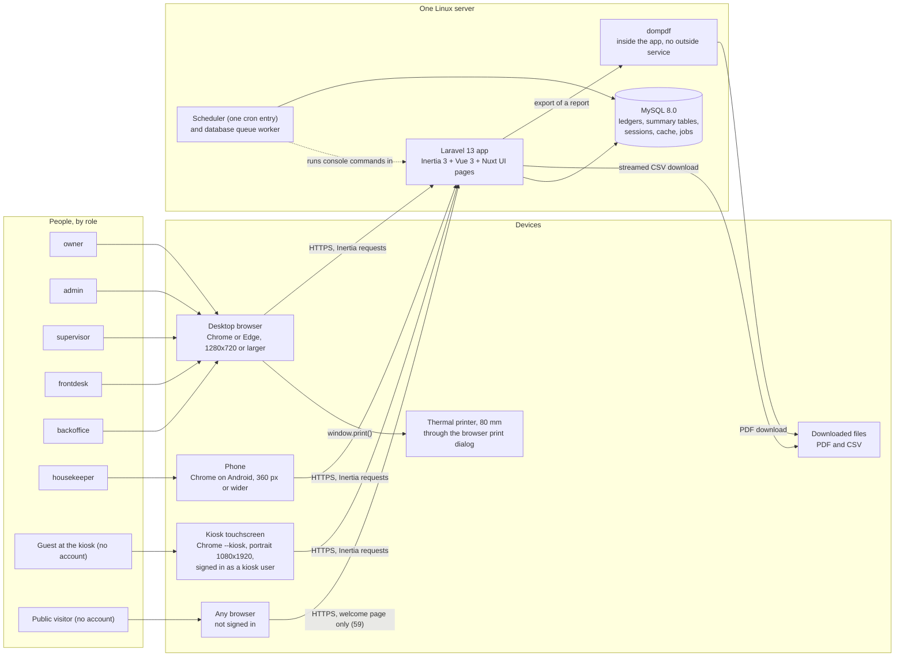
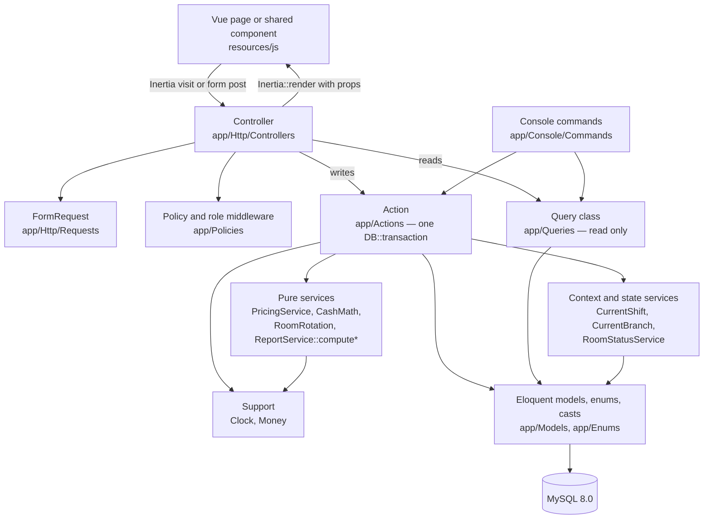
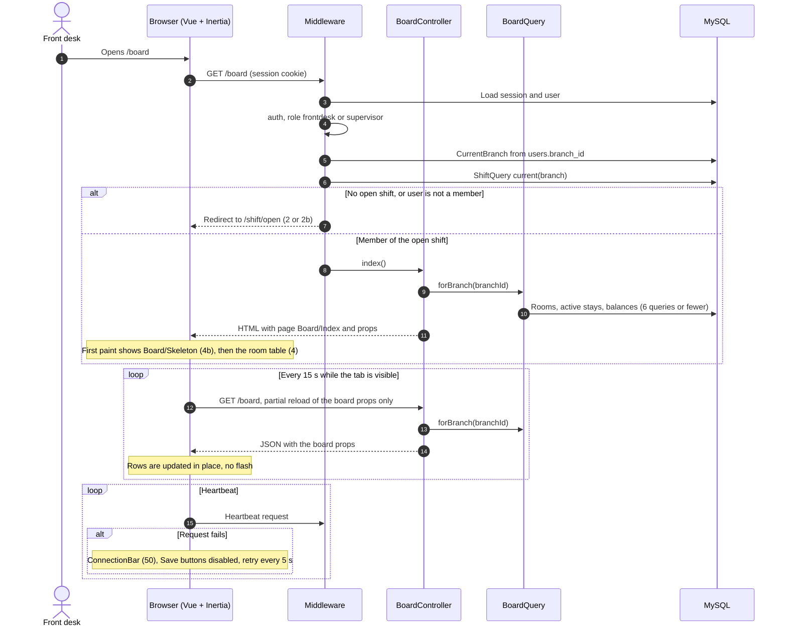
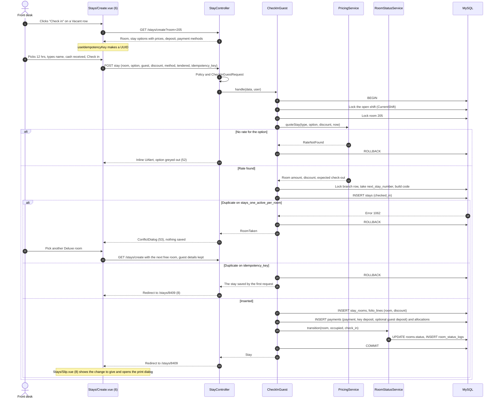
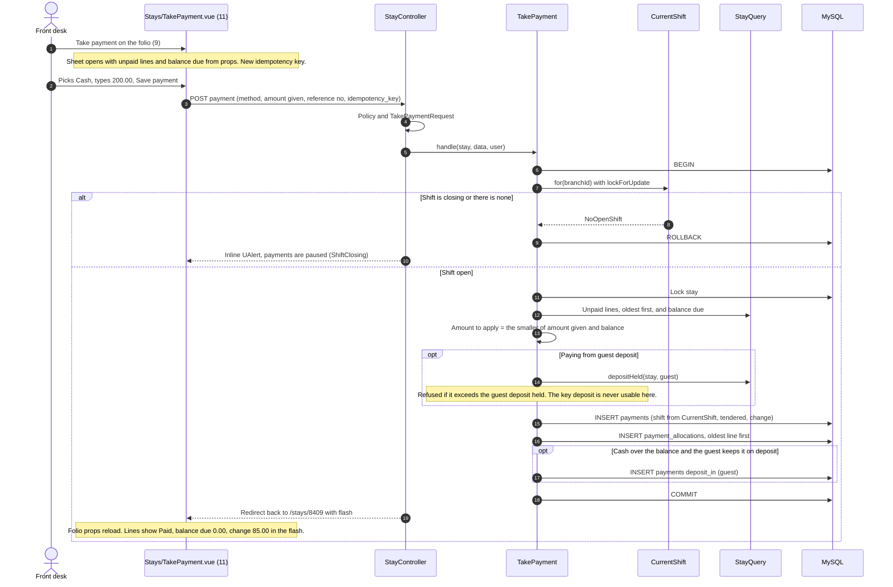
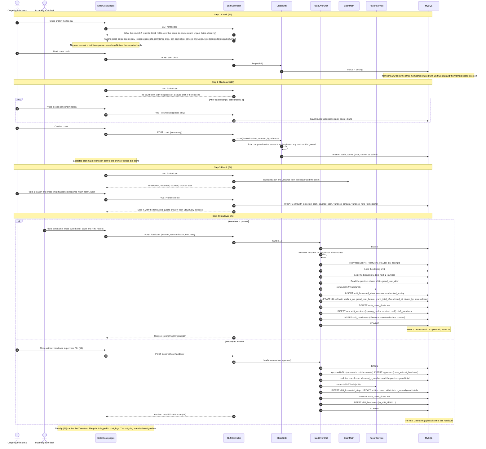
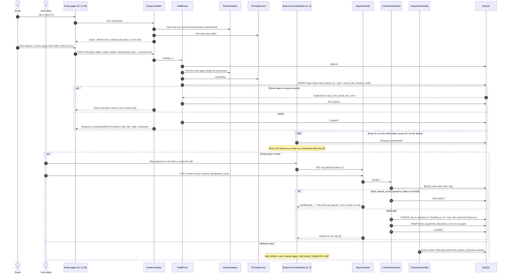
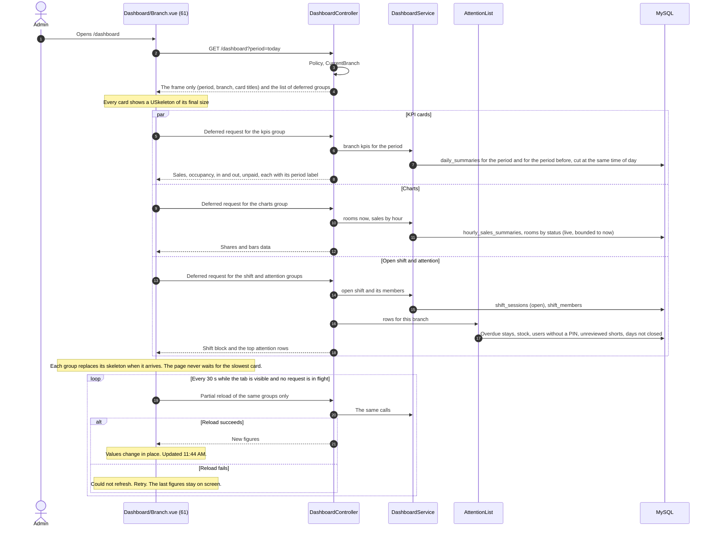
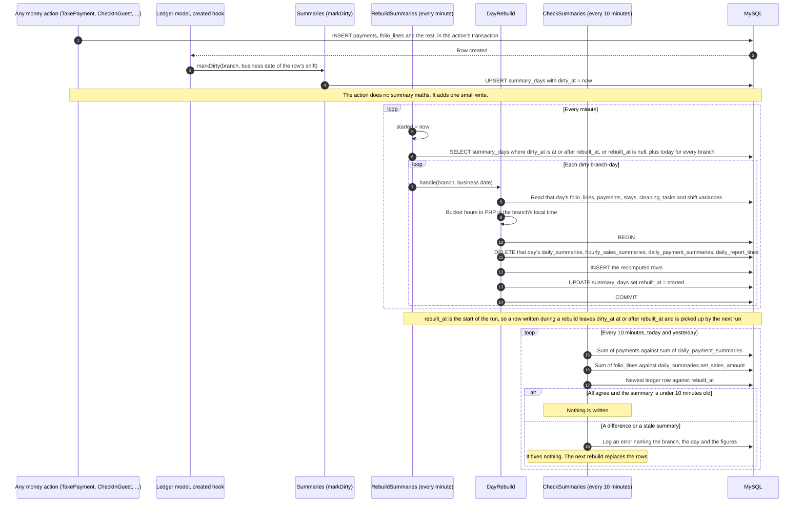

# System Design — Homi

| | |
|---|---|
| Version | 1.1 · 11 November 2026 (Nuxt UI, dashboards, Z-report, shift safeguards) |
| Status | Approved with mockup v3 |
| Stack | Laravel 13 · Inertia 3 · Vue 3 · Tailwind CSS 4 · Nuxt UI v4 · MySQL 8.0 |
| Wins on conflict | No. Table, column and enum names: [DATABASE_SCHEMA](DATABASE_SCHEMA.md). Technical rules, formulas, budgets: [TRD](TRD.md). Screen numbers and look: [mockup](mockup/hotel-mockup.html). |
| Related | [PRD](PRD.md) · [TRD](TRD.md) · [DATABASE_SCHEMA](DATABASE_SCHEMA.md) · [APP_FLOW](APP_FLOW.md) · [DESIGN_SYSTEM](DESIGN_SYSTEM.md) · [ASSETS](ASSETS.md) · [ROADMAP](ROADMAP.md) · [mockup](mockup/hotel-mockup.html) |

Homi is the rebuild of HotelV2. This document says how the pieces fit together: who uses what, which layer may do what, where every file lives, and how the seven most important flows run. It does not restate SQL, pricing formulas or cash formulas; it links to them. Screen numbers (1–63, and the variants 2b, 4b, 4c, 31b, 37b, 37c, 38b) are the mockup's numbers.

Sample data everywhere is the made-up "Hotel Dalisay GenSan".

## 1. Context

One installation serves one owner and all their branches. There are no external services: no payment gateway, no SMS, no websockets, no paid API ([TRD §2](TRD.md#2-allowed-dependencies), [TRD §6](TRD.md#6-platform-specifics)). The only things that leave the server besides pages are files a signed-in user asks for: PDF and CSV exports of reports.



| Actor | Device | Layout | Home after sign-in | Screens |
|---|---|---|---|---|
| owner | Desktop | `OwnerLayout`; `AdminLayout` after opening a branch | `/owner` (60) | 60, 39, 55, 56, and 36–49, 61, 63, 38b for any branch |
| admin | Desktop | `AdminLayout` | `/dashboard` (61) | 61, 63, 44–49, 36–43, 37b, 37c, 38b |
| supervisor | Desktop | `FrontDeskLayout` | `/today` (62) | 62, 2–26, 57, 58, 49, 61, 63, reports 36–43, 37b, 37c; approves by PIN (14) |
| frontdesk | Desktop | `FrontDeskLayout` | `/today` (62), or `/shift/open` (2, 2b) when the user is not on an open shift | 62, 2–26, 57, 58 |
| backoffice | Desktop | `BackOfficeLayout` | `/dashboard` (61) | 61, 63, 36–43, 37b, 37c, 38b |
| housekeeper | Phone | `PhoneLayout` | `/housekeeping` (32) | 32–35 |
| kiosk | Kiosk touchscreen | `KioskLayout` | `/kiosk` (27) | 27–31b |
| public visitor | Any browser | none (public page) | — | 59 only; "Staff sign in" leads to 1 |

The home is not hard-coded per role in Vue: it is the first page of the user's server-built navigation (section 4.3). The full permission matrix is in [TRD §4.1](TRD.md#41-roles-and-permissions).

Exports: the Z-report and the day Z as PDF and CSV, other reports as CSV ([TRD §6](TRD.md#6-platform-specifics)). They need the reports permission, are built from the same array as the screen, and every print and export writes a `print_logs` row.

## 2. Layers



### Layer rules

| Layer | May | May not |
|---|---|---|
| Vue page (`Pages/`) | Display props, hold form state, call routes through Ziggy, format with `formatMoney()` and `formatDateTime()` | Compute a price, total, balance, change owed to the ledger, or a permission. Amounts arrive as integer centavos and are only formatted. No hex colours. |
| Shared component (`Components/`) | Render one building block from [DESIGN_SYSTEM §5](DESIGN_SYSTEM.md#5-components) — a Nuxt UI component where one exists, our own otherwise — and emit events | Call routes, read `usePage()` shared props (except the app shell pieces, `ConnectionBar`, `OverdueBar`, `PinSwitch`, `ApprovalPin`), know about a screen |
| Controller | Authorise (policy), call one FormRequest, call one Action or Query classes, return an Inertia response or redirect | Hold business logic, use `DB`, build queries (arch test: controllers do not use `DB`), read the clock |
| FormRequest | Validate shape, types, lengths, existence; carry the `idempotency_key` | Decide prices or availability; touch the database beyond `exists` rules |
| Policy / `role` middleware | Answer "may this user do this on this branch" from `users.role` and `CurrentBranch` | Read shift state from the user row (there is none) |
| Action | Open exactly one `DB::transaction($fn, attempts: 3)`, take locks in the order in [DATABASE_SCHEMA §8](DATABASE_SCHEMA.md#8-business-transactions), write rows, call services | Call another action's `handle()` outside its own transaction; call `now()`; take a shift id, price or total from the request |
| Query class | Read with eager loading, return arrays or DTOs for props and reports | Write anything; lazy-load (prevented in non-production) |
| Pure service | Take values in, return values out | Read globals, the clock, the session or the request; write to the database |
| `CurrentShift` | Return the open shift of a branch, locked `FOR UPDATE` inside a transaction | Accept a shift id from anywhere else |
| `CurrentBranch` | Return the branch for this request (user's `branch_id`, or the branch an owner opened, from the server session) | Trust a branch id from the browser |
| `RoomStatusService` | Be the only writer of `rooms.status`; lock the room, check the move, write `room_status_logs` | Be bypassed by a direct model update |
| Model | Relationships, casts (`Money`, enums, `immutable_datetime`), `BelongsToBranch`, `AppendOnly` | Business rules, pricing, report maths |
| `DashboardService`, `StatsService` | Read the summary tables, plus live state bounded to now (the open shift and its members, rooms by status, in-house stays, kiosk holds); return arrays for deferred props | Aggregate `folio_lines` or `payments` in a request; send collected amounts or expected cash to a front desk user ([TRD §4.11](TRD.md#411-dashboards-stats-and-summaries)) |
| Summaries (`app/Summaries`) | Mark a branch-day dirty when a ledger row is written; rebuild one branch-day from the ledgers and replace its summary rows in one transaction | Be read by a closed-shift report (37, 37b, 37c, 38, 38b read `totals`, `shift_forwarded_stays` and `day_closings`); hold anything that cannot be rebuilt |
| Report builder and exports | `ReportService::zReport()` returns one array of sections and lines; the Vue paper, the 80 mm slip, the Blade PDF view and the CSV only render it | Compute a figure of their own in any format |
| Console command | Call an Action, a Query or a summary class on a schedule, write `audit_logs` | Fix ledger data automatically (see `CheckInvariants`) |

The eleven architecture requirements these rules come from are in [TRD §3](TRD.md#3-architecture-requirements).

## 3. Folder tree

Numbers in brackets are mockup screens. Files marked † are named by convention here because the sources name the folder but not the file.

```text
HotelV4/
├─ app/
│  ├─ Actions/
│  │  ├─ Auth/
│  │  │  ├─ VerifyPin.php                 (3) switch user, incoming front desk at handover (25); writes pin_attempts
│  │  │  ├─ ApproveByPin.php              (14) writes approvals and pin_attempts
│  │  │  └─ UnlockPin.php                 a supervisor or admin unlocks PIN entry on a computer with their own password
│  │  ├─ Stays/
│  │  │  ├─ CheckInGuest.php              (6, 8; also a reserved stay from 57)
│  │  │  ├─ ConfirmKioskHold.php          (7)
│  │  │  ├─ HoldRoom.php                  (30)
│  │  │  ├─ ReserveRoom.php               (58)
│  │  │  ├─ AddCharges.php                (10; POS room charge 19)
│  │  │  ├─ TakePayment.php               (11, 17)
│  │  │  ├─ ExtendStay.php                (12)
│  │  │  ├─ TransferRoom.php              (13)
│  │  │  ├─ VoidLine.php                  (15)
│  │  │  ├─ CancelStay.php                (15)
│  │  │  └─ CheckOutGuest.php             (16–18)
│  │  ├─ Shifts/
│  │  │  ├─ OpenShift.php                 (2)
│  │  │  ├─ JoinShift.php                 (2b)
│  │  │  ├─ RecordCashMovement.php        (21)
│  │  │  ├─ VoidCashMovement.php          (21)
│  │  │  ├─ SaveCountDraft.php            (23) autosave of the pieces being typed, cash_count_drafts
│  │  │  ├─ CloseShift.php                (22–24; force close from 49)
│  │  │  └─ HandOverShift.php             (25) assigns the Z number and the grand total
│  │  ├─ Reports/
│  │  │  └─ CloseDay.php                  (38b) day_closings, day Z number
│  │  ├─ Pos/
│  │  │  ├─ CompleteSale.php              (19)
│  │  │  ├─ VoidSale.php                  (19)
│  │  │  ├─ ReceiveStock.php              (20)
│  │  │  └─ RecordWastage.php             (20)
│  │  ├─ Housekeeping/
│  │  │  ├─ StartCleaning.php             (32)
│  │  │  ├─ FinishCleaning.php            (33)
│  │  │  └─ ResetCleaning.php             (49)
│  │  └─ Owner/
│  │     └─ CreateBranch.php              (56)
│  ├─ Services/
│  │  ├─ PricingService.php               (6, 7, 12, 13, 28, 58) quoteStay, quoteExtension, quoteTransfer
│  │  ├─ CashMath.php                     (24, 37) expected cash, variance, roll-forwards
│  │  ├─ RoomRotation.php                 (28)
│  │  ├─ RoomStatusService.php            only writer of rooms.status
│  │  ├─ ReportService.php                (36–43, 37b, 37c, 38b, 39) computeShiftTotals, shift, zReport (the one builder array
│  │  │                                   of sections and lines), daily, summary, occupancy, housekeeping, inventory
│  │  ├─ ZReportExport.php                (37b, 38b) renders the zReport array as PDF (dompdf) and as streamed CSV; writes print_logs
│  │  ├─ DashboardService.php             (60, 61, 62) owner(), branch(), today() — summary tables + live state
│  │  ├─ StatsService.php                 (63) range totals, comparison, grain by hour / day / month
│  │  ├─ AttentionList.php                (49, 60, 61) the one builder of "Needs attention" rows: severity, sentence, route
│  │  ├─ CurrentShift.php
│  │  └─ CurrentBranch.php
│  ├─ Summaries/
│  │  ├─ Summaries.php                    marks summary_days.dirty_at; called from the ledger models' created hook
│  │  └─ DayRebuild.php                   recomputes one branch-day from the ledgers and replaces its summary rows
│  ├─ Support/
│  │  ├─ Clock.php                        wraps CarbonImmutable; toLocal()
│  │  └─ Money.php                        integer centavos value object
│  ├─ Queries/
│  │  ├─ BoardQuery.php                   (4)
│  │  ├─ StayQuery.php                    (5, 9, 11, 17, 22, 25, 57)
│  │  ├─ RoomQuery.php                    (6, 13, 28, 58)
│  │  ├─ ShiftQuery.php                   (everywhere, 24, 37, 37b, 37c, 61)
│  │  ├─ ReportQuery.php                  (20, 37–42, 37b, 37c)
│  │  └─ CleaningQuery.php                (32)
│  ├─ Enums/                              one backed enum per MySQL ENUM column
│  │  ├─ Role.php                         owner, admin, supervisor, frontdesk, backoffice, housekeeper, kiosk
│  │  ├─ StayState.php · RoomStatus.php · LineKind.php · PaymentKind.php · CashMovementKind.php
│  │  └─ …one more per remaining ENUM column in DATABASE_SCHEMA §4 †
│  ├─ Models/
│  │  ├─ Concerns/BelongsToBranch.php †   global scope from CurrentBranch
│  │  ├─ Concerns/AppendOnly.php †        throws on update and delete
│  │  ├─ Branch · User · ShiftDefinition · Floor · RoomType · Room · RoomStatusLog
│  │  ├─ Rate · ExtensionRate · Discount · TransferReason · ExpenseCategory
│  │  ├─ ShiftSession · ShiftMember · CashCount · ShiftHandover · ShiftForwardedStay · CashMovement
│  │  ├─ Stay · StayRoom · FolioLine · Payment · PaymentAllocation
│  │  ├─ Product · ProductPriceLog · StockMovement · PosOrder
│  │  ├─ CleaningTask · Approval · AuditLog
│  │  ├─ DayClosing · CashCountDraft · Reason · PinAttempt · PinLock · PrintLog
│  │  └─ SummaryDay · DailySummary · HourlySalesSummary · DailyPaymentSummary · DailyReportLine †
│  ├─ Casts/MoneyCast.php †               on every *_amount and *_cash column
│  ├─ Exceptions/ †                       DomainException subclasses: RoomTaken, HoldExpired, RateNotFound,
│  │                                      InsufficientStock, NoOpenShift, BalanceNotZero, NotAvailable, PinInvalid,
│  │                                      ShiftAlreadyOpen, RoomNotAvailable, ShiftClosing, NotEnoughCash, PinLocked,
│  │                                      DayNotClosable
│  ├─ Http/
│  │  ├─ Controllers/
│  │  │  ├─ AuthController.php            (1)
│  │  │  ├─ WelcomeController.php †       (59) public
│  │  │  ├─ DashboardController.php †     (60, 61, 62)
│  │  │  ├─ StatsController.php †         (63)
│  │  │  ├─ BoardController.php           (4, 4b, 4c, 5)
│  │  │  ├─ StayController.php            (6–18)
│  │  │  ├─ ShiftController.php           (2, 2b, 3, 21–26)
│  │  │  ├─ PosController.php             (19)
│  │  │  ├─ StockController.php           (20)
│  │  │  ├─ KioskController.php           (27–31b)
│  │  │  ├─ HousekeepingController.php    (32–35)
│  │  │  ├─ ReportController.php          (36–38, 37b, 37c, 38b, 40–43; PDF and CSV exports)
│  │  │  ├─ ReservationController.php     (57, 58)
│  │  │  ├─ Admin/RoomController.php      (44)
│  │  │  ├─ Admin/RateController.php      (45)
│  │  │  ├─ Admin/SettingController.php   (46)
│  │  │  ├─ Admin/UserController.php      (47)
│  │  │  ├─ Admin/ProductController.php   (48)
│  │  │  ├─ Admin/ExceptionController.php (49)
│  │  │  ├─ Owner/BranchController.php    (55, 56)
│  │  │  └─ Owner/SummaryController.php   (39)
│  │  ├─ Middleware/
│  │  │  ├─ HandleInertiaRequests.php     shared props (section 4.3), including the permission-filtered navigation
│  │  │  └─ role, shift-membership, module and device-key (PIN lockout cookie) checks †
│  │  └─ Requests/                        one FormRequest per Action, named <Action>Request †
│  ├─ Policies/                           one per model that a controller authorises against †
│  ├─ Console/Commands/
│  │  ├─ RebuildSummaries.php             every minute (60–63)
│  │  ├─ CheckSummaries.php               every 10 minutes, today and yesterday
│  │  ├─ ExpireKioskHolds.php             every minute
│  │  ├─ ReleaseNoShows.php               every 5 minutes
│  │  ├─ ReconcileBusinessDay.php         daily 09:00 Asia/Manila (36, 38)
│  │  └─ CheckInvariants.php              daily 09:05 Asia/Manila (49)
│  └─ Providers/AppServiceProvider.php    binds Clock; Model::preventLazyLoading() outside production
├─ config/
│  └─ hotel.php                           name ('Homi'), display_timezone, PIN length 4, login lock 5 tries / 15 min,
│                                         board refresh 15 s, kiosk refresh 20 s (TRD §3.9), dashboard refresh 30 s,
│                                         PIN lockout after 10 wrong tries per computer (TRD §4.11, §4.12)
├─ database/
│  ├─ migrations/                         2026_11_12_000001 … 000031, listed in DATABASE_SCHEMA §6
│  ├─ factories/                          one per model
│  └─ seeders/                            DatabaseSeeder, OwnerSeeder, BranchSeeder, ShiftDefinitionSeeder, RoomSeeder,
│                                         RateSeeder, ExtensionRateSeeder, DiscountSeeder, ListSeeder, ProductSeeder,
│                                         UserSeeder, DemoShiftSeeder (local only)
├─ resources/
│  ├─ css/app.css                         @import "tailwindcss" and "@nuxt/ui"; the --hm-* token layer, light and dark; the --ui-*
│  │                                      mapping; @theme blocks (DESIGN_SYSTEM §2); font faces; .dtable; print styles
│  ├─ fonts/                              self-hosted Geist and Geist Mono woff2 (ASSETS §1)
│  ├─ images/brand/                       homi-logo.png, homi-logo-white.png (ASSETS §1)
│  ├─ images/photos/                       sign-in, welcome, kiosk and room-type photographs (ASSETS §2); room-{slug}.jpg per room type
│  ├─ views/app.blade.php                 the single Inertia root view
│  ├─ views/reports/zreport.blade.php     the PDF twin of the Z paper (37b, 38b): renders the same builder array for dompdf
│  └─ js/
│     ├─ app.ts                           Inertia + Vue bootstrap; .use(ui) from '@nuxt/ui/vue-plugin'; Ziggy; layout resolver;
│     │                                   the root render wraps every page in <UApp> (toaster, tooltips, overlays)
│     ├─ Layouts/
│     │  ├─ FrontDeskLayout.vue · BackOfficeLayout.vue · AdminLayout.vue · OwnerLayout.vue    thin wrappers over the app shell
│     │  └─ KioskLayout.vue · PhoneLayout.vue
│     ├─ Components/                      our own building blocks, DESIGN_SYSTEM §5.2 (Nuxt UI covers the rest, §5.1)
│     │  ├─ SidebarNav · TopBar · PageHeader · UserMenu                                       the app shell pieces
│     │  ├─ StatCard · StatCards · PeriodSegments · StatusLabel · AttentionList
│     │  ├─ DataTable · ListCard · Pager · EmptyState · ExportMenu
│     │  ├─ RoomTable · RoomRow · MoneyInput · MoneyRow · TotalRow · OptionTiles · StepBar · PinPad
│     │  ├─ ConfirmDialog · Slip · ZPaper · PhotoHero · SignInPanel · RoomTypeCard
│     │  ├─ ConnectionBar (50) · OverdueBar (54) · PinSwitch (3) · ApprovalPin (14) · ConflictDialog (53)
│     │  ├─ Kiosk/ †                      KioskStepBar · KioskTypeCard · KioskFooter · KioskHoldCard
│     │  ├─ Phone/ †                      PhoneHeader · TaskCard · CleanTimer
│     │  ├─ Charts/                       VBars · HBars · Shares · HeatGrid · Spark · ChartTip · chart.ts (shared helpers)
│     │  └─ __tests__/                    Vitest: MoneyInput, PinPad, OptionTiles, RoomTable, ConfirmDialog
│     ├─ Composables/
│     │  ├─ useMoney.ts                   formatMoney()
│     │  ├─ useDateTime.ts †              formatDateTime(), durations
│     │  ├─ usePolling.ts                 Inertia partial reload on an interval; skips while hidden or in flight
│     │  ├─ useIdempotencyKey.ts          UUID made when a form opens
│     │  ├─ useConnection.ts              heartbeat state for ConnectionBar
│     │  ├─ useFlashToast.ts †            turns the flash `toast` into a Nuxt UI toast, once per flash
│     │  ├─ useConfirmDialog.ts           promise-based ConfirmDialog through Nuxt UI's useOverlay()
│     │  └─ useKioskIdle.ts †             back to the kiosk welcome after 60 s
│     └─ Pages/
│        ├─ Welcome.vue                   (59) public
│        ├─ Auth/Login.vue                (1)
│        ├─ Dashboard/
│        │  └─ Owner.vue (60) · Branch.vue (61) · Today.vue (62)
│        ├─ Stats/Index.vue               (63)
│        ├─ Shift/
│        │  ├─ Open.vue (2) · Join.vue (2b) · Cash.vue (21) · ReportSlip.vue (26)
│        │  └─ Close/Check.vue (22) · Count.vue (23) · Result.vue (24) † · Handover.vue (25) †
│        ├─ Board/
│        │  └─ Index.vue (4, 4c) · Skeleton.vue (4b) · KioskHolds.vue (5)
│        ├─ Stays/
│        │  ├─ Create.vue (6, 52, 53) · ConfirmHold.vue (7) · Slip.vue (8)
│        │  ├─ Show.vue (9) · FolioTable.vue (9) · AddCharge.vue (10) · TakePayment.vue (11, 17)
│        │  ├─ Extend.vue (12) · Transfer.vue (13)
│        │  └─ Checkout/Returns.vue (16) · Settle.vue (17) † · Done.vue (18)
│        ├─ Pos/Index.vue                 (19)
│        ├─ Stock/Index.vue               (20)
│        ├─ Reservations/Index.vue (57) · Create.vue (58)
│        ├─ Kiosk/
│        │  └─ Welcome.vue (27) · PickRoom.vue (28) · Details.vue (29) · Held.vue (30) · NoRooms.vue (31) · Offline.vue (31b)
│        ├─ Housekeeping/
│        │  └─ Queue.vue (32, 35) · Task.vue (33) · History.vue (34)
│        ├─ Reports/
│        │  └─ Hub.vue (36) · Shift.vue (37) · ZReport.vue (37b, 37c) · Daily.vue (38) · CloseDay.vue (38b)
│        │     Occupancy.vue (40) · Housekeeping.vue (41) · Inventory.vue (42) · Audit.vue (43)
│        ├─ Admin/
│        │  └─ Rooms.vue (44) · Rates.vue (45) · Settings.vue (46) · Users.vue (47) · Products.vue (48) · Exceptions.vue (49)
│        ├─ Owner/
│        │  └─ Branches.vue (55) · BranchForm.vue (56) · Summary.vue (39)
│        ├─ Errors/Forbidden.vue          (51)
│        └─ Dev/Components.vue †          component gallery at /dev/components, local only (ROADMAP phase 1)
├─ routes/
│  ├─ web.php                             / (59); requires the seven files below; heartbeat; /dev/components when local
│  ├─ auth.php                            /login, sign out, switch user by PIN
│  ├─ frontdesk.php                       /today, /shift*, /board, /stays*, /pos, /stock, /reservations*
│  ├─ kiosk.php                           /kiosk*
│  ├─ housekeeping.php                    /housekeeping*
│  ├─ reports.php                         /dashboard, /stats, /reports*
│  ├─ admin.php                           /admin/*
│  ├─ owner.php                           /owner, /owner/*
│  └─ console.php                         the six scheduled commands
├─ vite.config.ts                         laravel, tailwindcss, vue and the Nuxt UI plugin: ui({ router: 'inertia', ui: { colors:
│                                         { primary: 'homi', neutral: 'neutral' }, button, modal, … } }) (DESIGN_SYSTEM §2.2, §5.1)
├─ tests/
│  ├─ Unit/                               PricingService, CashMath, Money, RoomRotation, enums, ReportService::compute*, the zReport lines
│  ├─ Feature/                            every Action; dashboards, summaries, exports, shift safeguards; runs on MySQL
│  ├─ Reconciliation/                     invariants 1–8 after scripted multi-shift scenarios; rebuild equals the ledgers
│  ├─ Arch/                               no now() in app/, controllers do not use DB, models use BelongsToBranch, no float money casts,
│  │                                      front desk pages carry no expected_cash
│  └─ Support/ †                          invariants helper, query counter
└─ docs/
   ├─ PRD.md · TRD.md · DATABASE_SCHEMA.md · SYSTEM_DESIGN.md · APP_FLOW.md
   ├─ DESIGN_SYSTEM.md · ASSETS.md · ROADMAP.md
   └─ mockup/hotel-mockup.html
```

## 4. Framework conventions

### 4.1 Laravel

| Topic | Convention |
|---|---|
| Controllers | Thin. Resourceful where the screen is a resource (`Admin/RoomController`), one invokable controller per odd action ([TRD §12](TRD.md#12-coding-conventions)). A write method is always: authorise → FormRequest → `Action::handle()` → redirect. A read method is always: authorise → Query class → `Inertia::render()`. |
| Form requests | One per Action, name ends in `Request`. Validation only. The four idempotent forms (check-in, kiosk hold, POS sale, payment) require `idempotency_key` as a UUID. No request ever carries a price, a total, a shift id or a branch id that the server trusts. |
| Actions | One class, one public `handle()`, one `DB::transaction($fn, attempts: 3)`. Verb-first names. Shared steps live in services. "Continue into" flows (`AddCharges` → payment, `ExtendStay` → payment, `CheckOutGuest` → payment) run inside the first action's transaction. |
| Policies | Every controller method calls a policy. The `role` middleware guards route groups; policies guard the record (same branch, right state). An approver must be a different user from the requester ([TRD §9](TRD.md#9-security-and-privacy)). |
| Enums | PHP backed enums in `app/Enums`, string values identical to the MySQL ENUM values. Cast on the model. No magic strings in code or Vue; Vue receives the enum value and a label. |
| Casts | `MoneyCast` on every `*_amount` and `*_cash` column, enum casts on every ENUM column, `immutable_datetime` on every timestamp. |
| Global scopes | `BelongsToBranch` on every operational model adds `where branch_id = CurrentBranch`. Console commands loop over branches and set `CurrentBranch` explicitly. An arch test asserts the trait is present. |
| Append-only | Models for the tables listed in [DATABASE_SCHEMA §1](DATABASE_SCHEMA.md#1-conventions) use `AppendOnly`. A correction is a new row. |
| Time | Only `App\Support\Clock`. Stored UTC, shown in `config('hotel.display_timezone')` (`Asia/Manila`) through `Clock::toLocal()` on the server and `formatDateTime()` in Vue. |
| Config | Product-wide constants in `config/hotel.php`, including the product name (`name` = `Homi`). Per-branch values on `branches`, read through the `Branch` model. |
| Errors | Domain errors are `DomainException` subclasses with a user message, rendered by one handler (section 8). |

### 4.2 Routes

`routes/web.php` only requires the area files, so each area's middleware is declared once.

| File | URL prefixes | Middleware | Screens |
|---|---|---|---|
| `web.php` | `/` | none (public); signed-in staff see "Dashboard" instead of "Staff sign in" | 59 |
| `auth.php` | `/login`, sign out, PIN switch | guest for `/login`; `auth` for the rest; login throttle 5 tries / 15 minutes; device key for PIN routes | 1, 3 |
| `frontdesk.php` | `/today`, `/shift/open`, `/shift`, `/shift/close`, `/shift/{id}/report`, `/board`, `/stays/*`, `/pos`, `/stock`, `/reservations*` | `auth`, `role:frontdesk,supervisor`, then shift membership on everything except `/shift/open`; module check for POS, stock and reservations | 62, 2–26, 52–54, 57, 58 |
| `kiosk.php` | `/kiosk`, `/kiosk/start`, `/kiosk/details`, `/kiosk/held/{code}` | `auth`, `role:kiosk`, kiosk module check | 27–31b |
| `housekeeping.php` | `/housekeeping`, `/housekeeping/{task}`, `/housekeeping/history` | `auth`, `role:housekeeper`, housekeeping module check | 32–35 |
| `reports.php` | `/dashboard`, `/stats`, `/reports`, `/reports/shifts/{id}`, `/reports/shifts/{id}/z` (`?tab=rooms` for 37c), `/reports/daily`, `/reports/daily/close`, `/reports/occupancy`, `/reports/housekeeping`, `/reports/inventory`, `/reports/audit` | `auth`, `role:backoffice,supervisor,admin,owner`; `/reports/daily/close` is refused to `supervisor` by its policy | 61, 63, 36–38, 37b, 37c, 38b, 40–43 |
| `admin.php` | `/admin/rooms`, `/admin/rates`, `/admin/settings`, `/admin/users`, `/admin/products`, `/admin/exceptions` | `auth`, `role:admin,owner`; `/admin/exceptions` also allows `supervisor` | 44–49 |
| `owner.php` | `/owner`, `/owner/branches`, `/owner/branches/create`, `/owner/summary` | `auth`, `role:owner` | 60, 39, 55, 56 |

Routes are named and used from Vue through Ziggy (`route('…')`); no URL is typed by hand in a page. A user who reaches a route their role cannot use gets HTTP 403 and screen 51. PDF and CSV exports are extra methods on the report routes; their URLs are listed in [APP_FLOW](APP_FLOW.md), not here.

Where each role lands after sign-in:

| Role | Lands on |
|---|---|
| frontdesk | `/today` (62); `/shift/open` (2, 2b) when the branch has no open shift or the user is not a member |
| supervisor | `/today` (62) |
| admin, backoffice | `/dashboard` (61) |
| owner | `/owner` (60) |
| housekeeper | `/housekeeping` (32) |
| kiosk | `/kiosk` (27) |

The landing page is not a table in code: it is the first visible entry of the navigation array in section 4.3.

### 4.3 Inertia

Shared props, set in `HandleInertiaRequests::share()` and available on every page:

| Prop | Content | Source |
|---|---|---|
| `auth.user` | id, name, username | `users` |
| `auth.role` | the `Role` enum value | `users.role` |
| `branch` | id, name, `status`; `null` for an owner who has not opened a branch (top bar shows "All branches") | `CurrentBranch` |
| `branch.modules` | `kiosk_enabled`, `reservations_enabled`, `pos_enabled`, `housekeeping_enabled` — menus hide switched-off modules | `branches` |
| `shift` | Summary of the open shift for front desk roles: id, `period_name`, `business_date`, `status`, member names, minutes past the defined end, whether it is past `shift_stale_block_minutes`; `null` when none. **Never includes expected cash, collected amounts or any figure they can be derived from.** | `ShiftQuery::current()` |
| `nav` | The navigation for this user: one array of groups, each item `{ key, label, route, icon, roles, subtitle }`, already filtered by role and by the branch's modules. The sidebar renders it as it comes. | `HandleInertiaRequests`, from one PHP list of every page |
| `pinLocked` | `true` when this computer has an open `pin_locks` row; PIN dialogs then show the locked state | `device_key` cookie, `pin_locks` |
| `flash` | `toast` (`{ type, title?, message }`), `error` (domain error message for an inline alert or dialog), `requestId` | `Inertia::flash()` / session flash |
| `errors` | Field errors from the last FormRequest | Inertia default |

Rule for every prop, shared or page: **a response to a front desk user never contains `expected_cash`, collected amounts or sales totals of an open shift.** The server leaves them out; hiding them in the template is not enough. An arch test asserts front desk pages carry no `expected_cash` ([TRD §4.11](TRD.md#411-dashboards-stats-and-summaries), [§4.12](TRD.md#412-shift-safeguards)).

| Topic | Convention |
|---|---|
| Page resolution | `Inertia::render('Stays/Create')` maps to `resources/js/Pages/Stays/Create.vue`. Each page declares its layout. |
| Partial reloads | A polling page reloads only its changing props with `router.reload({ only: [...] })`, so the shared props and static props are not re-sent. The board refresh must stay within the budget in [TRD §7](TRD.md#7-performance-budgets). |
| Polling | Through `usePolling(only, seconds)`: board 15 s (4), kiosk holds sheet 5 s (5), housekeeping queue 20 s (32, 35), kiosk availability 20 s (27, 31), dashboards, Today and Stats 30 s (60–63). Polling pauses while the tab is hidden, while a request is in flight and while `ConnectionBar` shows. Polls do not count as activity for the session lifetime. No websockets. |
| Deferred props | Every dashboard and stats figure is `Inertia::defer(fn () => …)`, grouped by card. The first response is only the frame (period, branch, card titles); each card shows a `USkeleton` inside `<Deferred>` until its group arrives. The 30 s poll reloads the same groups with `router.reload({ only: [...] })`. On failure the page shows "Could not refresh. Retry" and keeps the last figures. |
| Flash to toast | A controller that wants a toast calls `Inertia::flash(['toast' => ['type' => 'success', 'message' => 'Payment saved. Change ₱85.00']])` before its redirect; `type` is `success`, `error` or `info`, `title` is optional. The layout listens once (`useFlashToast`) and calls Nuxt UI's `useToast().add()`. A blocking domain error is not a toast: it is the `flash.error` alert or a dialog (section 8). |
| Navigation | Built on the server, shared as `nav`. One PHP array lists every page with `key`, `label`, `route`, `icon` (`i-lucide-*`), `roles` and `subtitle`; the middleware keeps the entries the user's role and the branch's modules allow. The user's "first visible page" is the redirect target after sign-in and the button on screen 51. Vue never decides what a role may see. |
| Forms | Inertia `useForm`. Buttons show the loading state while `form.processing` and are disabled while the connection bar shows. |
| Sheets and dialogs | Screens 3, 5, 10, 11, 14, 15 are components over their parent page, not routes (`USlideover`, `UModal`). They post to their own route and the parent page reloads its props. |
| First load | The first board load shows `Board/Skeleton.vue` (4b); later refreshes update rows in place. |

### 4.4 Nuxt UI

| Topic | Convention |
|---|---|
| Setup | `vite.config.ts` adds the plugin `ui({ router: 'inertia', ui: { colors: { primary: 'homi', neutral: 'neutral' }, … } })` from `@nuxt/ui/vite`; `app.ts` calls `.use(ui)` from `@nuxt/ui/vue-plugin`; `app.css` imports `tailwindcss` then `@nuxt/ui`. Theme values: [DESIGN_SYSTEM §2.2](DESIGN_SYSTEM.md#22-how-the-tokens-map-onto-nuxt-ui). |
| Router mode | `router: 'inertia'` makes `ULink` and any Nuxt UI component with a `to` prop use Inertia visits. Pages pass `:to="route('…')"`. |
| `UApp` | The root render wraps the resolved page and its layout in one `<UApp>`. It owns the toaster, tooltips and the overlay host that `useOverlay()` (and so `useConfirmDialog`) mounts into. Nothing else mounts a toaster. |
| Components | Nuxt UI first: `UButton`, `UFormField` + `UInput`, `USelect`, `USwitch`, `UCheckbox`, `UModal`, `USlideover`, `UDropdownMenu`, `UAlert`, `USkeleton`, `UTooltip`, `UAvatar`, `UCalendar`. Our own components only for what it lacks ([DESIGN_SYSTEM §5.2](DESIGN_SYSTEM.md#52-our-own-components)). Tables are plain `<table>` with the `.dtable` style. |
| Colour mode | Nuxt UI's colour mode (`useColorMode()` from `@vueuse/core`): Light, Dark or System in the user menu, stored in `localStorage`. Sign-in, welcome, kiosk and print are light only (class `hm-light`). |
| Icons | `i-lucide-*` names from the local `@iconify-json/lucide` set; nothing is fetched at runtime ([ASSETS §1.2](ASSETS.md#12-icons)). |
| Charts | Our own `Components/Charts/*`; no chart, table or date-picker library ([TRD §2](TRD.md#2-allowed-dependencies)). |

### 4.5 Vue

| Topic | Convention |
|---|---|
| Pages | One per route under `Pages/`, `<script setup lang="ts">`, props typed with `defineProps<{}>()`. The root element carries the mockup number comment, e.g. `<!-- Mockup 12 -->`. |
| Layouts | Six layouts (section 1). The four desktop layouts are thin wrappers over the same app shell (`SidebarNav`, `TopBar`, `UserMenu`) fed by the shared `nav`; a layout also owns `ConnectionBar` and, for front desk, `OverdueBar` and `PinSwitch`. The welcome page and sign-in use no layout. |
| Page actions | A page puts its buttons in `<PageHeader>`, which teleports them into the top bar beside the title. |
| Components | Nuxt UI components and the set of our own in [DESIGN_SYSTEM §5](DESIGN_SYSTEM.md#5-components). A page builds from these; a new visual pattern is added to the shared set and to the `/dev/components` gallery first. |
| Composables | `useMoney` (format centavos), `useDateTime` (Manila dates, durations, countdowns), `usePolling`, `useIdempotencyKey` (one UUID per form open, renewed only after a successful save), `useConnection` (heartbeat every 5 s while failing; exposes `online`), `useFlashToast`, `useConfirmDialog` (returns a promise). |
| State | No global store. Server state is Inertia props; everything else is local component state (section 7). |
| Styling | Nuxt UI's semantic utilities and the Homi token utilities only; no hex values, no palette classes, no `dark:` variants in pages. |

## 5. Key components

### 5.1 Actions

| Component | Responsibility | Depends on |
|---|---|---|
| `Auth/VerifyPin` | Check a user's 4-digit PIN for switch user (3) and for the incoming front desk (25); count wrong tries (3 → full sign-in) | `User`, `Clock` |
| `Auth/ApproveByPin` | Check an approver's PIN, role and branch, refuse self-approval, insert `approvals`; 5 wrong PINs lock that approver for 15 minutes | `User`, `Approval`, `CurrentBranch`, `Clock` |
| `Stays/CheckInGuest` | Walk-in or reserved check-in: stay, `stay_rooms`, room and discount lines, payment, deposits, room → occupied ([schema §8.1](DATABASE_SCHEMA.md#81-check-in-a-walk-in-checkinguest-screen-6)) | `CurrentShift`, `PricingService`, `RoomStatusService`, `Clock`, `Money` |
| `Stays/ConfirmKioskHold` | Turn a `held` stay into `checked_in`, restart the stay clock, take the money ([§8.2](DATABASE_SCHEMA.md#82-confirm-a-kiosk-hold-confirmkioskhold-screen-7)) | `CurrentShift`, `PricingService`, `RoomStatusService`, `Clock` |
| `Stays/HoldRoom` | Kiosk: create a `held` stay with `hold_expires_at`; price computed on the server | `RoomRotation`, `RoomQuery`, `PricingService`, `Clock` |
| `Stays/ReserveRoom` | Create a `reserved` stay after an overlap check; optional money paid ahead as guest deposit ([§8.7](DATABASE_SCHEMA.md#87-reserve-reserveroom-screen-58)) | `RoomQuery`, `PricingService`, `CurrentShift` (only when money is paid), `Clock` |
| `Stays/AddCharges` | `pos_orders` (room charge), folio lines, stock out; may continue into payment ([§8.3](DATABASE_SCHEMA.md#83-add-charges-addcharges-screen-10-also-pos-room-charge-19)) | `CurrentShift`, `Product`, `Clock` |
| `Stays/TakePayment` | One payment, allocations oldest line first, change or guest deposit ([§8.4](DATABASE_SCHEMA.md#84-take-payment-takepayment-screen-11)) | `CurrentShift`, `StayQuery`, `Money`, `Clock` |
| `Stays/ExtendStay` | Extension line, new expected check-out, `cycle_hours_used` ([§8.5](DATABASE_SCHEMA.md#85-extend-extendstay-screen-12)) | `CurrentShift`, `PricingService`, `Clock` |
| `Stays/TransferRoom` | Move a stay, price difference, old room to cleaning or maintenance ([§8.6](DATABASE_SCHEMA.md#86-transfer-transferroom-screen-13)) | `ApproveByPin`, `CurrentShift`, `PricingService`, `RoomQuery`, `RoomStatusService`, `Clock` |
| `Stays/VoidLine` | Reversal line, refund, stock back ([§8.9](DATABASE_SCHEMA.md#89-cancel-a-stay--void-a-line-cancelstay-voidline-screen-15)) | `ApproveByPin`, `CurrentShift`, `Clock` |
| `Stays/CancelStay` | Reverse every line, refund deposits, stay → cancelled, room → available | `ApproveByPin`, `CurrentShift`, `RoomStatusService`, `Clock` |
| `Stays/CheckOutGuest` | Damages, settle balance and deposits, stay → checked_out, room → uncleaned, cleaning task ([§8.8](DATABASE_SCHEMA.md#88-check-out-checkoutguest-screens-1618)) | `CurrentShift`, `StayQuery`, `RoomStatusService`, `Clock` |
| `Shifts/OpenShift` | Insert the one open `shift_sessions` row with period, business date and opening cash; link to a handover left without a receiver | `ShiftQuery`, `Clock` |
| `Shifts/JoinShift` | Insert `shift_members`; refuse above `max_frontdesks_per_shift` | `CurrentShift` |
| `Shifts/RecordCashMovement` | Insert an expense, remittance or shortage payment; idempotent by key; refuses an expense or remittance above the cash expected in the drawer at that moment (`NotEnoughCash`); enforces `needs_note` and `needs_manager` of the chosen category | `CurrentShift`, `CashMath`, `ApproveByPin`, `Clock` |
| `Shifts/VoidCashMovement` | Set the void columns on a movement of the open shift | `ApproveByPin`, `CurrentShift`, `Clock` |
| `Shifts/CloseShift` | Steps 1–3: status `closing`, `cash_counts`, expected cash and variance, frozen `totals`, `shift_forwarded_stays`, status `closed` ([§8.10](DATABASE_SCHEMA.md#810-close-a-shift-and-hand-over-closeshift-handovershift-screens-2225)) | `CurrentShift`, `CashMath`, `ReportService::computeShiftTotals`, `StayQuery::inHouse`, `Clock` |
| `Shifts/HandOverShift` | Step 4: verify the receiver (never the person who counted), take the branch's next Z number, chain the grand total, freeze `totals`, delete the count draft, open the next shift with the received cash, `shift_members`, `shift_handovers`; or record a close without handover | `VerifyPin`, `ApproveByPin`, `CloseShift` (inside its own transaction), `ReportService::computeShiftTotals`, `Clock` |
| `Pos/CompleteSale` | Walk-in sale paid in full, or room charge; stock out | `CurrentShift`, `Product`, `Clock` |
| `Pos/VoidSale` | Reverse a sale of the same shift, stock back | `ApproveByPin`, `CurrentShift`, `Clock` |
| `Pos/ReceiveStock` | `stock_movements` kind `receive`, update `stock_on_hand` | `CurrentShift`, `Product`, `Clock` |
| `Pos/RecordWastage` | `stock_movements` kind `wastage` with a note | `CurrentShift`, `Product`, `Clock` |
| `Housekeeping/StartCleaning` | Task → `in_progress`, room → cleaning; only a startable task, one per housekeeper | `CleaningQuery`, `RoomStatusService`, `Clock` |
| `Housekeeping/FinishCleaning` | Task → `done`, late flag, room → available or maintenance ([§8.11](DATABASE_SCHEMA.md#811-finish-cleaning-finishcleaning-screen-33)) | `RoomStatusService`, `Clock` |
| `Housekeeping/ResetCleaning` | A stuck task → `reset` from screen 49, room back to uncleaned and queued again | `RoomStatusService`, `Clock` |
| `Owner/CreateBranch` | New branch, first admin, optional copy of rates, settings, products and lists (never rooms, staff or money) | `Branch`, `User`, `Clock` |

### 5.2 Services and support

| Component | Responsibility | Depends on |
|---|---|---|
| `PricingService` | `quoteStay`, `quoteExtension`, `quoteTransfer`; throws `RateNotFound`, never returns ₱0. Rules: [TRD §4.2–4.4](TRD.md#42-stay-pricing-pricingservicequotestay) | Values passed in (rates, branch settings, stay), `Money` |
| `CashMath` | Expected cash, variance and the three roll-forwards. Formula: [TRD §4.5](TRD.md#45-cash-maths-cashmath) | `Money` |
| `RoomRotation` | Order candidate rooms for the kiosk. Rule: [TRD §4.8](TRD.md#48-kiosk-room-rotation-roomrotation) | Values passed in |
| `RoomStatusService` | `transition(room, status, reason)`: lock the room, check the move is allowed, update, write `room_status_logs` | `Room`, `RoomStatusLog`, `Clock` |
| `ReportService` | `computeShiftTotals` (pure, builds the `totals` JSON) and the readers `shift`, `zReport`, `daily`, `summary`, `occupancy`, `housekeeping`, `inventory`. Closed shifts are read from frozen `totals`, never recomputed. `zReport()` returns **one array of sections and lines** that the screen, the 80 mm slip, the PDF and the CSV all render; for an open shift it builds the same array live as a preview with no Z number ([TRD §4.10](TRD.md#410-z-numbers-grand-total-and-the-day-close)). | `ReportQuery`, `ShiftQuery`, `CashMath` |
| `ZReportExport` | Turns the `zReport()` array (shift Z or day Z) into a PDF through `resources/views/reports/zreport.blade.php` and dompdf, or into a streamed CSV (UTF-8 BOM; Section, Line, Count, Amount). Refuses a preview. Writes `print_logs` and marks reprints. | `ReportService`, `PrintLog`, `barryvdh/laravel-dompdf`, `Clock` |
| `DashboardService` | `owner()` (60), `branch()` (61), `today()` (62): one method per card group, each at most 3 queries, reading the summary tables plus live state bounded to now. Period comparison "by this time" for today; short and over summed separately. `today()` returns counts and names only. | Summary models, `ShiftQuery`, `BoardQuery`, `StayQuery`, `AttentionList`, `Clock` |
| `StatsService` | Range totals and series for 63; grain by hour up to 2 days, by day up to 62 days, by month beyond; comparison with the same-length period before, omitted when there is no previous data | Summary models, `Clock` |
| `AttentionList` | The one builder of "Needs attention" rows — each a severity, a sentence and a route — for a branch or for all branches. Dashboards show the top rows; screen 49 shows all. | `StayQuery`, `ShiftQuery`, `CleaningQuery`, `Product`, `User`, `AuditLog`, `DayClosing`, `config('hotel')` thresholds |
| `CurrentShift` | `for($branchId)`: the open shift, with `lockForUpdate()` inside a transaction; throws `NoOpenShift` | `ShiftQuery` |
| `CurrentBranch` | The branch of this request: the user's `branch_id`, or the owner's opened branch from the session | Auth user, server session |
| `Clock` | The only source of time; `toLocal()` for display and business dates | `CarbonImmutable` |
| `Money` | Integer centavos, arithmetic and half-up rounding | — |

### 5.3 Queries

Method lists are in [DATABASE_SCHEMA §7](DATABASE_SCHEMA.md#7-key-queries-repository-methods).

| Component | Responsibility | Depends on |
|---|---|---|
| `BoardQuery` | All active rooms with floor, type, active stay, balance due and today's reserved stay, in at most 6 queries for 300 rooms | `Room`, `Stay` |
| `StayQuery` | Folio, balance due, deposit held, in-house list, kiosk holds, reservations | `Stay`, `FolioLine`, `Payment` |
| `RoomQuery` | Free rooms for a type and period; next room for the kiosk | `Room`, `Stay` |
| `ShiftQuery` | Current shift, expected cash inputs, forwarded-in rows | `ShiftSession`, `ShiftForwardedStay`, `ShiftHandover` |
| `ReportQuery` | Sales by kind and by floor, room chart, occupancy, stock | Ledger models |
| `CleaningQuery` | A housekeeper's queue with the startable flag ([TRD §4.7](TRD.md#47-housekeeping-queue)) | `CleaningTask`, `User` |

### 5.4 Console commands

| Component | Responsibility | Depends on |
|---|---|---|
| `RebuildSummaries` | Every minute: for each dirty branch-day (and always today) run `DayRebuild`; sets `rebuilt_at` to the start time of the run | `Summaries\DayRebuild`, `SummaryDay`, `Clock` |
| `CheckSummaries` | Every 10 minutes, for today and yesterday: log an error if `Σ payments ≠ Σ daily_payment_summaries`, `Σ folio_lines ≠ daily_summaries.net_sales_amount`, or a summary is more than 10 minutes older than the newest ledger row. Never fixes anything; the next rebuild does. | Ledger models, summary models, `Clock` |
| `ExpireKioskHolds` | Every minute: `held` stays past `hold_expires_at` → `expired` | `Stay`, `Clock` |
| `ReleaseNoShows` | Every 5 minutes: `reserved` stays past `arrival_at + reservation_release_minutes` → `no_show`; money paid ahead stays as guest deposit | `Stay`, `Branch`, `Clock` |
| `ReconcileBusinessDay` | Daily 09:00 Asia/Manila: recompute yesterday's shifts from the ledger, compare with `totals`, write `reconcile.mismatch` to `audit_logs` (36, 38) | `ReportService`, `ReportQuery`, `AuditLog` |
| `CheckInvariants` | Daily 09:05: check invariants 1–8 ([TRD §8](TRD.md#8-reliability-and-error-handling)), write `invariant.failed` to `audit_logs` (49). Never fixes anything. | Invariants helper shared with tests, `AuditLog` |

### 5.5 Actions added in the cross-check

Rules: [TRD §4.9](TRD.md). Routes: [APP_FLOW §8](APP_FLOW.md).

| Component | Responsibility | Depends on |
|---|---|---|
| `Stays/ReleaseKioskHold` | Set a `held` stay to `cancelled` | `Stay`, `Clock` |
| `Stays/CancelReservation` | Cancel a `reserved` stay with reason and approval; refund or keep money paid ahead | `ApproveByPin`, `CurrentShift`, `Payment`, `FolioLine` |
| `Stays/RefundNoShow` | Settle money paid ahead on a `no_show` stay (refund or forfeit) with approval | `ApproveByPin`, `CurrentShift`, `Payment`, `FolioLine` |
| `Shifts/ForceCloseShift` | Count and freeze a shift left open, with approval; sets `is_force_closed` | `ApproveByPin`, `CashMath`, `ReportService` |
| `Auth/SetPin` | Store a user's own PIN hash at first sign-in | `User` |
| `Auth/ChangePassword` | Replace a temporary password | `User` |

### 5.6 Added in version 1.1 (Z-report, day close, dashboards, shift safeguards)

Rules: [TRD §4.10–4.12](TRD.md#410-z-numbers-grand-total-and-the-day-close). Tables: [DATABASE_SCHEMA §4.16](DATABASE_SCHEMA.md#416-tables-added-in-version-11). The services (`ZReportExport`, `DashboardService`, `StatsService`, `AttentionList`) and the commands (`RebuildSummaries`, `CheckSummaries`) are in 5.2 and 5.4.

| Component | Responsibility | Depends on |
|---|---|---|
| `Reports/CloseDay` (action) | Close a business day ([schema §8.10b](DATABASE_SCHEMA.md#810b-close-the-day-closeday-screen-38b)): lock the branch row; refuse with `DayNotClosable` while a shift of that date is not closed, an earlier day with shifts is not closed, or the reconcile found a mismatch; take `next_day_z_number`; insert `day_closings` with the first and last shift Z numbers, the grand totals, and short and over summed separately | `Branch`, `ShiftSession`, `DayClosing`, `AuditLog`, `Clock` |
| `Shifts/SaveCountDraft` (action) | Upsert `cash_count_drafts` for the closing shift after each change to the pieces (debounced 1 s in the browser); only the denominations are stored, any total sent is ignored; the row is deleted when the shift is frozen | `CurrentShift`, `CashCountDraft`, `Clock` |
| `Auth/UnlockPin` (action) | A supervisor or admin types their own password; set `unlocked_at` and `unlocked_by` on the open `pin_locks` row of this computer | `User`, `PinLock`, `Clock` |
| PIN lockout inside `VerifyPin` and `ApproveByPin` | Insert a `pin_attempts` row for every try (device key, account, context, result). Ten wrong tries in a row on one computer insert `pin_locks`; while a lock is open every PIN action throws `PinLocked`. Three wrong tries on switch-user still fall back to the full sign-in. | `PinAttempt`, `PinLock`, the `device_key` cookie |
| Closing guard inside every money action | When the shift is `closing`, a write by the outgoing team throws `ShiftClosing` and the form stays on screen with its input. When the shift is past `shift_stale_block_minutes`, payments and charges are refused until it is closed. | `CurrentShift`, `Branch`, `Clock` |
| `Summaries\Summaries` | `markDirty(branchId, businessDate)`: set `summary_days.dirty_at`. Called from the `created` hook of the ledger models, for the business date of the row's shift. Today is always treated as dirty, so counts that are not ledger rows (check-outs, finished cleans, a shift's short or over) are picked up within a minute. | `SummaryDay`, `Clock` |
| `Summaries\DayRebuild` | `handle(branchId, businessDate)`: recompute the day from the ledgers, bucket hours in PHP in the branch's local time, and in one transaction delete and re-insert that day's `daily_summaries`, `hourly_sales_summaries`, `daily_payment_summaries` and `daily_report_lines` rows | Ledger models, summary models, `Clock` |
| `PrintLog` writes | Every print and export of a slip or report inserts `print_logs` (document, format, user, shift); a second print of the same document sets `is_reprint`. Slip reprints are counted in the Z-report's exceptions. | `PrintLog`, `CurrentShift` |
| `created_by` on money rows | Every `folio_lines`, `payments`, `cash_movements`, `pos_orders` and `stock_movements` row records the person signed on at that computer (after a PIN switch, that person) as well as the shift; "By front desk" on 37b is built from it | Auth user, `CurrentShift` |

## 6. Sequence diagrams

### 6.1 Request lifecycle for a signed-in front desk user



Every Inertia response also carries the shared props of section 4.3, so the sidebar (the `nav` array) and the top bar (branch, shift status, user) are always from the server. After sign-in a front desk user lands on `/today` (62); the board is one click away and follows the lifecycle above. When the open shift is 30 minutes past its defined end (`shift_overdue_warn_minutes`), `shift` says so and `OverdueBar` (54) appears.

### 6.2 Walk-in check-in, including "room just taken"



### 6.3 Take payment



The shift stamped on the payment is whichever shift is open at commit time, never a value from the browser and never derived from who is signed in ([TRD §3.5](TRD.md#3-architecture-requirements)).

### 6.4 Close shift and hand over

Four steps on `/shift/close` (22–25). The step shown is derived from the database (`status`, whether `cash_counts` exists), so a refresh or a second computer lands on the same step. While the shift is `closing` its top-bar status reads "AM shift · closing" and payments by the outgoing team are refused.



Separation of duties: the person who counted cannot be the receiver and cannot approve their own variance; when a supervisor approves a variance the row is `approvals.action = 'approve_variance'` ([TRD §4.12](TRD.md#412-shift-safeguards)). `grand_total_after = grand_total_before + the shift's net sales`; shifts of a branch close in order, so the chain never forks.

What is frozen at close and never recalculated:

| Frozen item | Where | Read later by |
|---|---|---|
| `expected_cash`, `counted_cash`, `variance_amount`, `variance_note` | `shift_sessions` | 26, 37 |
| `totals` JSON (sales, counts, collected, deposits, unpaid, guests, cash, gross sales, discounts by name, payments by method, exceptions, by user, documents, VAT) — shape in [DATABASE_SCHEMA §4.7](DATABASE_SCHEMA.md#47-shift_sessions) | `shift_sessions.totals` | 26, 37, 37b, 37c, 38, 38b, 39 |
| `z_no`, `grand_total_before`, `grand_total_after` | `shift_sessions` | 26, 37b, 38b |
| One row per in-house stay: room, guest, expected check-out, unpaid, key deposit, guest deposit | `shift_forwarded_stays` | Shift N "forwarded out" and shift N+1 "forwarded in" (25, 37, 37b, 37c) |
| The day: `day_z_no`, net sales, short and over, grand totals, first and last shift Z | `day_closings`, written by `CloseDay` (38b) | 38b |

A force close from screen 49 is the same `CloseShift` path with a count, an approval (`force_close_shift`) and `is_force_closed = 1`; it gets a Z number too.

### 6.5 Kiosk hold → confirm → expiry



The kiosk returns to the welcome screen (27) 30 seconds after showing the hold, on Done, or after 60 seconds idle on any other kiosk screen.

### 6.6 Dashboard load: frame, deferred cards, poll

The same pattern serves the owner dashboard (60), the branch dashboard (61), Today (62) and Stats (63). The first response carries no figures, so it is fast whatever the period; each card then arrives on its own.



| Rule | Detail |
|---|---|
| What a card may read | Summary tables, plus live state bounded to now: the open shift and its members, rooms by status, in-house stays, kiosk holds. Never an aggregate over `folio_lines` or `payments` in the request ([TRD §4.11](TRD.md#411-dashboards-stats-and-summaries)). |
| Budget | First response ≤ 300 ms; each deferred group ≤ 300 ms and ≤ 3 queries ([TRD §7](TRD.md#7-performance-budgets)) |
| Who sees money | Owner, admin, back office and supervisor on 60, 61 and 63. Today (62) returns counts and names only; a front desk response never contains collected amounts or expected cash. |
| Session | A poll does not extend the session lifetime |
| Freshness | Summary rows are at most about a minute behind the ledger (section 6.7); the "Updated" time is the time of the last successful reload |

### 6.7 Summaries rebuild

Dashboards never add up the ledgers themselves. A ledger write only marks its day dirty; a command rebuilds dirty days every minute; a second command checks the result.



| Rule | Detail |
|---|---|
| One branch-day at a time | A rebuild replaces a whole day in one transaction, so a dashboard never reads half a day |
| Disposable | The summary tables hold nothing that cannot be rebuilt from the ledgers; truncating them loses nothing |
| Not for reports | Closed-shift and day reports (37, 37b, 37c, 38, 38b) read `shift_sessions.totals`, `shift_forwarded_stays` and `day_closings`, never these tables ([DATABASE_SCHEMA §4.16](DATABASE_SCHEMA.md#416-tables-added-in-version-11)) |
| Budget | One busy branch-day ≤ 2 s ([TRD §7](TRD.md#7-performance-budgets)) |

## 7. State ownership

| State | Lives in | Notes |
|---|---|---|
| Rooms, stays, folio lines, payments, shifts, stock, cleaning tasks, approvals, audit | Database | The only source of truth. Balance due, deposit held and line status are derived by `StayQuery`, never stored. |
| Which shift is open | Database (`shift_sessions.open_branch_id`) | Found only through `CurrentShift`. Nothing about shifts is stored on `users`, in the session or in the browser. |
| Who is on the shift | Database (`shift_members`) | Signing out or a session timeout does not change it. |
| Close-shift step (1–4) | Database (`shift_sessions.status`, presence of `cash_counts`) | Derived on every load of `/shift/close`. |
| Count draft (the pieces being typed on 23) | Database (`cash_count_drafts`, one row per closing shift) | Saved 1 s after each change, restored on reload or on another computer, deleted when the shift is frozen. Never in `localStorage`. |
| Frozen shift figures | Database (`shift_sessions.totals`, `z_no`, grand totals, `shift_forwarded_stays`) | Written once. |
| Closed day | Database (`day_closings`) | Written once by `CloseDay`. |
| Dashboard and stats figures | Database (summary tables), rebuilt every minute | Disposable copies of the ledgers; delivered as deferred props and replaced every 30 s. Never cached in the browser beyond the page. |
| Which days need a rebuild | Database (`summary_days.dirty_at`, `rebuilt_at`) | |
| Print and export history | Database (`print_logs`) | Decides whether a print is a reprint. |
| Signed-in user | Server session (database driver, 12-hour lifetime) | Kiosk user uses a 30-day remember token. |
| Owner's opened branch | Server session | Read by `CurrentBranch`. Cleared on sign-out. Never a query parameter the server trusts. |
| Wrong-PIN counter for switch user | Server session | 3 wrong → full sign-in. |
| Which computer this is | `device_key` cookie: a random UUID, long-lived, `http_only` and `secure`, set on the first visit | Identifies the computer for the PIN lockout only. It is not a login and carries no user data. Clearing it gives the computer a new key; the tries already logged stay in `pin_attempts`. |
| PIN tries and PIN lock per computer | Database (`pin_attempts`, `pin_locks`), keyed by `device_key` | 10 wrong in a row → locked until a supervisor or admin unlocks it with their own password (`UnlockPin`). |
| Login lock and approval lock | Database (`users.failed_logins`, `users.locked_until`) for login; cache (database driver) keyed by approver for the 15-minute approval lock | |
| Remembered branch for the sign-in facts (1) | Cookie holding only a branch id, long-lived, set at a successful sign-in on that computer | Lets `/login` show that branch's four facts (counts only, never money). No cookie → the greeting alone. An owner's sign-in does not set it. |
| Flash message, validation errors | Server session, one request | Delivered as the `flash` (`toast`, `error`) and `errors` props. |
| Auth user, role, branch, modules, shift summary, navigation | Inertia shared props | Re-sent on every full response. The navigation is built and filtered on the server. |
| Colour mode (Light, Dark, System) | `localStorage`, through Nuxt UI's colour mode | Per browser, not per user. Default Light. Ignored on sign-in, welcome, kiosk and print. |
| Sidebar collapsed to the icon rail | `localStorage` | Per browser. On a first visit under 1100 px wide it starts collapsed. |
| Page data (board, folio, report) | Inertia page props | Replaced by partial reloads. Not copied into a store. |
| Search text and floor filter on the board | URL query (`/board?q=`) and local state | Survives a refresh. |
| Report date, period and owner's branch picker; dashboard period; stats range; Z-report tab (`?tab=rooms`) | URL query | Shareable link. |
| Form fields, cash received, selected option tile | Local component state (`useForm`) | Lost on leaving the page, by design. |
| Check-out step 1 answers (key, remote, damages) | Local component state until the final save | Written only when Check out is pressed (16 → 17). |
| Kiosk choice of type and hours between 28 and 29 | URL query of `/kiosk/details` | No personal data in the URL; name and mobile stay in local state. |
| Idempotency key | Local component state (`useIdempotencyKey`) | New key per form open. |
| PIN digits | Local component state in `PinPad` | Cleared after every submit; never logged. |
| Countdown on a hold, time left on a board row, cleaning timer | Local component state, computed from server timestamps | The server decides expiry; the browser only displays. |
| Connection state | Local (`useConnection`) | Drives `ConnectionBar`. |
| Last-used board floor filter | `localStorage` | Convenience only; the board works without it. |
| Anything about money, guests, shifts or permissions | Never in `localStorage` or `sessionStorage` | `localStorage` holds exactly three things: colour mode, sidebar collapsed, board floor filter. |

## 8. Error handling

| Failure | Where caught | What the user sees |
|---|---|---|
| Validation error | FormRequest → 422 | Message under the field in red; the field gets the error ring. Save stays possible after correcting. |
| `RateNotFound` | Thrown by `PricingService`; domain handler | Screen **52**: the option tile is greyed with "no rate" and a red alert explains it. Same alert on Extend (12) and Transfer (13). Never ₱0. |
| `RoomTaken` (duplicate on `stays_one_active_per_room`, error 1062) | Action catches by constraint name; domain handler | Screen **53**: `ConflictDialog` "Room 205 was just taken", with "Pick another Deluxe room" (keeps the guest details) and "Back to board". On the kiosk: back to the room choice (28). |
| `RoomNotAvailable` | `CheckInGuest`, `TransferRoom` | Same dialog as 53. |
| `HoldExpired` | `ConfirmKioskHold` | Red alert on screen 7: "This hold has expired"; the room is back on sale. |
| `InsufficientStock` | `AddCharges`, `CompleteSale` | Red alert in the sheet naming the item; the item shows "Out of stock" and cannot be added. |
| `NoOpenShift` | `CurrentShift`; shift-membership middleware | Redirect to `/shift/open` (2 or 2b). |
| `ShiftClosing` | Every action that writes a money row, when the shift's status is `closing` and the writer is on the outgoing team | Inline red alert on the form the user was on: "Jessa Mae is closing the shift. Nothing was saved." The form keeps everything that was typed. No redirect. |
| Stale shift (past `shift_stale_block_minutes`, default 240) | The same actions, for payments and charges | The red form of `OverdueBar` (54) and an inline alert: payments and charges are stopped until the shift is closed. |
| `NotEnoughCash` | `RecordCashMovement`, for an expense or remittance above the cash expected in the drawer at that moment | Error under the amount field: "There is not that much cash in the drawer." The message never states the expected amount, so the count stays blind. Nothing saved. |
| `PinLocked` | `VerifyPin`, `ApproveByPin`, when this computer has an open `pin_locks` row (10 wrong tries in a row) | The PIN dialog shows its locked state: "PIN entry is locked on this computer. Ask a supervisor to unlock it." A supervisor or admin unlocks it with their own password. |
| `DayNotClosable` | `CloseDay` (38b) | Red alert on 38b naming the reason: a shift of that date is still open, an earlier day is not closed yet, or the nightly check found a mismatch. "Close the day" stays disabled. |
| `ShiftAlreadyOpen` (duplicate on `shift_sessions_one_open`) | `OpenShift` | Screen 2 reloads as Join (2b). |
| `BalanceNotZero` | `CheckOutGuest` | Step 2 (17) stays open with the balance in red; Check out stays disabled. |
| `NotAvailable` | `ReserveRoom` | Red alert on screen 58 naming the night that is full. |
| `PinInvalid` | `VerifyPin`, `ApproveByPin` | "PIN not recognised" under the PIN cells, tries left shown; nothing saved; the try is logged in `pin_attempts`. 3 wrong on switch user → sign-in (1). 5 wrong on approval → that approver is locked 15 minutes. 10 wrong in a row on one computer → `PinLocked`. |
| Repeated idempotency key | Action returns the first result | The same success screen as the first submit; no second row. |
| Deadlock | `DB::transaction(attempts: 3)` | Nothing, unless all 3 tries fail → unexpected exception. |
| Wrong role (HTTP 403) | `role` middleware, policy | Screen **51**: "You do not have access to this page", names the account, button to that role's home. |
| Session expired (401 / 419) | Auth middleware | Redirect to sign-in (1). The shift stays open. |
| Lost connection | `useConnection` heartbeat in the layout | Screen **50**: red bar on every screen, page dimmed, Save buttons disabled, retry every 5 s. Kiosk shows 31b instead. |
| Shift past its end time | Shared `shift` prop | Screen **54**: amber `OverdueBar` after `shift_overdue_warn_minutes` (30) with a Close shift button. Nothing is closed or moved automatically. After 2 hours the shift is listed on 49. |
| Unexpected exception (HTTP 500) | Global handler; rolled back, logged with user, branch, route, request id | Red alert: "Something went wrong. Nothing was saved." with the request id. |
| Invariant broken | `CheckInvariants` → `audit_logs` (`invariant.failed`) | An item on Needs attention (**49**). No auto-fix. |
| Reconcile mismatch | `ReconcileBusinessDay` → `audit_logs` (`reconcile.mismatch`) | The check line on 36 and 38 turns red and lists the lines that differ. The day cannot be closed (38b) until it is resolved. |
| Dashboard refresh fails | `usePolling` on 60–63 | "Could not refresh. Retry" beside the "Updated" time; the last figures stay. |
| Summary differs from the ledger or is stale | `CheckSummaries` → error log | Nothing on screen; the next `RebuildSummaries` run replaces the rows. Reports are not affected, because they do not read the summary tables. |
| Export of a preview | `ZReportExport` | The Export menu and Print are disabled while the shift is open; a direct request is refused. |

All domain errors roll the transaction back; nothing is half-saved ([TRD §8](TRD.md#8-reliability-and-error-handling)). A success is shown as a toast through the flash contract (section 4.3); an error that blocks the user is always inline or a dialog, never only a toast. Message wording is in [APP_FLOW](APP_FLOW.md).

## 9. Testing seams

| Seam | How it is replaced or observed | Used for |
|---|---|---|
| `Clock` | Bound in the container; tests bind a frozen clock and move it forward | Expected check-out, hold expiry, no-show release, late cleaning, business date, a shift that runs 40 minutes late. An arch test bans `now()` in `app/`. |
| `CurrentShift` | Real class against real rows; tests open shifts with `OpenShift` or a factory state | "Payment stamped with the open shift regardless of who is signed in"; charge in shift A, paid in shift B |
| `CurrentBranch` | Tests set it for the acting user, or call `actingAs($owner)` and put a branch in the session | Branch isolation: an admin cannot read another branch; an owner can open any |
| Pure services | Called directly with values, no database | `PricingService`, `CashMath`, `RoomRotation`, `Money`, `ReportService::compute*` unit tests |
| Query counter | Helper that counts queries in a closure (`DB::listen`) | Board ≤ 6 queries on a 300-room seed; no N+1 (`Model::preventLazyLoading()` always on in tests) |
| Factories | One per model, with states (`checkedIn()`, `held()`, `reserved()`, `closed()` and similar) | Arranging Feature tests quickly; the 300-room and one-year datasets for the budgets in [TRD §7](TRD.md#7-performance-budgets) |
| Seeders | `DatabaseSeeder` and `DemoShiftSeeder` ([DATABASE_SCHEMA §5](DATABASE_SCHEMA.md#5-seed-data)) | Comparing screens 37, 37b and 37c figure by figure with the mockup; the unit test that every bold line of the Z-report's sales-and-cash column equals its arithmetic |
| Invariants helper | One class used by `CheckInvariants` and by an `afterEach` hook in Feature and Reconciliation tests | Invariants 1–8 hold after every scenario |
| Real MySQL | Tests run on MySQL 8, never SQLite | Generated columns, CHECK constraints, duplicate-key errors, two simultaneous check-ins |
| Idempotency key | Tests post the same key twice | Same stay, sale or payment returned; one row |
| Vitest + `@vue/test-utils` | Mount shared components with props | `MoneyInput`, `PinPad`, `OptionTiles`, `RoomTable`, `ConfirmDialog` |
| Component gallery | `/dev/components`, local only | Manual check of every component of our own and every themed Nuxt UI component, in every state, in Light and Dark, against the mockup's Building blocks |
| Summary tables | Tests run `DayRebuild` directly, then compare with the ledgers; the clock is moved to write a row "during" a rebuild | Rebuild equals the ledgers for a scripted day; a row written during a rebuild is picked up next run; `CheckSummaries` flags a tampered summary |
| Deferred props | Tests request a dashboard with the partial-reload headers for one group, with the query counter on | Each card ≤ 3 queries; same-time comparison for today; no change figure without previous data; short and over not netted |
| Front desk props | An arch test and Feature tests walk every front desk page's props | No `expected_cash`, collected amount or sales total reaches a front desk user while the shift is open |
| The Z-report array | `ReportService::zReport()` is called once and its array is fed to the Blade view and the CSV writer | PDF and CSV carry the same figures as the screen; a preview has no Z number and cannot be exported; prints are logged and reprints marked |
| `device_key` cookie | Tests send requests with a fixed cookie value | Ten wrong PINs lock that computer and not another; a supervisor unlocks it |
| Concurrent closes | Two handovers run against one branch on real MySQL | Z numbers are sequential with no gaps or repeats; the grand total chains |

Required test cases are listed in [TRD §10](TRD.md#10-testing-requirements).

## 10. Future extension points

None of these are built in version 1. Each has a seam so it can be added without reshaping the ledger. Version 1.1 added dashboards, the Z-report paper, the day close and the shift safeguards; none of the seams below changed.

| Later feature | Seam that already exists | What would be added |
|---|---|---|
| Kitchen and pub outlets | `products.outlet` (`frontdesk`, `kitchen`, `pub`); version 1 only uses `frontdesk` | Outlet screens that filter products and POS orders by outlet; no schema change |
| Payment gateway | `payments.method` enum and `payments.reference_no`; methods per branch in `branches.payment_methods` | A gateway adapter that fills `reference_no` itself; a new enum value per method |
| Online booking | `stays.source` (`walk_in`, `kiosk`, `reservation`) and the `reserved` state; `ReserveRoom` already does the overlap check; the public welcome page (59) already shows room types and rates | A public booking page linked from the welcome page and calling `ReserveRoom`; a new `source` value |
| Several unrelated owners on one server | `users_owner_branch_chk` and `CurrentBranch` already isolate by branch | An owner or company key above `branches` and a scope like `BelongsToBranch` |
| Working offline | Idempotency keys on check-in, hold, sale and payment; append-only ledger | A local queue that replays posts with their keys; version 1 shows 50 and blocks saving |
| Supervisor approving from their own phone | `approvals` rows are separate from the action; `ApproveByPin` is one class | A pending-approval state and a phone screen; the action waits for the row instead of a typed PIN |
| Peso penalty for late cleaning | `cleaning_tasks.is_late`, one task per clean tied to the stay that left | A penalty amount setting on `branches` and a column on report 41 |
| VAT lines on the Z-report | `branches.vat_enabled`, `vat_rate_percent`, `tin`, `registered_name`; `totals.vat` is `null` until a branch turns it on | Nothing new: switching the setting on starts the VAT code path ([TRD §4.10](TRD.md#410-z-numbers-grand-total-and-the-day-close)) |
| More dashboard cards or stats charts | Summary tables rebuilt from the ledgers; `daily_report_lines.section`; the chart kit in `Components/Charts` | A column or a `section` value plus its lines in `DayRebuild`, a method on `DashboardService` or `StatsService`, one deferred group. No ledger change. |
| Other reports as PDF | One builder array per report, `ZReportExport`, the Blade twin | A builder array and a Blade view for that report |
| Automatic overtime charge | Not planned (decision D5). The Overdue row and `ExtendStay` stay manual. | — |
